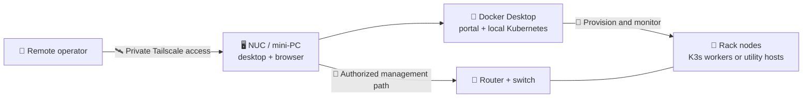
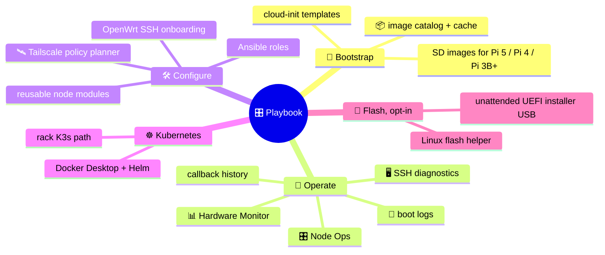
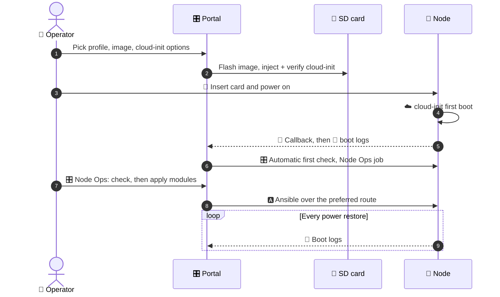
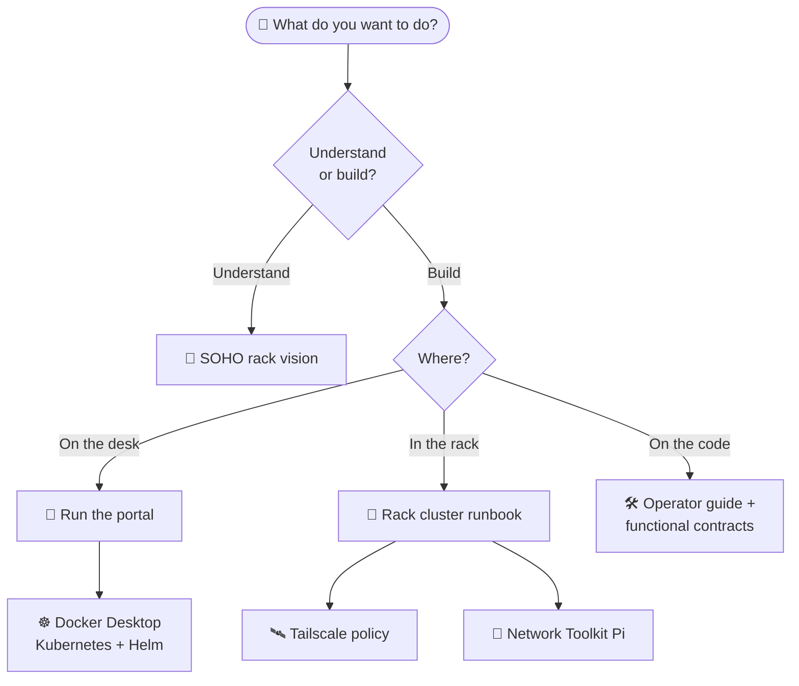
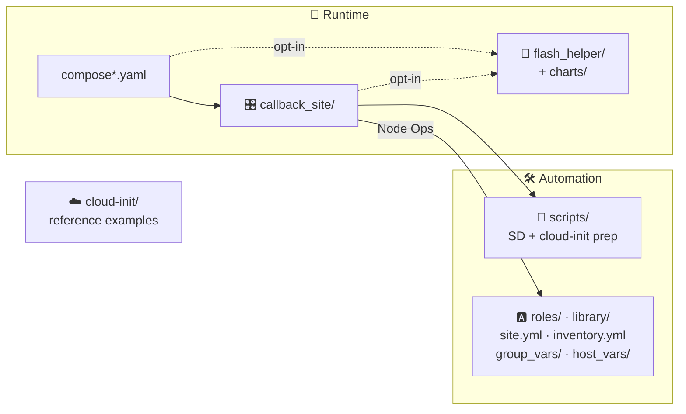

<div align="center">

# 🎛️ Playbook

### A small control desk for a small rack.

🥧 Raspberry Pi &nbsp;·&nbsp; 🖥️ Mini PCs &nbsp;·&nbsp; 🐳 Docker Desktop &nbsp;·&nbsp; ☸️ Kubernetes &nbsp;·&nbsp; 🛰️ Tailscale


**Browser-based rack bootstrap and day-to-day operations for SOHO racks.**<br/>
Start small · bring devices online deliberately · keep a private path back in.

</div>

> [!TIP]
> 🧭 **New here?** Read the [project vision](docs/soho-rack-vision.md) first: the
> mini-PC control desk, remote access, router setup, and why local Kubernetes and
> the physical rack are kept apart.

---

<a id="the-idea-at-a-glance"></a>
## 🧭 The idea at a glance



> [!NOTE]
> This is the **intended topology**, not automatic network configuration. Desktop
> sharing, tailnet permissions, container reachability, and router access are all
> configured explicitly by you.

<a id="whats-in-the-box"></a>
## 🧩 What's in the box



<a id="life-of-a-node"></a>
## 🔁 Life of a node



<a id="boundaries"></a>
## 🚫 Boundaries

| ✅ It is | 🚫 It is not |
| --- | --- |
| An evolving operator toolkit | A turnkey router installer |
| A way to bring nodes up one at a time | A production high-availability platform |
| A Docker Desktop Kubernetes workbench | A cluster that absorbs your Pis automatically |
| A container with persistent state | A container that sees the host's Tailscale or USB/SD devices by default |

<a id="start-the-portal"></a>
## 🚀 Start the portal

With Docker and Compose available, from the repository root:

```bash
docker compose up --build -d
docker compose ps
```

Then open **<http://127.0.0.1:8088/>** on the host. 🎉

This starts the portal only — it does not configure the router or provision nodes.

> [!WARNING]
> 🔐 **Keep management private.** Base Compose publishes the portal port on host
> interfaces. Restrict it with host firewall rules to trusted LAN/tailnet paths and
> **never port-forward the dashboard to the internet.**

> [!IMPORTANT]
> 💾 State lives in the `callback-site-data` volume. It survives rebuilds, but it is
> **not a backup**.

For host setup, Kubernetes connectivity, credentials, and device-access limits, see
the [operator deployment guide](callback_site/README.md#deployment-notes).
Before committing deployment changes, install the
[secret checks and read the credential-handling guide](SECURITY.md). 🔐

<a id="choose-your-next-step"></a>
## 🗺️ Choose your next step



| I want to... | Read |
| --- | --- |
| 🧭 **Understand the purpose and architecture** | [SOHO rack vision](docs/soho-rack-vision.md) |
| 🐳 **Run the portal with Docker Desktop** | [Docker Compose setup](callback_site/README.md#docker-compose) |
| ☸️ **Connect the local Kubernetes cluster** | [Docker Desktop Kubernetes and Helm](callback_site/README.md#docker-desktop-kubernetes-and-helm) |
| 🥧 **Bring up and maintain rack nodes** | [Rack cluster runbook](docs/rack-cluster-runbook.md) |
| 🛰️ **Plan private management access** | [Tailscale policy workflow](docs/rack-cluster-runbook.md#tailscale-policy-page) |
| 🧰 **Use a dedicated network toolkit device** | [Network Toolkit setup](callback_site/README.md#network-toolkit-pi-3b) |
| 💾 **Flash cards or build installer USBs from Linux** | [Isolated flash helper](flash_helper/README.md) |
| 🛠️ **Understand or develop the portal** | [Operator guide](callback_site/README.md) · [Functional contracts](docs/callback_site-functional-prototypes.md) |
| 🔐 **Handle credentials safely** | [Secrets and repository safety](SECURITY.md) |

<a id="repository-map"></a>
## 🗂️ Repository map



| Location | What belongs here |
| --- | --- |
| 🎛️ [callback_site/](callback_site/) | Web portal, services, templates, and tests. |
| 📚 [docs/](docs/) | Project vision, rack operations, and functional reference. |
| 📜 [scripts/](scripts/) | Bootstrap, SD preparation, validation, and local Kubernetes helpers. |
| ☁️ [cloud-init/](cloud-init/) | Reference cloud-init examples (the portal generates per-node user-data). |
| 🅰️ [roles/](roles/) · [library/](library/) | Ansible provisioning for rack devices and the network toolkit. |
| 📋 [inventory.yml](inventory.yml) · [site.yml](site.yml) | Device inventory and the main provisioning playbook. |
| 💾 [flash_helper/](flash_helper/) · [charts/](charts/) | Opt-in isolated Linux flashing helper and its Helm chart. |
| 🐳 [compose.yaml](compose.yaml) · [compose.kubernetes.yaml](compose.kubernetes.yaml) · [compose.flash-helper.yaml](compose.flash-helper.yaml) | Portal runtime, optional kubeconfig mount, optional flash-helper wiring. |

---

<div align="center">

**🧭 Working principle:** establish local control → verify private remote access →
automate one device at a time.

</div>
