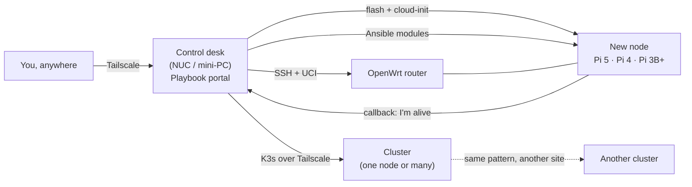

# Playbook

### Distributed compute, without the syntax headache.

**Raspberry Pis · Mini PCs · Routers · K3s · Tailscale · one browser tab**

Playbook is a one-stop shop for one thing: **getting compute onto your
hardware and talking to each other**, without spending your evening reading
YAML indentation errors.

The big version is a **distributed mesh of distributed compute clusters**:
racks of small machines in different places, each its own K3s cluster, all
stitched together over Tailscale and reachable from wherever you are. You can
reference them as one fabric, or keep them as separate islands.

But it doesn't have to be big. The same approach works for:

- 🧱 **One of a type**: a single Pi that calls home and runs your stuff.
- 📦 **Many of a type**: flash five identical cards and get five identical
  nodes.
- 🗄️ **A rack of minis**: a 10-inch rack of Pi 5s, plus a NUC as the brain and
  a travel router as the front door.
- 🍿 **A home media server**: one box, a few containers, done.

You pick the shape. Playbook handles the boring parts: imaging, first boot,
joining the tailnet, joining the cluster, and telling you when something
didn't.

---

## How it fits together



**The loop is simple:**

1. **Flash** a card from the portal. Pick a profile (Pi 5, Pi 4, 3B+, router,
   toolkit) and the modules you want: baseline, Tailscale, Telegraf, Docker,
   K3s, and so on.
2. **Boot** it. Cloud-init joins your tailnet, and the node **calls back** so
   you know it's alive, where it is, and what hardware it has.
3. **Shape** it. Apply modules with Ansible from the Nodes page. K3s nodes join
   over Tailscale, including pod networking, so a Pi behind someone's NAT still
   works.
4. **Use** it. Deploy Helm charts, and reach the Kubernetes API from any of
   your tailnet devices through the Tailscale operator. Watch the dashboards.

Doing it once teaches you the pattern. After that, every new node is just
another card.

## What's in the box

| Area | What you get |
| --- | --- |
| 🚀 **Bootstrap** | SD images and cloud-init for Pi 5, Pi 4 and Pi 3B+. First-boot Tailscale join. Callbacks with hardware profiles. |
| 🩺 **Operate** | Callback history, Hardware Monitor, Node Ops, SSH diagnostics, boot logs. |
| 🧩 **Configure** | Reusable node modules backed by Ansible roles. Profile-specific options show up only where they apply. |
| 📡 **Routers** | OpenWrt SSH onboarding, key push, and an organized UCI readout: LAN, WAN, DHCP, Wi-Fi. |
| ☸️ **Kubernetes** | K3s over Tailscale, Helm workflows, and the Tailscale operator's API proxy, with live health checks. |
| 🔐 **Access** | A Tailscale policy builder for tags, grants and operator access, so the ACL file isn't hand-written. |

**Honest limits:** this is a growing homelab toolkit, not a turnkey router
installer or a production HA platform. It automates what it knows about and
shows you the rest.

## Start the portal

You need Docker and Compose. That's it.

From the repository root:

```bash
docker compose up --build -d
docker compose ps
```

Open **[http://127.0.0.1:8091/](http://127.0.0.1:8091/)** on the host for
first-time account setup and the dashboard. Port `8088` is reserved for node
callbacks and other node-only endpoints. This starts the portal only; it does
not configure the router or provision nodes.

> **Keep management private.** Base Compose binds the dashboard to localhost by
> default. Setting `CALLBACK_ADMIN_BIND=0.0.0.0` exposes it on host interfaces;
> only do so on a trusted network, and never port-forward it to the internet.
> Persistent data lives in the `callback-site-data` volume; it survives rebuilds
> but is not a backup.

For host setup, Kubernetes connectivity, credentials, and device-access limits,
follow the [operator deployment guide](callback_site/README.md#deployment-notes).
For a Pi deployment preflight and callback troubleshooting, see the
[callback checklist](callback_site/README.md#pi-deployment-and-callback-checklist).
For the Linux K3s cluster connection, see
[Linux K3s and the Kubernetes dashboard](callback_site/README.md#linux-k3s-and-the-kubernetes-dashboard).

Before committing deployment changes, install the
[secret checks and follow the credential-handling guide](SECURITY.md).

## Where to next

| I want to... | Read |
| --- | --- |
| **Understand the purpose and intended architecture** | [SOHO rack vision](docs/soho-rack-vision.md) |
| **Run the portal with Docker Desktop** | [Docker Compose setup](callback_site/README.md#docker-compose) |
| **Connect the local Kubernetes cluster** | [Linux K3s](callback_site/README.md#linux-k3s-and-the-kubernetes-dashboard) · [Docker Desktop Kubernetes and Helm](callback_site/README.md#docker-desktop-kubernetes-and-helm) |
| **Use a dedicated network toolkit device** | [Network Toolkit setup](callback_site/README.md#network-toolkit-pi-3b) |
| **Understand or develop the portal** | [Operator guide](callback_site/README.md) · [Functional contracts](docs/callback_site-functional-prototypes.md) |

## Repository map

| Location | What belongs here |
| --- | --- |
| [callback_site/](callback_site/) | Web portal, services, templates, and tests. |
| [docs/](docs/) | Project vision, rack operations, and functional reference. |
| [scripts/](scripts/) | Bootstrap, SD preparation, validation, and local Kubernetes connection helpers. |
| [roles/](roles/) | Ansible provisioning for rack devices and the network toolkit. |
| [inventory.yml](inventory.yml) · [site.yml](site.yml) | Device inventory and the main provisioning playbook. |
| [compose.yaml](compose.yaml) · [compose.kubernetes.yaml](compose.kubernetes.yaml) | Portal runtime and optional kubeconfig mount. |
| [tower-2-compose/](tower-2-compose/README.md) | Recovered, credential-free legacy Compose projects; separate from the portal. |

---

**Working principle:** get one box right, then make more of them. Local
control first, private remote access second, then automate one device at a
time, until "a device" turns into "a rack" and "a rack" turns into "a few
racks".
