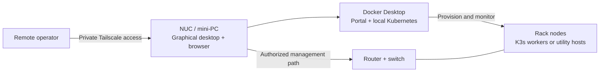

# Playbook

### A small control desk for a small rack.

**SOHO racks · Mini PCs · Docker Desktop · Kubernetes · Tailscale**

Playbook brings rack bootstrap and day-to-day operations into a browser-based
operator portal, backed by cloud-init, Ansible, and Docker. The intended home is
a NUC or similar small computer with a graphical desktop: a local workstation
that can also serve as the remotely accessible management hub for a
small-office/home-office (SOHO) rack.

Start small, bring devices online deliberately, and keep a private path back in.

> **Start here:** [Read the project vision and intended setup](docs/soho-rack-vision.md).
> It explains the mini-PC control desk, remote access, router setup, and the
> distinction between local Kubernetes experiments and the physical rack.

---

## The idea at a glance



This is the intended topology, not automatic network configuration. Desktop
sharing, tailnet permissions, container reachability, and router access must be
configured explicitly.

| Piece | Purpose |
| --- | --- |
| **Mini-PC control desk** | A graphical workstation for the portal, Docker Desktop, and administrative tools. |
| **Operator portal** | Prepare images, track callbacks, inspect nodes, apply configuration, and review logs. |
| **Private remote access** | Use Tailscale to reach the desk and authorized management endpoints without public admin ports. |
| **SOHO network** | Configure the router, addressing, firewall, and switch before depending on remote operation. |
| **Rack nodes** | Run useful services with Docker, K3s, or no Kubernetes at all, according to each device's capacity. |

## What is here today?

- **Bootstrap:** SD-image and cloud-init workflows for Raspberry Pi 5, Pi 4,
  and Pi 3B+ profiles.
- **Operate:** callback history, Hardware Monitor, Node Ops, SSH diagnostics,
  and boot-log collection.
- **Configure:** reusable node modules, Ansible roles, OpenWrt SSH onboarding,
  and Tailscale policy planning.
- **Explore Kubernetes:** Docker Desktop cluster connectivity and Helm workflows,
  alongside a separate K3s rack provisioning path.

**Boundaries matter:** this is an evolving operator toolkit, not a turnkey router
installer or a production high-availability platform. Docker Desktop's local
cluster does not automatically absorb physical rack nodes. The default container
also does not receive the host's Tailscale service or USB/SD devices.

## Start the portal

With Docker and Compose available, run from the repository root:

```bash
docker compose up --build -d
docker compose ps
```

Open **[http://127.0.0.1:8088/](http://127.0.0.1:8088/)** on the host.
This starts the portal only; it does not configure the router or provision nodes.

> **Keep management private.** Base Compose publishes the portal port on host
> interfaces. Restrict it with host firewall rules to trusted LAN/tailnet paths;
> do not port-forward the dashboard to the internet. Persistent data lives in
> the `callback-site-data` volume; it survives rebuilds but is not a backup.

For host setup, Kubernetes connectivity, credentials, and device-access limits,
follow the [operator deployment guide](callback_site/README.md#deployment-notes).

Before committing deployment changes, install the
[secret checks and follow the credential-handling guide](SECURITY.md).

## Choose your next step

| I want to... | Read |
| --- | --- |
| **Understand the purpose and intended architecture** | [SOHO rack vision](docs/soho-rack-vision.md) |
| **Run the portal with Docker Desktop** | [Docker Compose setup](callback_site/README.md#docker-compose) |
| **Connect the local Kubernetes cluster** | [Docker Desktop Kubernetes and Helm](callback_site/README.md#docker-desktop-kubernetes-and-helm) |
| **Bring up and maintain rack nodes** | [Rack cluster runbook](docs/rack-cluster-runbook.md) |
| **Plan private management access** | [Tailscale policy workflow](docs/rack-cluster-runbook.md#tailscale-policy-page) |
| **Use a dedicated network toolkit device** | [Network Toolkit setup](callback_site/README.md#network-toolkit-pi-3b) |
| **Understand or develop the portal** | [Operator guide](callback_site/README.md) · [Functional contracts](docs/callback_site-functional-prototypes.md) |

## Repository map

| Location | What belongs here |
| --- | --- |
| [callback_site/](callback_site/) | Web portal, services, templates, and tests. |
| [docs/](docs/) | Project vision, rack operations, and functional reference. |
| [scripts/](scripts/) | Bootstrap, SD preparation, validation, and local Kubernetes connection helpers. |
| [roles/](roles/) | Ansible provisioning for rack devices and the network toolkit. |
| [inventory.yml](inventory.yml) · [site.yml](site.yml) | Device inventory and the main provisioning playbook. |
| [compose.yaml](compose.yaml) · [compose.kubernetes.yaml](compose.kubernetes.yaml) | Portal runtime and optional kubeconfig mount. |
| [tower-2-compose/](tower-2-compose/README.md) | Recovered, credential-free legacy Compose projects; separate from the portal. |

---

**Working principle:** establish local control, verify private remote access,
then automate one device at a time.
