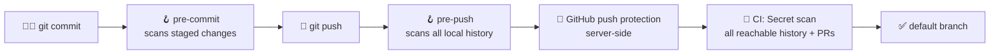
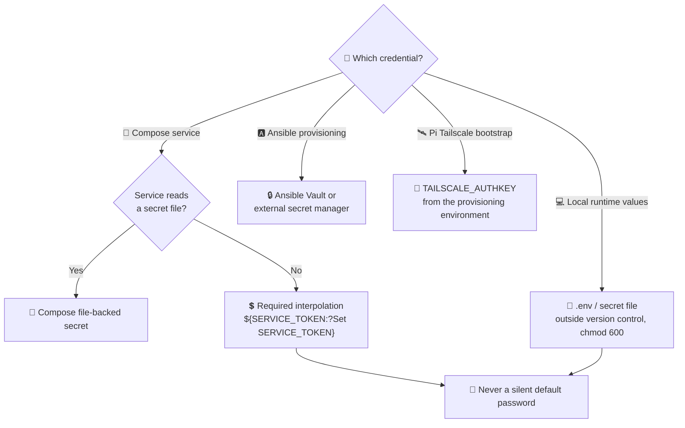
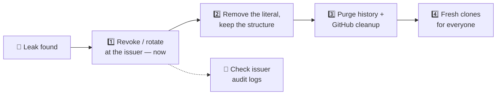

# 🔐 Secrets and repository safety

> [!IMPORTANT]
> **No literal credentials in this repository — ever.** Not in Compose files, Ansible
> variables, cloud-init examples, or comments. Reference them; don't paste them.

<a id="layers-of-protection"></a>
## 🛡️ Layers of protection



| Layer | What it catches | Can be bypassed? |
| --- | --- | --- |
| 🪝 **pre-commit** | Credentials in staged changes | ⚠️ Yes (`--no-verify`) |
| 🪝 **pre-push** | Credentials anywhere in locally reachable history, so an old clone can't reintroduce known secrets | ⚠️ Yes |
| 🐙 **GitHub push protection** | Known token formats, before they land | Only by explicit override |
| 🤖 **CI Secret scan** | All history reachable from the checkout, including pull-request commits | Runs *after* the push |

All local and CI scans use the same digest-pinned Gitleaks version and the repository
rules in [.gitleaks.toml](.gitleaks.toml): Tailscale keys, Discord tokens, and literal
credential assignments in configuration files — Ansible variables (including `*_pass`),
Kubernetes manifests, Compose files, environment files, Jinja templates and cloud-init
`user-data`/`network-config`, **including commented-out assignments and `$6$`-style
password hashes**. Findings are redacted and the scanner runs without network access.

> [!WARNING]
> Hooks can be bypassed and CI runs after a push, so neither replaces server-side push
> protection. Enable **GitHub secret scanning and push protection** where available,
> and require the **Secret scan** check in the default branch's ruleset. Pattern
> scanning cannot prove that every arbitrary password or token is absent.

<a id="before-committing"></a>
## 🚀 Before committing

Install the local checks with Docker running:

```bash
python3 -m venv .venv-security
.venv-security/bin/python -m pip install -r requirements-security.txt
.venv-security/bin/pre-commit install --hook-type pre-commit --hook-type pre-push
bash scripts/check_secrets.sh history
```

> [!TIP]
> On Debian/Ubuntu, install the matching `python3-venv` package if virtual environment
> creation reports that `ensurepip` is missing. The first scan needs network access
> once, to pull the public scanner image.

<a id="where-credentials-belong"></a>
## 🗝️ Where credentials belong



- 🐳 **Compose:** keep Compose files tracked, but never put literal credentials in them.
  Use required environment interpolation (`${SERVICE_TOKEN:?Set SERVICE_TOKEN}`) or
  Compose file-backed secrets when the service can read a secret file. Do not silently
  fall back to a default password.
- 📄 **`.env` and secret files:** keep them outside version control; commit only example
  files with obvious placeholders. Compose `.env` substitution and environment
  variables are **not a secret vault** — Docker administrators can inspect container
  environments. Prefer a secret manager or file mounts for sensitive service
  credentials.
- 🅰️ **Ansible:** use Ansible Vault or an external secret manager, not plaintext
  inventory, group variables, playbooks, or cloud-init examples. Supply vault passwords
  outside the repository.
- 🛰️ **Tailscale:** the Pi bootstrap requires `TAILSCALE_AUTHKEY` from the provisioning
  environment, with no embedded or fallback key. Get it from your private secret source
  without putting the value in shell history. Tailscale role tasks use `no_log` so it
  stays out of Ansible output.
- 🔒 **Permissions:** credential files `chmod 600`, their directories `chmod 700`.
- 💾 **Portal data volumes and backups** can contain SSH keys, connection profiles,
  provisioning credentials, and the dashboard password hash and cookie-signing key —
  protect them. Access to the Docker daemon also grants access to these secrets.
- 📜 **Logs:** never print credentials. Don't share `docker compose config` output
  without inspecting and redacting it. Use short-lived, least-privilege tokens.

> [!NOTE]
> Git ignores local environment files, private-key files, vault files, and
> history-rewrite replacement files, and Docker excludes them from the build context.
> Ignore rules do **not** untrack existing files or prevent `git add -f`.

<a id="if-a-credential-was-committed"></a>
## 🚨 If a credential was committed



1. **Revoke or rotate it at its issuer immediately**, even if history was rewritten.
   Update the runtime secret source and inspect the issuer's access/audit logs.
2. **Remove the literal value** while preserving the Compose/deployment structure.
   Review every affected branch and tag, and scan the rewritten history before
   publishing it. Never paste leaked values into issues, PRs, or scanner logs.
3. **Follow [GitHub's sensitive-data removal procedure](https://docs.github.com/en/authentication/keeping-your-account-and-data-secure/removing-sensitive-data-from-a-repository).**
   Old commit URLs, pull-request refs, caches, forks, and other clones may still
   retain the data; request GitHub Support cleanup where applicable.
4. **Coordinate fresh clones** with collaborators so old history is not pushed back.
   Keep replacement maps private and delete them when no longer needed.

> [!CAUTION]
> Removing reachable history is **not** proof that a previously exposed token is safe.
> Rotation is the fix; history cleanup is hygiene.

---

➡️ **Next:** [Project overview](README.md) · [Operator deployment guide](callback_site/README.md#deployment-notes)
