# 📡 Callback Site Operator Portal

The callback site is the control plane for the rack workflow: 📦 image catalog,
💾 SD-card flashing with cloud-init, 📡 callback tracking, 🎛️ post-boot Node Ops
provisioning and 📊 the shared monitoring views that tie them together.
The screens explain themselves — this guide covers what clicking won't tell you:
commands, paths, ports, APIs, data files and safety boundaries.

> [!CAUTION]
> SD writes are destructive — only target the intended device. Run the portal on a
> trusted machine and network; it is not intended for direct public-internet exposure.

### Regenerating SSH keys

In the dashboard's SSH Access panel, select a saved generated key and choose
**Regenerate Selected** to create a fresh pair under a different name. The old
pair is preserved, and existing nodes' authorized keys are not changed. Download
the new private key; the new public key is selected for subsequent provisioning.

### Self-hosting Ubuntu server (experimental)

The `playbook-server` profile seeds Ubuntu Server 24.04 generic cloud images for
amd64 or arm64 UEFI machines, separately from the Raspberry Pi profiles. First
boot installs Docker, clones the configured public repository/ref, starts this
dashboard and optionally installs its local host SD/USB flasher. Node Ops assigns
only the Playbook Server module to `playbook_server_active` nodes.

To generate artifacts without writing a physical disk, run from the repository root:

```sh
scripts/build_server_image.sh --arch amd64 --ssh-key-file ~/.ssh/id_ed25519.pub \
  --ref reconcile/server-and-portal --output-dir dist/server-image
```

Use a ref containing this feature until it is merged to main. The builder requires
Linux, sudo, loop devices, `qemu-img`, cloud-init, Python with PyYAML/Jinja2 and the
normal flashing-script prerequisites. It writes `.img.xz`, a 20G virtual-size
`.qcow2`, a JSON manifest and `SHA256SUMS`; `--formats` selects outputs and
`--disk-size` changes the qcow2 size. Keep generated images private if their
cloud-init seed contains credentials. On the node, `sudo playbook-update [ref]`
rebuilds the deployment. The optional flasher binds to the Docker bridge gateway.

Renderer, profile wiring and flashing-backend integration have regression tests.
A full built-image/first-boot VM validation is still pending. No GitHub image-build
workflow is enabled; CI image generation remains a separate discussion.

### Shared interface styles

Every page still loads `static/common.css` after its feature stylesheet. It owns the
palette, typography, sidebar, content width, cards, controls, tables, disclosure
panels, log surfaces, focus indicators and responsive shell. Feature stylesheets
retain only their specialized layouts and state indicators; declarations already
owned by shared rules have been removed. Keep this load order: shared control and
responsive policies intentionally take precedence over feature decoration.
Navigation is rendered from `templates/_sidebar.html`
so labels, active-page states and mobile navigation stay consistent. The compact
sidebar header has an icon-only toggle with state-specific accessible labels.
Decorated cards such as `.panel.acl-hero` use scoped selectors so their contrast
survives the later shared `.panel` background rule. Phone layouts
use a two-column navigation grid, fit controls to available width and preserve
local scrolling for wide tables. Reduced-motion preferences disable decoration
and transition animations without changing operational state.

<a id="contents"></a>
## 🗺️ Contents

| 🚀 Use it | 🧠 Understand it | 🐳 Deploy it |
| --- | --- | --- |
| [🧭 At a glance](#at-a-glance) | [🧱 Architecture](#architecture) | [🐳 Deployment notes](#deployment-notes) |
| [🚀 Quick start](#quick-start) | [🗂️ Runtime contract](#runtime-contract) | [🐳 Docker Compose](#docker-compose) |
| [🗺️ Pages](#pages) | [📊 Source of truth](#source-of-truth) | [🔌 USB, WSL and Docker](#usb-devices-wsl-and-docker) |
| [💾 SD and cloud-init](#sd-and-cloud-init-flow) | [🔗 Key APIs](#key-apis) | [☸️ Kubernetes and Helm](#docker-desktop-kubernetes-and-helm) |
| [📡 Callbacks and boot logs](#callbacks-jobs-and-boot-logs) | [🗂️ Data files](#data-files) | [🩹 Release / recreate](#release--recreate) |
| [🔁 Archive and restore](#node-archive-and-restore) | [🧪 Testing](#testing) | [🚫 Notes](#notes) |
| [🛰️ Connection profiles](#connection-profiles-and-routes) | [🛠️ Styles and front-end build](#shared-interface-styles) | [🔐 Dashboard access](#dashboard-access) |
| [🧰 Network Toolkit](#network-toolkit-pi-3b) | [🐄 Longhorn](#longhorn-notes) | |

<a id="at-a-glance"></a>
## 🧭 At A Glance

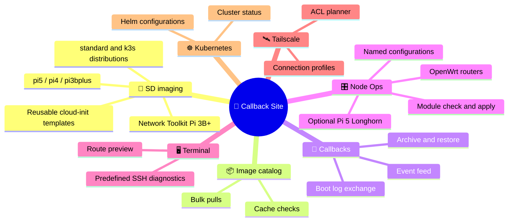

Callbacks, Hardware Monitor and Node Ops all read one
[source-of-truth payload](#source-of-truth), so every page tells the same story.

<a id="quick-start"></a>
## 🚀 Quick Start

> [!TIP]
> Docker Compose is the standard runtime — see [🐳 Docker Compose](#docker-compose).
> The local virtual environment below is for development and tests, not a second live server.

From the repository root:

```bash
cd callback_site
npm ci
npm run build
npm run check
```

Dependencies are pinned in `package.json` and `package-lock.json`; edit
`frontend/structured_output.js`, not the generated `static/structured_output.js`.

Keep source modules below 300 lines and group by responsibility rather than
splitting arbitrarily. Before introducing new shared rules, check for existing
owners/mixins; avoid page-specific copies of the shell or controls.

### Feature overview

- Dashboard setup follows Target Settings, Image Source and Integrity, then SSH
  Access. Target Settings starts open; opening another step closes the previous
  one without clearing inputs. Cloud-Init Settings expands independently.

- Settings groups Rack Identity, Image Catalog Health and Logging into compact,
  independently expandable controls. Under Node State & Maintenance, destructive
  maintenance can clear cached images or only partial downloads after confirmation.
  Active image jobs block cleanup; catalog definitions and image history remain.

- SD-card imaging for `pi5`, `pi4` and `pi3bplus` profiles.
- Cloud-init authoring with reusable optional-setting templates.
- Distribution-aware imaging for `standard` and `k3s` flows.
- Catalog management with cache checks and bulk pulls (select several presets, or pull everything missing).
- Callback, hardware-monitor, and Node Ops views backed by one shared source-of-truth payload.
- Boot log exchange: nodes flashed from this site send their own boot logs (journal, cloud-init, dmesg) to `/api/cloud-init/boot-log` after the final callback and on every power restore, which works behind NAT. For other nodes the site pulls them over SSH shortly after a callback (skipped when a push just arrived; `CALLBACK_AUTO_BOOT_LOGS=0` turns the automatic pull off). The last 10 per node are kept.
- Retire a node with **Archive node** on its newest callback. This hides it from active callbacks, Hardware Monitor, Node Ops and Terminal targets without deleting history, configuration, inventory or Kubernetes resources. New callbacks do not restore it or schedule automatic checks/SSH log collection. Restore it under **Settings > Archived Nodes**. Boot logs live below provisioning output in **Node Ops**, including read-only logs for archived nodes. Selecting an active node collects fresh logs over its preferred connection route; choosing another route attempts that route with its SSH user, key and port. Selecting a stored log only displays history. Collection can take up to 90 seconds and reports failures without erasing stored logs. The payload inspector is collapsed at the bottom of the callback dashboard and opens when a callback is selected.
- Node Ops connects to a node at its tailnet address when `tailscale status` on the site host lists it online, ahead of the LAN/NAT address a callback reports; the monitor pings the same target.
- Connection profiles (in active development): each node keeps several ways to reach it (callback, inventory, tailnet IP, tailnet FQDN, DNS, hostname) in `data/connection_profiles.json`, and a replaceable strategy picks one (`prefer_tailnet` default, `prefer_fqdn`, `lan_first`; set `CALLBACK_CONNECTION_STRATEGY` or `register_strategy`). The FQDN profile is only chosen when this host can resolve the MagicDNS name, and every tailnet profile carries the node's `fqdn` for later HTTPS with Tailscale certificates. `GET /api/nodes/<node>/connection-profiles` shows the candidates and the pick. Pinned profiles, per-profile user/key/port, failover and HTTPS via `tailscale cert` are planned next.
- Terminal: browse predefined SSH diagnostics under System, Boot & logs, and Inventory, filter by search, and preview the exact command before running. The host field is the task target; editing it overrides the discovered-host selection. The route preview uses the same hostname resolution as the task runner. Node Ops **Routes** and Terminal **All node routes** open a compact connection-path modal showing type, preferred strategy, and local interface/gateway when known. These are known candidates, not proof of live SSH reachability. Route lookups use Linux `iproute2` (included in Docker); in Docker the interface belongs to the container, not the Windows host or remote node. Hostname-only routes are resolved by SSH at connection time. Add `?routes=1` to the connection-profile API for these optional route details; `/api/test-terminal/route?host=<host>` previews the terminal target without connecting.
- Initial callbacks are saved before their automatic closer check is queued in the existing Node Ops job runner. The callback response includes `closer_job_id` when a job is started; inspect it through `/api/nodes/provision/jobs/<id>`. Checks no longer block callback delivery, and repeated callbacks do not start another initial check. Jobs are process-local and do not resume after a restart.
- Terminal tasks retain the last 20,000 characters of output and stop the local SSH process after 120 seconds, recording a failed job with an explicit timeout. Disconnecting SSH is not a guarantee that every remote child process has stopped.
- OpenWrt routers as Node Ops hosts (group `openwrt`) with SSH probe and key push, SSH key management, and Tailscale ACL planning.
- Optional Pi 5 Longhorn provisioning for k3s nodes, with a configurable storage path so a later SD-boot to NVMe-boot/storage move can be handled by changing the path value instead of rewriting the workflow.

## Runtime Contract

Image URL downloads during flashing now populate the persistent `image_cache/`
catalog cache and are reused on subsequent runs. Flashing and catalog pulls share
per-image locks, so concurrent requests for the same URL download only once.
Complete downloads are published atomically after any supplied/discovered SHA256
check; failed downloads are not reusable. Without a publisher checksum, a saved
digest checks local integrity on reuse, not publisher authenticity. Explicit local
image files still work, and existing catalog caches remain usable. The dashboard
shows when the latest available image was cached, formatted in the browser's local
date/time. CLI imaging uses the same cache by default; `IMAGE_CACHE_DIR` overrides
its location. These changes do not require interrupting an already-running flash.

Target Settings, Image Source And Integrity, and SSH Access form a compact
accordion on the dashboard: opening one closes the other two. Target Settings
starts open; Cloud-Init Settings remains independently collapsible.

The Tailscale ACL planner keeps tag, port, user, and other simple value lists
on one line in its generated JSON; policy objects remain indented.

Before overwriting a card, the flasher unmounts all mounted target filesystems
and checks again. An unmount or inspection failure aborts before the write;
close file managers or terminals using the card and retry rather than forcing it.
After the image is flushed, `partprobe` refreshes its partition table before the
boot partition is mounted for cloud-init injection.
Cloud-init rendering and schema validation now happen **before** any unmount/write.
The target must be a whole disk large enough for the image; system filesystems
and swap are refused. A device lock refuses overlapping preparations on the same
device. After flushing the device buffers, the entire written image
is compared byte-for-byte with the source. The injected user-data, meta-data and
toolkit network-config are also compared after unmounting and reopening the boot
partition read-only. Any mismatch fails the job rather than reporting the card ready.
This adds a full-card-image read to each flash and detects write-path failures;
it does not guarantee stable power or reliable storage on the Pi during first boot.
Legacy Pi OS Bookworm/Bullseye catalog images remain downloadable but are excluded
from SD provisioning because they lack cloud-init. Preset changes replace the
previous image path, URL and checksum together, including clearing stale checksums.

Everything that should survive restarts or container recreation lives under `CALLBACK_APPDATA_DIR`.

- Default path: `callback_site/data/`
- Override path with `CALLBACK_APPDATA_DIR`
- The app can re-exec through `sudo` only when `CALLBACK_SITE_REQUIRE_ROOT=1` is set.
- The app stays normal-user friendly by default; elevated startup is opt-in.

## Run the local development server

From the repository root:

```bash
.venv/bin/python3 callback_site/app.py
```

For SD flashing or other root-required paths, still from the repository root:

```bash
sudo -E "$PWD/.venv/bin/python3" callback_site/app.py
```

Then open http://127.0.0.1:8088/, create the dashboard account on first visit
([🔐 dashboard access](#dashboard-access)) and explore the [pages](#pages). The dev server
serves the dashboard and node endpoints on one port; Docker splits them.

<a id="dashboard-access"></a>
## 🔐 Dashboard Access

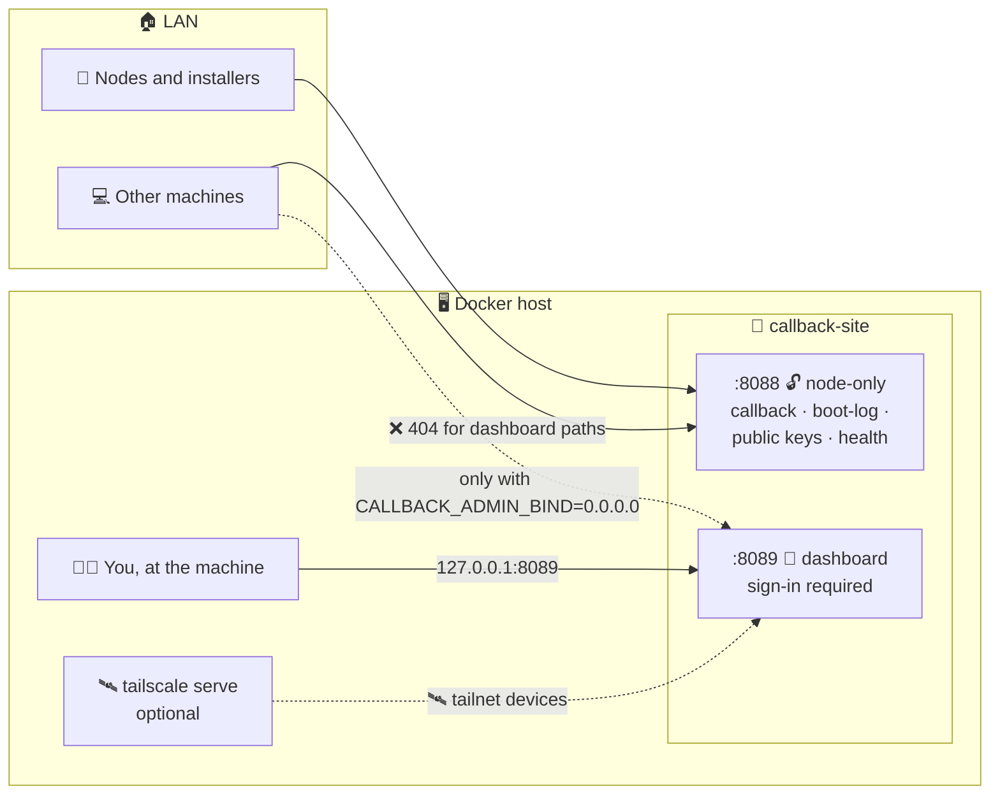

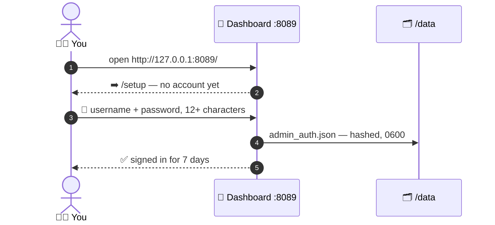

| 🎯 Want | 🛠️ Do |
| --- | --- |
| 🖥️ Use it at the machine | Nothing — `http://127.0.0.1:8089/` is the default |
| 🏠 Open it to the LAN | `.env`: `CALLBACK_ADMIN_BIND=0.0.0.0`, then `docker compose up -d` |
| 🛰️ Reach it over the tailnet | On the host: `tailscale serve --bg 8089` |
| 🔑 Reset a forgotten password | `docker compose exec callback-site rm /data/admin_auth.json`, reload, set up again |
| 🚪 Sign out every browser | Same as a reset — the new account signs out all old sessions |

| 🔓 Open without sign-in | Called by |
| --- | --- |
| `POST /api/cloud-init/callback` | cloud-init `phone_home`, installer scripts |
| `POST /api/cloud-init/boot-log` | Node boot-log push |
| `GET /api/ssh/public/<key_name>` | First-boot key fetch |
| `GET /health` | Container healthcheck |

> [!IMPORTANT]
> 👋 Finish setup **before** opening the dashboard to the LAN — the first visitor to
> `/setup` owns the account. Setup only answers on `localhost` or an IP address unless the
> hostname is listed in `CALLBACK_ADMIN_HOSTS`.

- 📡 Already-flashed nodes keep calling `:8088` — nothing to re-flash.
- 🔁 Wrong passwords back off (2 s doubling up to 5 min after five misses), shared by all
  clients because Docker Desktop hides the caller's address.
- 🍪 The sign-in cookie is `HttpOnly` and `SameSite=Strict`; set `CALLBACK_SECURE_COOKIES=1`
  when every visit is over HTTPS (for example through `tailscale serve`).

<a id="pages"></a>
## 🗺️ Pages

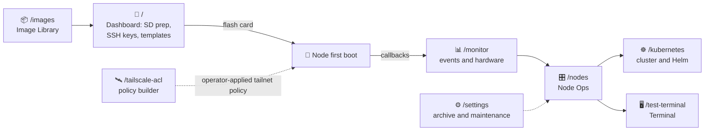

| Page | Purpose | Non-obvious |
| --- | --- | --- |
| `/` | SD image prep, SSH keys, optional cloud-init settings, saved templates | See [SD and cloud-init](#sd-and-cloud-init-flow) |
| `/images` | Cached and downloadable image catalog with bulk pull jobs | |
| `/monitor` | Callback event feed, hardware snapshots, certificate pull helpers | Architecture comes from hardware-check callbacks (`uname -m` on boot or `ansible_architecture` from Node Ops); run **Get Hardware Profile** to fill it for older reports |
| `/nodes` | Inventory, saved inputs, per-module configuration with remembered/named configurations, provisioning check/apply, boot logs | Saving a named configuration does **not** apply the module |
| `/kubernetes` | Cluster status and [Helm configurations](#docker-desktop-kubernetes-and-helm) | |
| `/test-terminal` | Predefined SSH diagnostics | See [terminal tasks](#terminal-tasks) |
| `/tailscale-acl` | Rack tailnet policy builder (grants, K3s ports, SSH, routes, tests) | |
| `/settings` | Restore archived nodes; Node State & Maintenance | Age-based pruning is retired — archive nodes explicitly |
| `/openwrt` | Redirects to the OpenWrt routers panel in `/nodes` | Routers are Node Ops hosts (group `openwrt`) with SSH probe and key push, SSH key management and Tailscale ACL planning |

> [!CAUTION]
> **Settings → Node State & Maintenance → Destructive maintenance** (each action has its
> own confirmation):
> - Clearing the callback backlog also deletes **archived** nodes' callback events, but does not restore them.
> - Node Ops reset also deletes saved named configurations, connection history and boot logs.
> - Neither action clears the archive registry.
> - Image cleanup can clear cached images, or only partial downloads. Active image jobs block it;
>   catalog definitions and image history remain.

<a id="architecture"></a>
## 🧱 Architecture

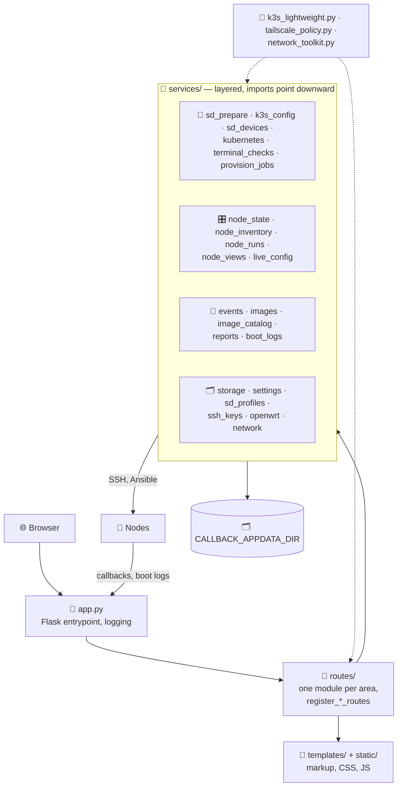

| Path | Role |
| --- | --- |
| `callback_site/app.py` | Flask entrypoint: logging, the app object and route registration |
| `callback_site/routes/` | HTTP endpoints, one module per area (pages, openwrt, settings, callbacks, sd, images, ssh, test_terminal, monitor, nodes); each exposes `register_*_routes(app)` |
| `callback_site/services/` | Domain logic, layered as drawn above; `live_config` does read-only SSH reads of a module's current settings |
| `callback_site/k3s_lightweight.py` | Board and role registry, shared by services, routes and templates |
| `callback_site/tailscale_policy.py` | Tailscale policy builder, shared likewise |
| `callback_site/network_toolkit.py` | Pi 3B+ appliance class; renders the same runtime assets that `roles/network_toolkit` installs with Ansible |
| `callback_site/static/` | Page CSS and JS; `home/`, `nodes/` and `monitor/` split the large scripts by area. Templates carry only markup and a small data bootstrap |

<a id="runtime-contract"></a>
## 🗂️ Runtime Contract

Everything that must survive restarts or container recreation lives under
`CALLBACK_APPDATA_DIR`. The app is normal-user friendly; elevated startup is opt-in.

| Variable | Default | Effect |
| --- | --- | --- |
| `CALLBACK_APPDATA_DIR` | `callback_site/data/` (Compose: `/data`) | Persistent app data — see [data files](#data-files) |
| `CALLBACK_SITE_REQUIRE_ROOT` | unset | `1` lets the app re-exec through `sudo` |
| `IMAGE_CACHE_DIR` | the persistent `image_cache/` | Overrides the image cache location (CLI imaging uses the same cache by default) |
| `CALLBACK_PORT` | `8088` | Host port Compose publishes for node callbacks |
| `CALLBACK_ADMIN_PORT` | `8089` | Host port Compose publishes for the dashboard |
| `CALLBACK_ADMIN_BIND` | `127.0.0.1` | Host address the dashboard port binds to; `0.0.0.0` opens it to the LAN |
| `CALLBACK_ADMIN_HOSTS` | unset | Extra hostnames, comma-separated, allowed to run first-time setup |
| `CALLBACK_SECURE_COOKIES` | unset | `1` sends the sign-in cookie over HTTPS only |
| `CALLBACK_NODE_ONLY_PORT` | image: `8088` | Container port that answers only [node endpoints](#dashboard-access) |
| `CALLBACK_AUTO_BOOT_LOGS` | on | `0` turns off the automatic SSH boot-log pull |
| `CALLBACK_CONNECTION_STRATEGY` | `prefer_tailnet` | `prefer_fqdn` or `lan_first` — see [connection profiles](#connection-profiles-and-routes) |
| `CLOUD_INIT_TOOLKIT_EXTRA_PACKAGES` | unset | CLI imaging: extra Network Toolkit packages, space- or comma-separated |
| `USB_DEVICE`, `USB_DEVICE_GID` | unset | Used by an operator-managed [device override](#usb-devices-wsl-and-docker) |

<a id="image-cache-and-downloads"></a>
### 📦 Image cache and downloads

Image URL downloads during flashing fill the persistent `image_cache/` catalog cache
and are reused on later runs.

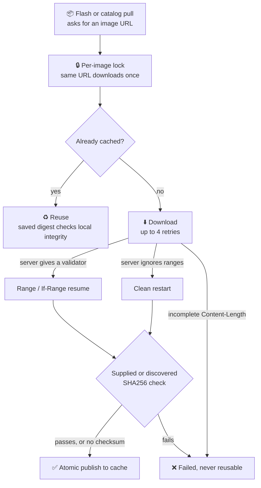

- Without a publisher checksum, the saved digest proves local integrity on reuse,
  **not** publisher authenticity.
- Explicit local image files still work; existing catalog caches remain usable.
- Legacy Pi OS Bookworm/Bullseye images remain downloadable but are excluded from SD
  provisioning because they lack cloud-init.
- Changing a preset replaces image path, URL and checksum together, clearing stale checksums.

<a id="flash-safety-pipeline"></a>
### 💾 Flash safety pipeline

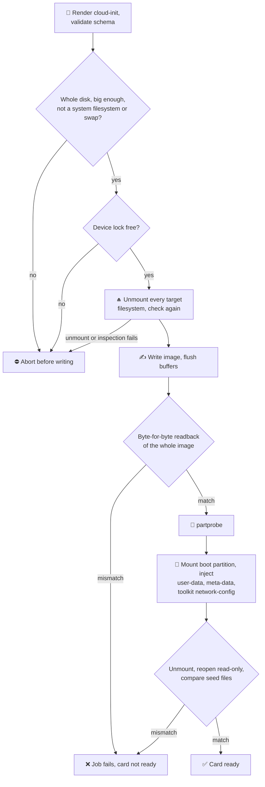

> [!WARNING]
> If unmounting fails, close file managers or terminals using the card and retry — don't
> force it. The readback adds a full-card read per flash and catches write-path failures;
> it does **not** guarantee stable power or reliable storage on the Pi during first boot.

<a id="sd-and-cloud-init-flow"></a>
## 💾 SD and Cloud-Init Flow

- Imaging script: `scripts/prepare_sd_cloud_init.sh`.
- Required inputs: `profile`, `hostname`, `device`, `ssh_public_key`, `callback_url`.
- Optional metadata: `cloud_init_options` and saved template profiles.
- `distribution`: `standard` or `k3s`.

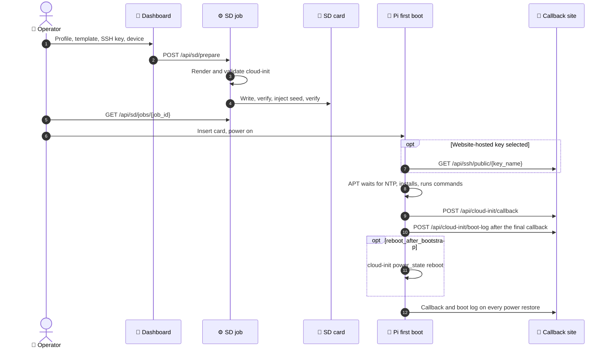

<a id="cloud-init-options-worth-knowing"></a>
### 🎛️ Cloud-init options worth knowing

- Sections follow a per-profile matrix in `static/home/cloud_init_options.js`. K3s settings
  appear only for the K3s distribution; Pi-specific boot controls only for Pi 5 templates.
  Hidden fields keep their values but are disabled and **excluded** from submissions and
  saved templates.
- `reboot_after_bootstrap` uses cloud-init's `power_state` module, not a reboot inside
  `runcmd`, so the power-restore callback service is enabled and final modules finish first.
  It applies to newly generated user-data; already-flashed nodes need updated user-data
  before repeating bootstrap. Old cloud-init log errors remain in the log history.
- **Apply Security Starter Defaults** disables SSH password auth and root SSH login, and
  enables fail2ban and unattended upgrades.
- Extra SSH hardening: `ssh_port`, `ssh_allow_groups` and extra authorized keys.
- The `k3s` distribution pre-fills a K3s config block with a pragma header. It is carried
  in the cloud-init payload and used by the post-boot K3s bootstrap path:

```yaml
# pragma: k3s-config-v1
server: https://<local-machine-ip>:6443
```

<a id="templates-and-retained-credentials"></a>
### 🔐 Templates and retained credentials

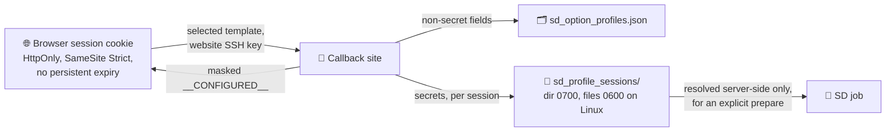

- The last saved/loaded template and website SSH key are remembered per browser session
  (shared by tabs) — not a global default. Reload restores non-secret fields; retained
  credentials show as masked `__CONFIGURED__`.
- Replace a masked value to update it; clear it and save to remove it. **Save As** copies
  retained credentials within the session. **Reset** clears the session's selection, not
  the saved template. SD devices, remote actions and private SSH-key contents are never restored.
- Retained secrets: Tailscale auth keys, toolkit Wi-Fi passwords and browser hashes, login
  passwords and Influx tokens. Template APIs, page HTML and job records never return them.
- Another browser session inherits nothing (though browser session-restore may keep
  session cookies across restarts). ⏳ A session record unused for **24 hours** is deleted
  with its secrets; any use resets the clock. Deleting a template clears its
  current-session record.
- Previously discarded keys cannot be recovered — enter them once and save. Expired or
  single-use Tailscale keys still need replacement.

> [!WARNING]
> `sd_profile_sessions/` is a **plaintext** private store. Treat it and its backups as
> credentials, and protect the Docker volume.

<a id="website-hosted-ssh-public-keys"></a>
### 🔐 Website-hosted SSH public keys

`GET /api/ssh/public/<key_name>` serves a saved public key as plain text — never its
private key. Generate or load a website key in **SSH Access** to enable first-boot
retrieval; uploaded or manually edited keys stay embedded-only.

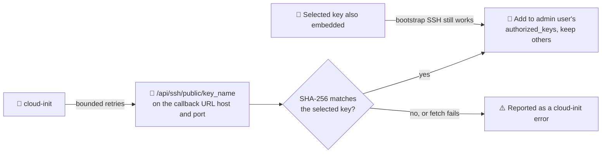

- The endpoint must be reachable from the new node — not `localhost` or loopback.
- First-boot install only: not automatic key rotation, not a fix for sudo permissions.
  Retain the matching private key for future login.
- Use HTTPS where possible. A changed endpoint key is rejected until you deliberately
  select it for a new image.

<a id="default-pi-administrative-access"></a>
### 🔐 Default Pi administrative access

- All Pi profiles (Pi 5, Pi 4, Pi 3B+, Network Toolkit) give the configured admin user
  **passwordless sudo**, matching raspi-config's **Admin Password disabled** setting. The
  example and legacy Pi cloud-init configs default to it too.
- Before other first-boot commands, cloud-init installs and validates
  `/etc/sudoers.d/010_<username>-nopasswd`; a non-interactive sudo check reports a boot
  error if the grant is ineffective.
- Other users' grants are untouched; the toolkit's `network-console` user does **not** get
  unrestricted sudo. SSH password auth and root SSH access remain separate settings.

> [!IMPORTANT]
> Protect administrative private keys: anyone holding one has root-level access.

<a id="misc-conveniences-and-extra-packages"></a>
### 📦 Misc conveniences and extra packages

| Option | Installs | Gotchas |
| --- | --- | --- |
| **Misc → Neovim with sensible defaults** (Pi 5/4/3B+) | Distro `neovim` and a plugin-free `~/.config/nvim/init.vim` for the admin user | Existing `init.vim`/`init.lua` (including symlinks) is preserved; no plugin downloads, editor alternatives or shell defaults change |
| **Misc → Everyday CLI tools** (Pi 5/4/3B+) | `tmux`, `ripgrep`, `fd-find`, `fzf`, `jq`, `unzip`, `bash-completion` | Debian/Ubuntu names the fd executable `fdfind` |
| **Packages and First-Boot Commands → Package List** | Your packages, added to the profile defaults (duplicates removed) | Debian package names only — no versions, URLs or command options. Uses the first-boot NTP-aware APT hook (removed after first boot); unavailable packages are reported as cloud-init errors |

Both **Misc** options default off, save into SD option templates and apply only to newly
provisioned images, not running nodes. Network Toolkit keeps its own diagnostic-package
controls and does not expose or apply them.

<a id="callbacks-jobs-and-boot-logs"></a>
## 📡 Callbacks, Jobs and Boot Logs

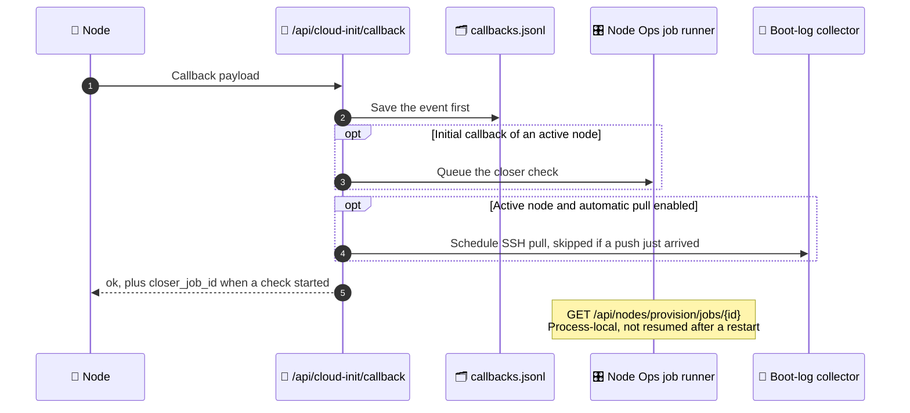

- Checks never block callback delivery, and repeated callbacks don't start another
  initial check.
- Jobs are process-local and do not resume after a restart (this is also why Compose runs
  a [single Gunicorn worker](#docker-compose)).

<a id="boot-log-exchange"></a>
### 📜 Boot log exchange

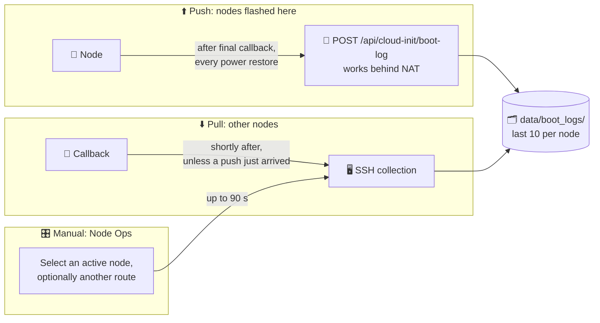

- Logs include the journal, cloud-init and dmesg. `CALLBACK_AUTO_BOOT_LOGS=0` turns off the
  automatic pull.
- Manual collection uses the node's preferred connection route; picking another route tries
  it with that route's SSH user, key and port. Failures never erase stored logs, and
  selecting a stored log only displays history.
- Archived nodes keep read-only logs; collection is rejected.
- Boot-log routes are network SSH routes, not USB transports.

<a id="terminal-tasks"></a>
### 🖥️ Terminal tasks

- Diagnostics are grouped under System, Boot & logs and Inventory. Editing the host field
  overrides the discovered-host selection; the route preview uses the same hostname
  resolution as the task runner.
- Output keeps the last **20,000 characters**. The local SSH process is stopped after
  **120 seconds** and the job is recorded as failed with an explicit timeout.

> [!WARNING]
> Disconnecting SSH is not a guarantee that every remote child process has stopped.

<a id="node-archive-and-restore"></a>
## 🔁 Node Archive and Restore

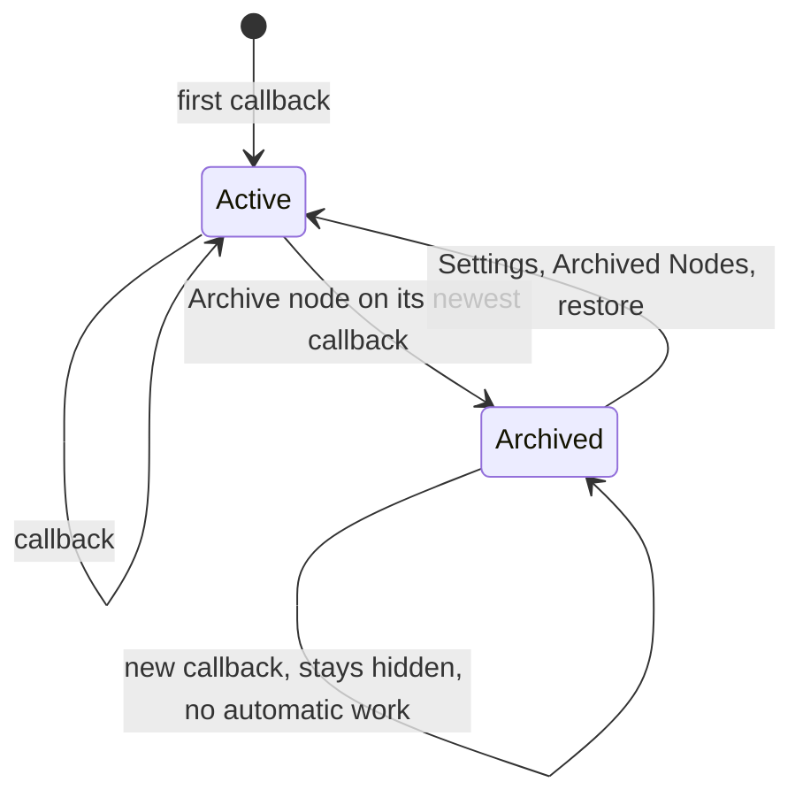

| Archived nodes are hidden from | Archived nodes keep |
| --- | --- |
| Active callbacks, Hardware Monitor, Node Ops and Terminal targets | Callback history, configuration, inventory, Kubernetes resources and read-only boot logs |

- API: `PUT /api/nodes/<name>/archive` with `{"archived": true}` hides a known node; `false`
  restores it. `GET /api/nodes/archive` lists archived nodes with timestamps.
- Registry: `data/archived_nodes.json` — reversible; all other records stay in place.
- New callbacks do not restore an archived node or schedule automatic checks or SSH log
  collection.
- `POST /api/nodes/stale/prune` is retired and returns HTTP 410 without deleting data.

<a id="connection-profiles-and-routes"></a>
## 🛰️ Connection Profiles and Routes

> [!NOTE]
> In active development. Planned next: pinned profiles, per-profile user/key/port,
> failover and HTTPS via `tailscale cert`.

Each node keeps several ways to reach it in `data/connection_profiles.json`; a replaceable
strategy picks one. By default Node Ops connects at the tailnet address when
`tailscale status` on the site host lists the node online, ahead of the LAN/NAT address a
callback reports; the monitor pings the same target.

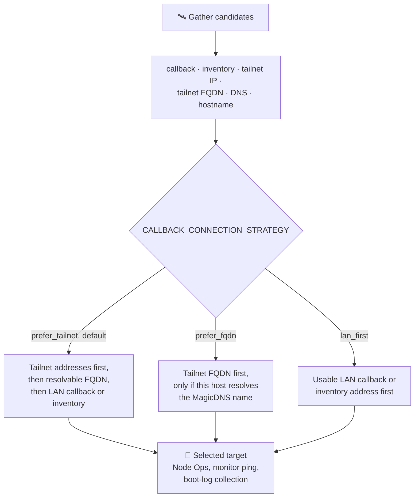

- Add custom strategies with `register_strategy`. Every tailnet profile carries the node's
  `fqdn` for later HTTPS with Tailscale certificates.
- `GET /api/nodes/<node>/connection-profiles` shows the candidates and the pick; add
  `?routes=1` for route details (type, preferred strategy, local interface/gateway when known).
- `GET /api/test-terminal/route?host=<host>` previews the terminal target without connecting.
- Node Ops **Routes** and Terminal **All node routes** show the same connection-path view.

> [!IMPORTANT]
> Routes are known candidates, **not** proof of live SSH reachability. Lookups use Linux
> `iproute2` (included in Docker); inside Docker the interface belongs to the container,
> not the Windows host or remote node. Hostname-only routes are resolved by SSH at
> connection time.

<a id="source-of-truth"></a>
## 📊 Source of Truth

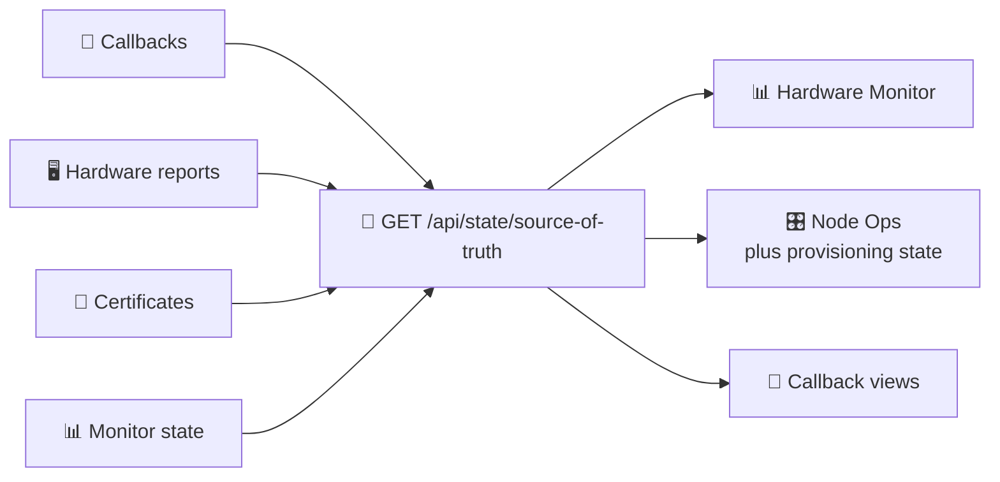

Hardware Monitor and Node Ops read the same payload; Node Ops adds provisioning state
alongside the callback, hardware and certificate context.

<a id="longhorn-notes"></a>
## 🐄 Longhorn Notes

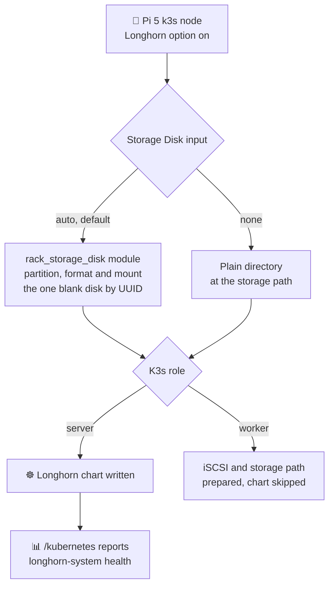

- Optional Pi 5 profile for now; the first pass assumes nodes still boot from SD card.
- The storage path is configurable, so a later move to an NVMe-backed mount changes a
  value, not the operator flow.
- `rack_storage_disk` lives in `library/`. It never touches a disk that holds data, and
  reports the path, UUID and by-id name in the run output.

<a id="network-toolkit-pi-3b"></a>
## 🧰 Network Toolkit (Pi 3B+)

Select **Network Toolkit (Pi 3B+)** as the SD profile. It is a separate `network-toolkit`
class, not a K3s role: pinned, checksum-verified Raspberry Pi OS **Trixie Lite 64-bit**
(which supports cloud-init), Standard distribution forced, and no desktop, Docker, K3s
or Telegraf.

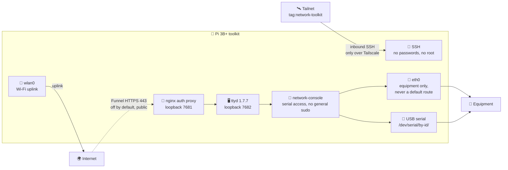

> [!WARNING]
> Do not substitute legacy Bookworm images — they lack this first-boot workflow.
> `ttyd` 1.7.7 (ARM64) comes from its pinned upstream release with SHA-256 verification,
> because the Pi OS Trixie repositories don't provide it; imaging and Node Ops use the same
> URL and checksum.

<a id="setup-checklist"></a>
### ✅ Setup checklist

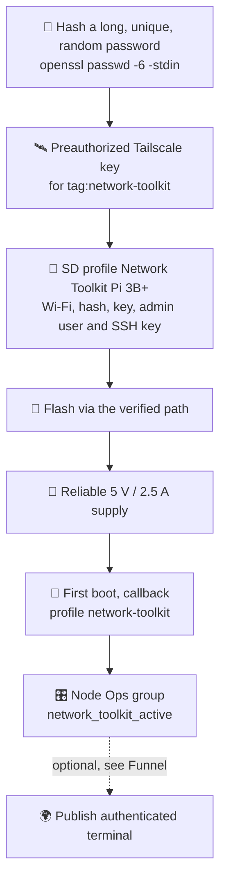

| Field | Requirement |
| --- | --- |
| Wi-Fi | SSID, password and country code for the `wlan0` uplink. Personal WPA/WPA2 PSK only — no enterprise EAP or captive-portal login |
| Browser password | A **hash** from `openssl passwd -6 -stdin`; the browser login is `operator` |
| Tailscale | Preauthorized auth key for **`tag:network-toolkit`** — this class uses only that tag, not the rack tags. Required even with Funnel off |
| Admin access | Non-root administrative user and SSH public key for private management |
| Extra Network Diagnostic Tools | Optional comma-separated Debian packages, e.g. `iperf3, iputils-tracepath, whois, strace`, added to the standard toolkit set and saved in templates. Leave blank for the base set. CLI: `CLOUD_INIT_TOOLKIT_EXTRA_PACKAGES` |

- The form shows only toolkit-relevant sections; the appliance enforces its own SSH,
  firewall, routing, MOTD and Telegraf defaults.
- Extra packages must exist in the image's configured repositories — unavailable packages
  fail cloud-init installation. They grant the browser terminal no extra sudo.
- The callback URL must be reachable from the Pi's Wi-Fi or tailnet, not a loopback
  address on the imaging machine.
- Ethernet is for equipment, not the internet uplink; keep its device subnet separate from
  Wi-Fi. More USB equipment may need a powered hub. Use a USB serial adapter with the
  electrical standard your equipment requires.

> [!CAUTION]
> Treat the flashed card's boot files as sensitive: Wi-Fi and join credentials are
> necessarily present there during first boot.

<a id="power-and-first-boot-gotchas"></a>
### ⚠️ Power and first-boot gotchas

```bash
sudo vcgencmd get_throttled
```

- Bit 0 = active undervoltage; bit 16 = earlier undervoltage. `0x50005` means both current
  and historical undervoltage/throttling — not merely too little power for USB peripherals.
  Fix the supply, cable and peripheral load before provisioning; software cannot remedy
  voltage drops.
- Package updates wait for NTP through an APT pre-update hook; HTTPS installers also wait.
  Nothing waits in `bootcmd`: Raspberry Pi OS runs that stage before sysinit, D-Bus and
  NetworkManager, so waiting there would block synchronization. Timeouts are reported.
- Toolkit setup fixes the image's Netplan file permissions and removes the
  `netplan_nm_patch` cloud-init entry only when that module is absent, avoiding the
  missing-module warning on the next boot.
- Persistent journals are capped at 16 MiB, so failures survive a restart without
  unbounded SD-card logging.

<a id="zero-byte-files-after-a-reset"></a>
### 🩹 Zero-byte files after a reset

Symptom: rack scripts/configuration are zero bytes, but the boot partition's user-data
still has their full content. Inspect `/var/lib/cloud/instance/sem/` — once-per-instance
markers can survive while the installed data does not.

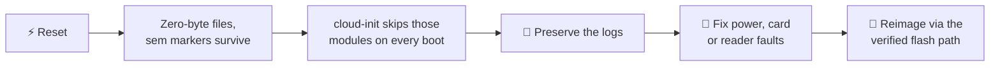

Rebooting the same damaged card will not repair it. Missing journals or an absent
final-stage callback alone do not identify the reset trigger.

<a id="publishing-the-terminal-with-funnel"></a>
### 🛰️ Publishing the terminal with Funnel

**Publish authenticated terminal** is off by default. Before enabling it:

1. Enable MagicDNS and HTTPS in the tailnet.
2. In the Tailscale ACL planner, tick **Network Toolkit Funnel permission** and apply the
   generated policy.

> [!CAUTION]
> Funnel is **public**, not tailnet-authenticated: anyone on the internet can reach the
> login prompt. Follow your organization's policy before publishing it.

- Path: HTTPS 443 → nginx auth proxy on loopback 7681 → ttyd on loopback 7682
  ([diagram](#network-toolkit-pi-3b)). The terminal runs as `network-console`: serial
  access, sudo only for the dedicated Ethernet configuration and bounded packet-capture helpers.
- SSH password and root logins are disabled; the firewall allows inbound SSH only over
  Tailscale and blocks forwarding. No router port-forward is needed.
- Public URL: `https://<hostname>.<tailnet>.ts.net/`.
- Failed Funnel policy authorization or terminal setup is reported by systemd/cloud-init;
  there is no unauthenticated fallback.
- Node Ops accepts an explicit `tag:shared` override in the Tailscale module when the auth
  key and existing tailnet policy use that tag. Imaging still defaults to
  `tag:network-toolkit`, which the planner's Funnel rules target; a shared-tag node needs
  its existing policy to permit SSH and, if enabled, Funnel. Routing and exit nodes stay
  disabled.

Inspect or disable over private SSH (or clear the toggle and apply the module; the proxy and
terminal remain local):

```bash
systemctl status rack-toolkit-terminal rack-toolkit-funnel
tailscale funnel status
sudo systemctl disable --now rack-toolkit-funnel.service
```

<a id="working-with-equipment"></a>
### 🔌 Working with equipment

`eth0` starts with link-local addressing and never provides a default route. USB serial
adapters appear under `/dev/serial/by-id/` (or `/dev/ttyUSB*` and `/dev/ttyACM*`).
From the browser terminal:

```bash
ls -l /dev/serial/by-id/
picocom --baud 9600 --flow n /dev/ttyUSB0
sudo rack-device-network show
sudo rack-device-network static 192.168.1.2/24
ping 192.168.1.1
ssh admin@192.168.1.1
sudo rack-device-capture
```

- Pick a device subnet that does **not** overlap the Wi-Fi uplink or Tailscale; the helper
  rejects Tailscale-range overlap and prefixes wider than /8.
- Baud/flow settings depend on the equipment. Use the right adapter (RS-232 versus TTL);
  GPIO UART is not enabled by this class.
- Packet capture is restricted to `eth0`, 60 seconds or 1000 packets.

> [!WARNING]
> Telnet and TFTP clients are included for legacy equipment but transmit without
> encryption — use them only on an authorized, isolated device connection.

<a id="managing-an-appliance-from-node-ops"></a>
### 🎛️ Managing an appliance from Node Ops

- Callbacks keep `profile: network-toolkit` and land in `network_toolkit_active`. Node Ops
  defaults to the Baseline, Tailscale and Network Toolkit modules only.
- The Network Toolkit module reuses the credential hash and Funnel toggle. Wi-Fi is
  boot-only; change it privately with `nmcli`.
- Saved SD templates keep the class and non-secret settings. Wi-Fi passwords, browser
  hashes and join keys are retained privately for the saving browser session as masked
  inputs; other sessions must supply their own.
- Existing appliance: add it under `network_toolkit_active` in inventory with its Tailscale
  address and non-root admin user, enter its hash, then **check** and **apply** the
  Network Toolkit module.

> [!CAUTION]
> The role deliberately changes Ethernet and enforces private SSH — never use it on a
> general-purpose Pi or an existing cluster member. Reimage a former cluster node only
> after safely removing it from the cluster.

<a id="deployment-notes"></a>
## 🐳 Deployment Notes

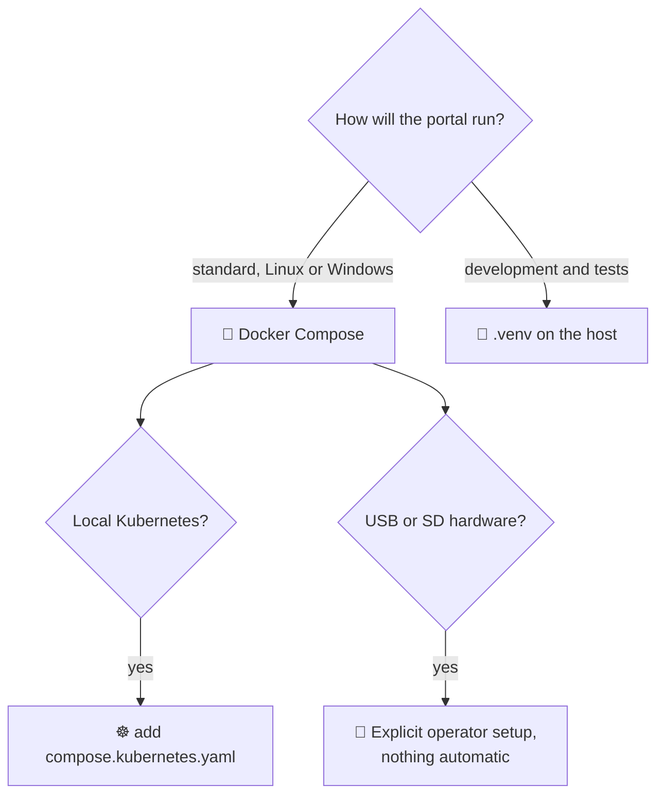

<a id="docker-compose"></a>
### 🐳 Docker Compose

From the repository root:

```powershell
docker compose up --build -d
docker compose ps
docker compose logs -f callback-site
docker compose down
```

```mermaid
flowchart LR
  browser["🌐 Browser<br/>http://127.0.0.1:8089/"] --> aport
  nodes["🥧 Nodes"] -- "host LAN IP and port,<br/>never 127.0.0.1" --> fw["🧱 Windows Firewall<br/>may need an inbound rule"] --> nport
  subgraph host["🖥️ Docker host"]
    nport["CALLBACK_PORT<br/>default 8088, all interfaces<br/>🔓 node endpoints only"] --> ctr
    aport["CALLBACK_ADMIN_PORT<br/>default 8089, 127.0.0.1<br/>🔐 sign-in"] --> ctr
    ctr["🐳 callback-site<br/>Gunicorn, 1 worker plus threads<br/>non-root, unprivileged"]
    ctr --> vol[("🗂️ /data<br/>playbook_callback-site-data")]
  end
  usb["🔌 USB and SD devices"] -. "❌ not passed in by default" .-> ctr
  ts["🛰️ Host Tailscale daemon"] -. "❌ not passed in by default" .-> ctr
```

- One Gunicorn worker because background job status is process-local; threads handle
  concurrent requests.
- Different host ports: set `CALLBACK_PORT` or `CALLBACK_ADMIN_PORT` first, e.g.
  `$env:CALLBACK_ADMIN_PORT=9821` in PowerShell. Exposure options: [🔐 dashboard access](#dashboard-access).
- The `callback-site-data` volume (explicitly named `playbook_callback-site-data` to keep the
  existing deployment's volume) holds catalog pulls, callbacks, node reports, SSH keys and
  operator edits across rebuilds and recreation. Never bake data, logs or keys into the image.
- Linux with Docker Desktop: `systemctl --user start docker-desktop` and the `desktop-linux`
  context (enable the user service to start at login). With Docker Engine, use its system
  service and default context. Do not run both engines for this application.
- Nodes calling back need the Windows host's LAN IP and port; Windows Firewall may need to
  allow that port. Hardware access needs an explicit [setup](#usb-devices-wsl-and-docker);
  host-tailnet discovery needs the relevant service available inside the container.

> [!CAUTION]
> `docker compose down` leaves the data volume intact — do **not** add `-v` if you want to
> keep its data.

> [!WARNING]
> Keep the site on a trusted network; it is not intended for direct public-internet exposure.

**Migrating an existing host deployment:**

```mermaid
flowchart LR
  a["⏹️ Stop the host<br/>Python server"] --> b["💾 Back up<br/>callback_site/data/"]
  b --> c["📥 Copy into the volume<br/>owner 10001:10001,<br/>keep key and session perms"]
  c --> d["✏️ Rewrite saved absolute<br/>paths to /data"]
  d --> e["🚀 First Compose start"]
  e --> f["✅ Verify the UI and a<br/>container recreation"]
```

- Stop the host server before publishing the same port.
- Rewrite paths such as image-history `download_path` and SSH archive `archive_path`;
  copying files alone does not make host paths usable inside the container.
- Keep the original host data until the migrated UI and a container recreation are verified.

### SD/USB flashing from Docker (host flasher)

The container cannot see host SD cards or USB drives; under Docker Desktop it
runs inside a VM. SD preparation is therefore delegated to a small host agent,
`callback_site/sd_flasher.py`. It is standard library only, runs as root, and
serves a token-authenticated JSON API on `127.0.0.1:8089`. The dashboard keeps
all validation, templates and secrets. The agent lists only removable disks
and only runs `scripts/prepare_sd_cloud_init.sh` against a disk it currently
lists, with `CLOUD_INIT_*` options only. It never accepts commands, arbitrary
paths or host environment overrides.

```bash
scripts/run_sd_flasher.sh install   # systemd service, survives reboots
docker compose up -d --force-recreate callback-site   # first time only, loads the token
```

`scripts/run_sd_flasher.sh` (no argument) runs the agent in the foreground
instead; `status` and `uninstall` manage the service. The first run creates
`.local/sd-flasher.env` (mode 0600, gitignored). Compose loads it into the
dashboard and points `SD_FLASHER_URL` at `http://host.docker.internal:8089`;
set `SD_FLASHER_URL=` to disable delegation. When the agent is unreachable, the
home page shows the reason next to the device picker instead of an empty list.

The agent uses its own image cache, `callback_site/data/image_cache` (the
native deployment's cache; override with `SD_FLASHER_IMAGE_CACHE_DIR`). Catalog
images missing there are downloaded and verified by the script; custom library
files must be copied there by name. It decompresses into
`/var/tmp/playbook-sd-flasher` (`SD_FLASHER_WORK_DIR`), so leave room for a full
image. Because it runs on the host, the K3s server default is the host's LAN
IP, not the container's. Anyone who can edit this checkout can change code
that runs as root, so keep the checkout owned by a trusted admin.

With native Docker Engine, `host.docker.internal` maps to the bridge gateway, so start the
agent with `--bind` set to that gateway address (for example `172.17.0.1`), not
loopback; the token still guards every request.

`compose.sd-flasher.yaml` sketches a privileged containerised flasher for
unrestricted native Engine hosts, the step towards a Kubernetes one-shot Job.
It is **unsupported and unvalidated**. It cannot work under Docker Desktop, the
image lacks `parted`, `udev` and `xz`, and it mounts the host's `/dev`. Use it
only for experiments on a dedicated machine.

<a id="usb-devices-wsl-and-docker"></a>
### 🔌 USB devices, WSL and Docker

> [!IMPORTANT]
> Base Compose stays non-root, unprivileged and device-free. No USB attachment or host
> configuration is performed automatically. Passing through a USB serial adapter or card
> reader does not create a node connection profile — boot-log routes are network SSH routes.

```mermaid
flowchart LR
  subgraph win["🪟 Windows"]
    dev["🔌 USB device<br/>drive letter or COM port<br/>is not a Linux /dev device"]
  end
  subgraph wsl["🐧 WSL 2"]
    wdev["verify with lsusb, lsblk"]
  end
  subgraph dd["🐳 Docker Desktop Linux"]
    ddev["device via Docker USB/IP,<br/>privileged helper stays running"]
  end
  subgraph lin["🐧 Native Linux Docker host"]
    ldev["/dev/serial/by-id/..."]
  end
  ctr["🐳 callback-site<br/>operator-managed override:<br/>devices and group_add"]
  dev -- "usbipd bind, attach --wsl" --> wdev
  wdev -. "does NOT imply<br/>daemon visibility" .-> ddev
  dev -- "Docker USB/IP procedure" --> ddev
  ddev -- "verify, then map" --> ctr
  ldev -- "verify, then map" --> ctr
```

**Windows / Docker Desktop:** follow Microsoft's
[WSL USB guide](https://learn.microsoft.com/en-us/windows/wsl/connect-usb), install
`usbipd-win` and keep a WSL 2 shell open.

```powershell
usbipd list                           # identify the intended device
usbipd bind --busid <BUSID>           # elevated PowerShell; share only that bus ID
usbipd attach --wsl --busid <BUSID>   # ordinary PowerShell
usbipd detach --busid <BUSID>         # before returning it to Windows
```

- Verify inside WSL with `lsusb` and, for storage, `lsblk`; drivers must exist in that Linux
  kernel. While attached, Windows cannot use the device. Restrict the USB/IP firewall rule to
  trusted hosts.
- WSL visibility does **not** prove Docker daemon visibility. Docker Desktop has its own
  Linux environment: follow Docker's
  [USB/IP instructions](https://docs.docker.com/desktop/features/usbip/) and verify the
  device there before mapping it. That procedure uses a separate privileged attachment
  helper that must stay running — never give the dashboard those privileges. Docker does
  not guarantee support for every USB device.

> [!WARNING]
> No physical Windows USB/card-reader setup has been validated here.

**Native Linux Docker:** once the intended device exists on the daemon host, an
operator-managed Compose override can expose only that device. For a serial adapter,
resolve its stable `/dev/serial/by-id/...` symlink to the current device and use its
numeric device-group ID:

```yaml
services:
  callback-site:
    devices:
      - "${USB_DEVICE:?Set the verified Linux device path}:/dev/ttyUSB0:rw"
    group_add:
      - "${USB_DEVICE_GID:?Set the numeric device group ID}"
```

- Combine the override with base Compose (and the Kubernetes override if used).
- Recheck identity after unplug/replug — `/dev/ttyUSB0` and `/dev/sdX` names can be reassigned.
- Device mappings grant access only; they don't install a serial console or add a USB
  transport to this app.

> [!CAUTION]
> **SD readers:** exposing the whole verified block device is only one prerequisite —
> flashing also needs privileged mount/write operations and partition devices. The default
> non-root image is **not a validated SD flasher**, and `--device` alone does not fix that.
> Use the host flasher above rather than making the web app privileged. Unmount the
> intended card, verify size/model/serial, and never expose a system disk or mount the
> host's entire `/dev` into the app.

**Optional flashing helper** — the [isolated Linux flashing helper](../flash_helper/README.md):

- Authenticated device discovery and preparation without running the dashboard as root.
- Opt-in Helm chart starts an idle-expiring Job on dashboard discovery, pinned to a Linux
  reader host.
- Does not bypass Windows USB passthrough requirements; the default deployment remains
  hardware-free.
- Separates raw Pi imaging from unattended UEFI installer USB creation for Ubuntu Server LTS
  and Rocky Linux on x86_64/ARM64.

> [!CAUTION]
> UEFI installer media requires explicit creation-time authorization to **erase the target
> machine's sole eligible internal disk** — there is no boot-time installation confirmation.
> Read the helper guide's disk-selection policy and hardware acceptance-test limits first.

<a id="docker-desktop-kubernetes-and-helm"></a>
### ☸️ Docker Desktop Kubernetes and Helm

Enable Kubernetes in Docker Desktop and wait for its node to be Ready. From PowerShell at
the repository root:

```powershell
powershell.exe -NoProfile -ExecutionPolicy Bypass -File .\scripts\connect_docker_kubernetes.ps1
```

For subsequent starts and rebuilds, keep the Kubernetes override:

```powershell
docker compose -f compose.yaml -f compose.kubernetes.yaml up --build -d
```

```mermaid
flowchart LR
  dd["☸️ Docker Desktop Kubernetes<br/>context docker-desktop"] -- "connect script exports<br/>only this context" --> kc["🔐 .local/kubeconfig<br/>git-ignored, not in the image"]
  kc -- "read-only mount via<br/>compose.kubernetes.yaml" --> ctr["🐳 callback-site<br/>git, helm, kubectl included"]
  gh["🐙 Public GitHub chart"] -- "Import defaults,<br/>commit pinned" --> ctr
  ctr --> vol[("🗂️ /data<br/>helm_configurations.json")]
  ctr -- "Deploy / upgrade,<br/>after confirmation" --> dd
```

- The process-only execution policy does not change Windows policy.
- Certificate validation is preserved; no anonymous access or TLS bypass is used.
- Docker Desktop may change the API port when recreating its cluster — rerun the script.
- The image includes `site.yml`, its roles and the required Ansible collection for Node Ops.
  Validate the packaged playbook without contacting nodes:

  ```powershell
  docker compose run --rm --no-deps callback-site ansible-playbook --syntax-check site.yml
  ```

- `.gitattributes` checks shell scripts out with LF endings, even on Windows, so scripts
  copied into Linux containers stay runnable by Bash.

> [!WARNING]
> `.local/kubeconfig` has administrative access to your local test cluster. Protect the
> file and keep the dashboard on a trusted network.

**Helm configurations** at `/kubernetes`:

```mermaid
stateDiagram-v2
  [*] --> Imported: Import defaults, commit pinned
  Imported --> Saved: Save configuration
  Saved --> Saved: edit values, release, namespace
  Saved --> Previewed: Preview manifests
  Previewed --> Submitted: Deploy / upgrade, confirmed
  Submitted --> Deployed: waits up to 2 min for readiness
  Submitted --> Failed: recorded as failed
  Deployed --> Saved: reopen to customize and upgrade
  note right of Previewed
    Import, save and preview
    never change the cluster
  end note
```

- Try it: select **Hello World (NGINX)** under **Included examples** and **Import defaults** —
  the official [`helm/examples`](https://github.com/helm/examples) chart at `charts/hello-world`.
- Other public GitHub repositories work the same way; with several charts, enter the
  relative chart directory. Private repositories and automatic chart dependency downloads
  are not supported in this first version.
- Deployment uses the mounted context (or the local K3s kubeconfig on a Linux host) and
  retains the cluster, release, Git commit and exact submitted values. Later edits do not
  overwrite the last submitted values.
- Native Linux deployments need Git, Helm and kubectl (or K3s); the Docker image already
  includes the clients.

> [!CAUTION]
> Failed submissions may leave resources in the cluster; they are not automatically rolled
> back or uninstalled.

> [!IMPORTANT]
> Saved configurations live in the `/data` volume, not the image. Back the volume up
> separately when moving hosts; Git cannot recover runtime configurations or credentials
> that were never committed.

<a id="key-apis"></a>
## 🔗 Key APIs

```mermaid
mindmap
  root((🔗 API))
    💾 /api/sd
      prepare and jobs
      options-profiles
    📡 /api/cloud-init
      callback
      boot-log
      events
    🎛️ /api/nodes
      summary and provision
      archive
      boot logs
      connection-profiles
      live-config
      module-presets
    🔐 /api/ssh
      generate and keys
      public key
    ☸️ /api/helm
      configurations
    📊 /api/state
      source-of-truth
```

<details>
<summary>📚 Reference: endpoints</summary>

Everything except the [🔓 node endpoints](#dashboard-access) needs a signed-in session;
signed-out API calls get HTTP 401 JSON.

| Method | Endpoint | Notes |
| --- | --- | --- |
| GET | `/health` | 🔓 |
| GET, POST | `/setup` | First-run account form; redirects to `/login` once an account exists |
| GET, POST | `/login` | `?next=/path` returns there after sign-in |
| POST | `/logout` | |
| POST | `/api/sd/prepare` | Start an SD preparation job |
| GET | `/api/sd/jobs/<job_id>` | SD job status |
| GET | `/api/sd/options-profiles` | Templates, plus this session's `selected_profile`, `ssh_key_name` and masked credential indicators |
| POST | `/api/sd/options-profiles` | Save a template |
| POST | `/api/sd/options-profiles/session` | Remember `name` and/or `ssh_key_name` in the current browser session |
| DELETE | `/api/sd/options-profiles/<name>` | |
| GET | `/api/cloud-init/events` | |
| POST | `/api/cloud-init/callback` | 🔓 Response includes `closer_job_id` when a check starts |
| POST | `/api/cloud-init/boot-log` | 🔓 Node-pushed boot logs |
| GET | `/api/state/source-of-truth` | Shared payload |
| GET | `/api/nodes/summary` | |
| GET | `/api/nodes/archive` | Archived nodes and timestamps |
| PUT | `/api/nodes/<name>/archive` | `{"archived": true}` hides a known node; `false` restores it |
| POST | `/api/nodes/stale/prune` | Retired — HTTP 410, deletes nothing |
| GET | `/api/nodes/boot-log-hosts` | Active nodes and retained-log hosts, with archive status |
| POST | `/api/nodes/<name>/boot-logs/fetch` | Optional `{"route_id": "callback"}` selects a current connection-profile ID, not an arbitrary client-supplied address; no payload keeps the automatic strategy; archived nodes are rejected |
| GET | `/api/nodes/<node>/connection-profiles` | Candidates and the pick; `?routes=1` adds route details |
| GET | `/api/test-terminal/route?host=<host>` | Preview the terminal target without connecting |
| POST | `/api/nodes/provision` | |
| GET | `/api/nodes/provision/jobs/<id>` | Node Ops job status, including callback closer checks |
| GET | `/api/nodes/live-config?node=<name>&module=<id>` | Reads the module's current settings off the node over SSH (never secrets); a failed read is `ok: false` with the reason, not an HTTP error |
| GET | `/api/nodes/module-presets?module=<id>&node=<name>` | Saved configurations plus settings drawn from other nodes and SD profiles |
| POST | `/api/nodes/module-presets` | Name a saved configuration (`id`, `name`) or save a node's current inputs under a name (`node`, `module`, `name`) |
| POST | `/api/nodes/module-presets/load` | Fill a node's module inputs from `preset:<id>`, `node:<name>` or `sd:<profile>` |
| DELETE | `/api/nodes/module-presets/<id>` | |
| POST | `/api/ssh/generate` | |
| GET | `/api/ssh/keys` | |
| GET | `/api/ssh/public/<key_name>` | 🔓 Plain-text public key for verified first-boot SSH setup |
| GET | `/api/helm/configurations` | Saved Helm configurations and the included example |
| POST | `/api/helm/configurations/import` | Import a public GitHub chart and its default values |
| PUT | `/api/helm/configurations/<id>` | Save edited values, release, namespace and configuration name |
| POST | `/api/helm/configurations/<id>/preview` | Render saved values without changing the cluster |
| POST | `/api/helm/configurations/<id>/deploy` | Explicitly install or upgrade the saved configuration |

</details>

<a id="data-files"></a>
## 🗂️ Data Files

```mermaid
flowchart LR
  cat["📁 callback_site/catalogs/<br/>image_catalog.yml"] --> cache
  subgraph appdata["🗂️ CALLBACK_APPDATA_DIR — default callback_site/data/"]
    subgraph sd["💾 Imaging"]
      cache["image_cache/"]
      sdo["sd_option_profiles.json"]
      sess["🔐 sd_profile_sessions/"]
      keys["🔐 ssh_keys/"]
    end
    subgraph cbk["📡 Callbacks"]
      ev["callbacks.jsonl"]
      rep["node_reports/"]
      bl["boot_logs/"]
      arc["archived_nodes.json"]
    end
    subgraph ops["🎛️ Node Ops and cluster"]
      np["node_provisioning.json"]
      mp["🔐 module_presets.json"]
      cp["connection_profiles.json"]
      helm["🔐 helm_configurations.json"]
    end
    subgraph access["🔐 Dashboard access"]
      auth["🔐 admin_auth.json"]
      skey["🔐 admin_secret_key"]
    end
  end
```

<details>
<summary>📚 Reference: data files</summary>

| Path | Contents |
| --- | --- |
| `callback_site/catalogs/image_catalog.yml` | Source image catalog (in the repository) |
| `callback_site/data/callbacks.jsonl` | Callback event log |
| `callback_site/data/image_cache/` | Local image cache |
| `callback_site/data/node_provisioning.json` | Node profiles and saved inputs |
| `callback_site/data/module_presets.json` | 🔐 Remembered and named module configurations — contains secrets; git-ignored |
| `callback_site/data/sd_option_profiles.json` | Reusable cloud-init option templates |
| `callback_site/data/sd_profile_sessions/` | 🔐 Private browser-session selection and credential records — protect it and its backups |
| `callback_site/data/ssh_keys/` | 🔐 Generated SSH key material |
| `callback_site/data/node_reports/` | Stored hardware-report payloads |
| `callback_site/data/boot_logs/` | Boot logs, one folder per node |
| `callback_site/data/archived_nodes.json` | Reversible archive registry; all other records remain in place |
| `callback_site/data/connection_profiles.json` | Per-node connection candidates |
| `callback_site/data/helm_configurations.json` | 🔐 Helm configurations and last submitted inputs — may contain secrets; git-ignored |
| `callback_site/data/admin_auth.json` | 🔐 Dashboard username, password hash and session epoch (0600); delete it to [reset](#dashboard-access) |
| `callback_site/data/admin_secret_key` | 🔐 Sign-in cookie signing key (0600); delete it and restart to sign everyone out |

</details>

<a id="testing"></a>
## 🧪 Testing

Install `callback_site/requirements-styles.txt` first (see
[styles](#shared-interface-styles)); the suite verifies that checked-in CSS matches its Sass
sources. From the repository root:

```bash
.venv/bin/python -m unittest discover -s callback_site/tests -t callback_site/tests
```

For a broader validation pass (Docker: add `CALLBACK_ADMIN_BASE=http://127.0.0.1:8089`):

```bash
python3 scripts/validate_callback_site.py
```

<a id="shared-interface-styles"></a>
## 🛠️ Styles and Front-End Build

```mermaid
flowchart LR
  scss["✏️ styles/<br/>Dart Sass modules"] -- "build_styles.py,<br/>bundled Dart Sass" --> css["🎨 static/*.css<br/>committed"]
  js["✏️ frontend/<br/>structured_output.js"] -- "npm run build" --> bundle["📦 static/structured_output.js<br/>plus license notices, committed"]
  css --> flask["🐍 Flask serves as-is,<br/>no compiler at startup"]
  bundle --> flask
  ci["🧪 Portal styles workflow"] -. "checks reproducibility" .-> css
```

| Edit this | Not this |
| --- | --- |
| `styles/*.scss` entrypoints, `styles/shared/`, `styles/pages/<feature>/`, `styles/abstracts/` | Generated `static/*.css` |
| `frontend/structured_output.js` | Generated `static/structured_output.js` |
| `templates/_sidebar.html` (navigation for every page) | Per-page navigation copies |

Build from the repository root (Python 3.10+):

```bash
.venv/bin/python -m pip install -r callback_site/requirements-styles.txt
.venv/bin/python callback_site/build_styles.py
.venv/bin/python callback_site/build_styles.py --check
```

- The pinned build-only package bundles Dart Sass; Node.js and npm are not required for styles.
- Commit regenerated CSS with Sass changes so Flask and deployed nodes need no compiler or
  startup build step. Build on a supported workstation when the deployment platform has no
  compiler wheel.
- `--check` compiles to a temporary directory and fails for missing/stale assets without
  modifying them. Compile errors stop the build before any assets are published; unchanged
  assets are not rewritten; source maps are not published.
- Every page loads `static/common.css` **after** its feature stylesheet — keep that order;
  shared control and responsive policies intentionally take precedence.
- `styles/abstracts/` mixins emit no CSS until included. Use `@use`, not legacy `@import` or
  selector-expanding `@extend`.
- Keep source modules below 300 lines, grouped by responsibility. Reuse existing
  owners/mixins before adding shared rules; avoid page-specific copies of the shell or controls.
- The `Portal styles` GitHub Actions workflow checks reproducibility and build-failure
  behavior whenever stylesheet sources, assets or build tooling change.

<a id="structured-output-formatting"></a>
### 🛠️ Structured output formatting

Read-only JSON, reports, YAML manifests and command previews use the shared
`pre[data-format]` renderer with locally bundled Highlight.js and
json-stringify-pretty-compact (no CDN requests). Live logs and editable fields are untouched;
blocks over 200,000 characters keep their original text. Syntax styles live in
`styles/shared/_structured-output.scss`.

Rebuild the committed bundle and third-party license notices (Node.js/npm are build-only;
neither Flask nor deployed containers need them):

```bash
cd callback_site
npm ci
npm run build
npm run check
```

Dependencies are pinned in `package.json` and `package-lock.json`.

<a id="release--recreate"></a>
## 🩹 Release / Recreate

The repo recreates from source plus an empty appdata directory. Runtime state and generated
artifacts stay out of version control: callback events, node provisioning state, SD option
profile state, node reports, SSH archives and SSH known-host caches.

```mermaid
flowchart LR
  src["📁 Source checkout"] --> venv["🐍 python -m venv .venv"]
  venv --> pip["📦 pip install -r<br/>callback_site/requirements.txt"]
  empty[("🗂️ Empty appdata directory")] --> run
  pip --> run["🚀 app.py with<br/>CALLBACK_APPDATA_DIR set"]
```

From the repository root:

```bash
python -m venv .venv
.venv/bin/pip install -r callback_site/requirements.txt
CALLBACK_APPDATA_DIR="$PWD/callback_site/data" .venv/bin/python callback_site/app.py
```

Set `CALLBACK_SITE_REQUIRE_ROOT=1` only if a deployment needs elevated startup in specific
contexts; otherwise run normally as the unprivileged user.

<a id="notes"></a>
## 🚫 Notes

- SD writes are destructive; only target the intended device.
- The app expects a working local environment and is meant to run on a trusted machine.
- The repository-root venv and the app-local venv are not interchangeable; prefer the
  repo-root venv for tests and the app run if that is the environment you configured.

---

➡️ **Next:** [🏠 Project home](../README.md) · [🧭 SOHO rack vision](../docs/soho-rack-vision.md) ·
[🔁 Rack cluster runbook](../docs/rack-cluster-runbook.md) ·
[🧪 Functional contracts](../docs/callback_site-functional-prototypes.md) ·
[💾 Flash helper](../flash_helper/README.md)
