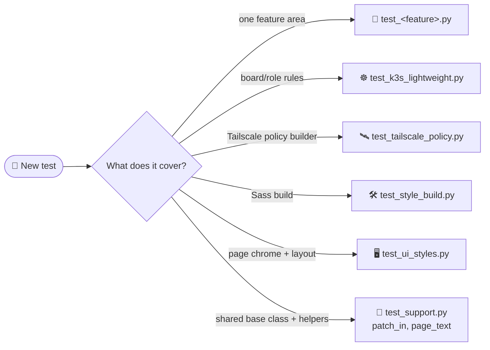
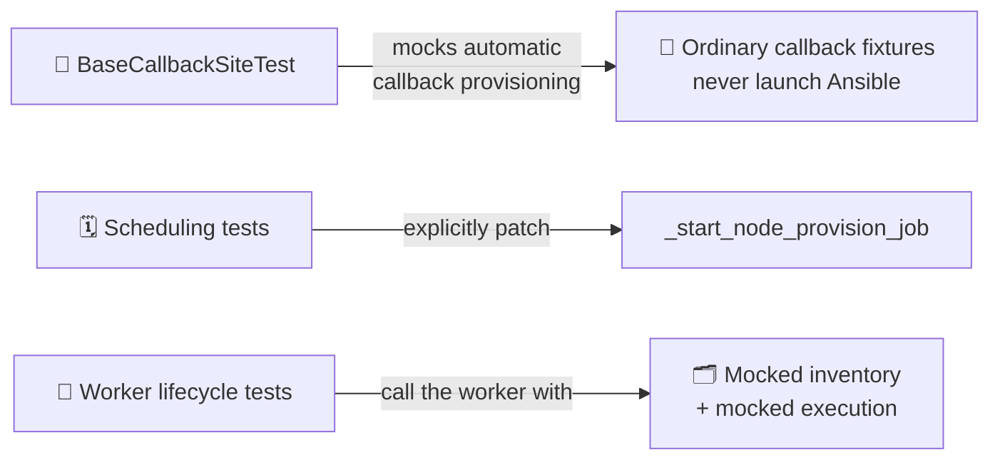

# 🧪 Callback Site Test Naming

Use filename patterns that encode **feature area** and **behavior**.

## 🗺️ Naming patterns

| Pattern | Covers | Notes |
| --- | --- | --- |
| `test_<feature>.py` | One file per feature area: callbacks, images, monitor, node provisioning, node inventory, SD card, settings, SSH keys, terminal checks, repo config | e.g. `test_callbacks.py`, `test_sd_card.py`, `test_ssh_keys.py` |
| `test_k3s_lightweight.py`, `test_tailscale_policy.py` | Board/role rules and the Tailscale policy builder | |
| `test_support.py` | Shared base class and `patch_in`, which patches a name in every module that imported it | Use `page_text()` for assertions on text that now lives in linked static files |
| `test_style_build.py` | Build-only Sass compilation, stale/missing assets, safe failures and source ownership/module-size checks | ⚠️ Install `../requirements-styles.txt` before running these tests |
| `test_ui_styles.py` | Shared page chrome and browser layout/control invariants at desktop, tablet and phone viewport widths | |

## ✅ Guidelines

- 🎯 Keep one dominant concern per file.
- 🏷️ Prefer explicit names over generic buckets.
- 📂 Add new tests to the focused file for their feature.

## 🚫 Provisioning mocks

- `BaseCallbackSiteTest` mocks automatic callback provisioning so ordinary callback
  fixtures never launch Ansible.
- Tests of scheduling should explicitly patch `_start_node_provision_job`.
- Worker lifecycle tests call the worker with mocked inventory and execution.

> [!WARNING]
> Do not run real checks against repository inventory from unit tests.

---

➡️ Next: [Callback site README](../README.md) · [Repository overview](../../README.md)
