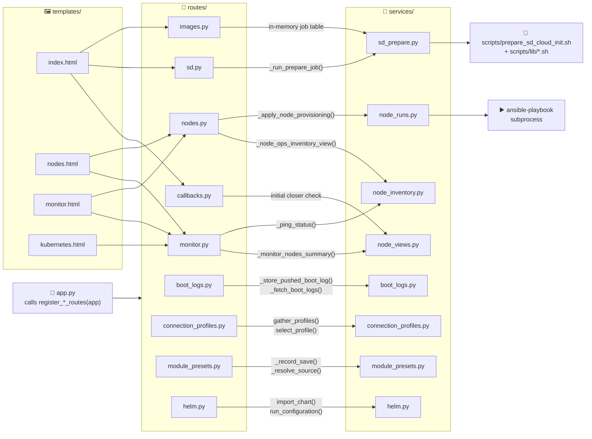
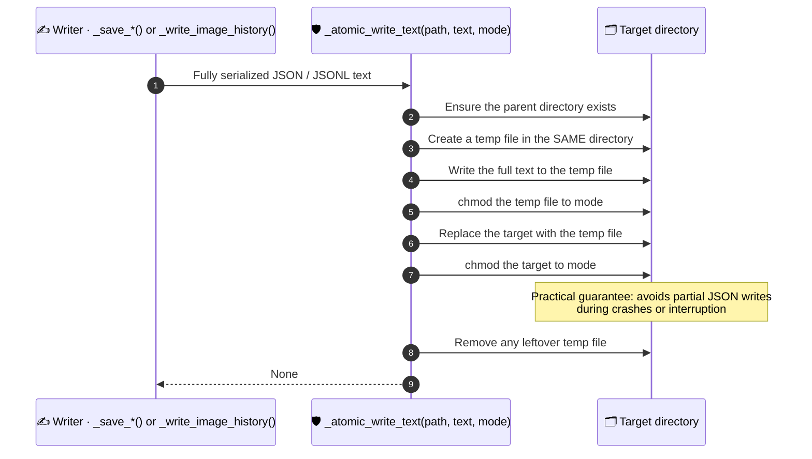

# 🧱 Callback Site Functional Prototypes and Interdependencies

> Strict developer reference: functional prototypes (inputs, outputs, side effects) for the
> callback-site app, plus the major cross-file dependencies.

| Section | What it pins down |
| --- | --- |
| [🚀 1) Runtime entry points](#1-runtime-entry-points) | Where the app, routes, services, Ansible and SD prep start |
| [🐍 2) Backend prototype contracts](#2-backend-prototype-contracts-python) | Python helper signatures, outputs, side effects |
| [🗂️ Durable state writes](#durable-state-writes-strict-atomic-persistence) | Which writers must be atomic, and how |
| [🔗 3) API route contracts](#3-api-route-contracts-flask) | Flask route modules and endpoint contracts |
| [🖼️ 4) UI interdependencies](#4-ui-interdependencies) | Which template pulls which endpoint |
| [🗂️ 5) Data and state map](#5-data-and-state-dependency-map) | Every data file, who reads it, who writes it |
| [🔌 5b) Connection profiles](#5b-connection-profiles-committed-direction-in-development) | How Node Ops picks an address (in development) |
| [🚫 6) Strict rules](#6-practical-functional-rules-strict-mode) | Rules every change must follow |
| [✅ 7) Changes addressed](#7-high-impact-overlooked-changes-addressed) | Completed work and remaining caution |

<a id="1-runtime-entry-points"></a>
## 🚀 1) Runtime Entry Points

| Entry | Location | Notes |
| --- | --- | --- |
| Flask service entry | `callback_site/app.py` | Logging, app object, route registration |
| Route modules | `callback_site/routes/` | One per area: pages, openwrt, settings, callbacks, sd, images, ssh, test_terminal, monitor, nodes, module_presets, boot_logs, connection_profiles, helm |
| Domain logic | `callback_site/services/` | See the module map in [3) API route contracts](#3-api-route-contracts-flask) |
| Ansible execution entry | `callback_site/services/node_runs.py` | Via subprocess calls to `ansible-playbook` |
| SD prep execution entry | `scripts/prepare_sd_cloud_init.sh` and `scripts/lib/*.sh` | Invoked by `callback_site/services/sd_prepare.py` |

<a id="module-route-template-dependencies"></a>
### 🧱 Module, Route and Template Dependencies

Edges show which route module serves the endpoints each template pulls (as listed in
[4) UI interdependencies](#4-ui-interdependencies)), and which service modules those routes
call. Only modules named in this document are drawn.



<a id="2-backend-prototype-contracts-python"></a>
## 🐍 2) Backend Prototype Contracts (Python)

These are the highest-impact contracts that the UI and automation flows depend on.

<a id="monitoring-and-node-summary"></a>
### 📊 Monitoring and Node Summary

```python
_monitor_nodes_summary() -> Dict[str, Any]
_node_ops_inventory_view() -> List[Dict[str, Any]]
```

| Contract | `_monitor_nodes_summary()` | `_node_ops_inventory_view()` |
| --- | --- | --- |
| Inputs | none (loads callback history and monitor config from disk) | none (reads inventory + callback + provisioning state) |
| Output | keys: `nodes`, `cloud_init_options`, `node_cloud_init` | enriched node rows for Node Ops UI |
| Side effects | none | none |
| Depends on | `callbacks.jsonl`, `node_monitor_state.json`, `node_provisioning.json` | `inventory.yml` parse, `callbacks.jsonl`, `node_provisioning.json` |

<a id="provisioning-execution"></a>
### ▶️ Provisioning Execution

```python
_apply_node_provisioning(node_name: str, profile_ids: List[str], mode: str, run_ansible: bool) -> Dict[str, Any]
_run_node_profile(
    node_name: str,
    profile: Dict[str, Any],
    mode: str,
    run_ansible: bool,
    profile_inputs: Dict[str, str],
    node_group: str | None = None,
    node_address: str | None = None,
    node_username: str | None = None,
    node_certificate: str | None = None,
) -> Dict[str, Any]
```

| Contract | `_apply_node_provisioning()` | `_run_node_profile()` |
| --- | --- | --- |
| Inputs | target node, selected profile IDs (unknown IDs are skipped), `mode` (`"check"` or `"apply"`, validated by `POST /api/nodes/provision`), `run_ansible` | node name, profile metadata, `mode`, `run_ansible`, the node's saved inputs for this profile, optional group/address/username/certificate from the Node Ops view |
| Output | keys: `node`, `mode`, `run_ansible`, `results` (one `_run_node_profile()` result per profile, in order, plus `hardware_check_trigger` in check mode) | keys: `profile_id`, `status` (`planned`, `ok`, `failed`, `timeout`, `unavailable`), `mode`, `checked_at`, `command`, `exit_code`, `inputs` (redacted), `output` (long output clipped) |
| Side effects | writes the node's results to `node_provisioning.json` (re-read under a lock first so results saved by other runs are kept); in `apply` mode stops after the first `failed`/`timeout`/`unavailable` profile | invokes `ansible-playbook` subprocess; with `run_ansible=False` runs nothing and returns `status: planned` |
| Depends on | `_run_node_profile()`, `_run_hardware_check_callback()` when `mode == "check"` and `run_ansible`, `_node_ops_inventory_view()` + `_preferred_node_connect_target()` for the address | generated inventory snippet + profile segment synthesis |

<a id="durable-state-writes-strict-atomic-persistence"></a>
### 🗂️ Durable State Writes (Strict Atomic Persistence)

All these functions now use atomic write semantics:

```python
_save_sd_option_profiles(profiles: Dict[str, Dict[str, Any]]) -> None
_save_profile_segments(segments: Dict[str, List[Dict[str, Any]]]) -> None
_save_monitor_state(state: Dict[str, Any]) -> None
_save_node_config(payload: Dict[str, Any]) -> Dict[str, Any]
_save_node_provisioning(state: Dict[str, Any]) -> None
_write_image_history(entries: List[Dict[str, Any]]) -> None
_reset_node_ops_settings() -> Dict[str, Any]  # for config/provision reset files
```

| Writer | Defined in | Target under `callback_site/data/` |
| --- | --- | --- |
| `_save_sd_option_profiles()` | `services/sd_profiles.py` | `sd_option_profiles.json` |
| `_save_profile_segments()` | `services/sd_profiles.py` | `profile_segments.json` |
| `_save_monitor_state()` | `services/node_state.py` | `node_monitor_state.json` |
| `_save_node_config()` | `services/node_state.py` | `node_monitor_config.json` |
| `_save_node_provisioning()` | `services/node_state.py` | `node_provisioning.json` |
| `_write_image_history()` | `services/images.py` | `image_download_catalog.jsonl` |
| `_reset_node_ops_settings()` | `services/node_state.py` | config/provision reset files |

**Atomic baseline helper** (`services/storage.py`):

```python
_atomic_write_text(path: Path, text: str, *, mode: int = 0o666) -> None
```

- **Contract:** write to temp file in same directory, then replace target.
- **`mode` (keyword-only):** file permissions applied to the temp file before the replace
  and to the target after it. A failed `chmod` on the target is ignored only when `mode` is
  the default `0o666`; any other `mode` raises.
- **Practical guarantee:** avoids partial JSON writes during crashes/interruption.



<a id="3-api-route-contracts-flask"></a>
## 🔗 3) API Route Contracts (Flask)

Route handlers live in `callback_site/routes/`, one module per area, each exposing a
`register_*_routes(app)` function that `app.py` calls (`routes/helm.py` does this by
registering a `helm` Blueprint):

| Route modules | Area |
| --- | --- |
| `routes/pages.py`, `routes/openwrt.py`, `routes/settings.py` | Pages and fragments, OpenWrt helpers, settings/logging/health/Tailscale |
| `routes/callbacks.py` | Cloud-init callback, events, node reports |
| `routes/sd.py`, `routes/images.py`, `routes/ssh.py` | SD prepare and devices, image library and catalog pulls, SSH keys |
| `routes/test_terminal.py`, `routes/monitor.py`, `routes/nodes.py` | Verifier terminal, hardware monitor, Node Ops |
| `routes/module_presets.py` | Saved module configurations: list, name, delete, load into a node |
| `routes/boot_logs.py` | Boot logs: node push, list, read, manual SSH pull |
| `routes/connection_profiles.py` | Connection profiles a node can be reached at, and the one the strategy picks |
| `routes/helm.py` | Helm chart configurations: import, edit, preview, deploy |

Routes call helpers in `callback_site/services/` for state and business logic:

| Helper named below | Lives in |
| --- | --- |
| `_apply_node_provisioning()` | `services/node_runs.py` |
| `_monitor_nodes_summary()` | `services/node_views.py` |
| `_ping_status()` | `services/node_inventory.py` |
| `_run_prepare_job()` | `services/sd_prepare.py` |
| `_store_pushed_boot_log()`, `_list_boot_logs()`, `_read_boot_log()`, `_fetch_boot_logs()` | `services/boot_logs.py` |
| `gather_profiles()`, `select_profile()`, `describe_route()`, `_read_node_profiles()` | `services/connection_profiles.py` |
| `_list_presets()`, `_sources()`, `_name_preset()`, `_record_save()`, `_delete_preset()`, `_resolve_source()`, `_merge_source_into_node()` | `services/module_presets.py` |
| `configurations()`, `import_chart()`, `save_configuration()`, `run_configuration()` | `services/helm.py` |

<a id="monitorapi"></a>
### 📊 Monitor/API

| Route | Contract | Depends on |
| --- | --- | --- |
| `GET /api/monitor/summary` | Returns: monitor node summary envelope | `_monitor_nodes_summary()` |
| `POST /api/cloud-init/callback` | Persists the event before queuing an initial closer check; **never waits for Ansible**. Returns: `ok`, `deduped`, `closer_job_id` (empty when no initial job was started). Initial checks share the Node Ops job runner and its status endpoint. | — |
| `GET /api/monitor/nodes/<node_name>/ping` | Returns: `ok`, `node`, `address`, `reachable`, `latency_ms`, `error`. 400 when the node has no address, 404 when it is not in the monitor summary. | `_ping_status()`, monitor node lookup |
| `POST /api/nodes/provision` | Starts provisioning/check operation and returns a job id. Missing target nodes/profiles fail explicitly; completed per-node results remain available if a later target fails. | `_apply_node_provisioning()` job worker wrapper |

<a id="sdapi"></a>
### 💾 SD/API

| Route | Contract | Depends on |
| --- | --- | --- |
| `POST /api/sd/prepare` | Starts SD preparation background job | `_run_prepare_job()` -> `scripts/prepare_sd_cloud_init.sh` |
| `GET /api/sd/catalog-pull/jobs/<job_id>` | Returns async image-catalog pull job state | in-memory job table + persisted image history where needed |

<a id="boot-logsapi"></a>
### 📜 Boot Logs/API

`routes/boot_logs.py`. Node names and log IDs are checked with `_safe_name()`; an invalid
one returns 400.

| Route | Contract | Depends on |
| --- | --- | --- |
| `GET /api/nodes/boot-log-hosts` | Returns: `ok`, `hosts` (`name`, `archived`), drawn from the Node Ops view, the archive registry and existing `boot_logs/` folders | `_node_ops_inventory_view()`, `archived_nodes()`, `BOOT_LOGS_DIR` |
| `POST /api/cloud-init/boot-log` | Node push. Requires `hostname` and a non-empty `log` (400); a `log` over 2,000,000 characters returns 413. Optional `stage` (40 chars kept) and `instance_id` (120 chars kept). Returns: `ok`, `id` | `_store_pushed_boot_log()` |
| `GET /api/nodes/<node_name>/boot-logs` | Returns: `ok`, `logs` | `_list_boot_logs()` |
| `GET /api/nodes/<node_name>/boot-logs/<log_id>` | Returns: `ok`, `text`; 404 when the log is not found | `_read_boot_log()` |
| `POST /api/nodes/<node_name>/boot-logs/fetch` | Manual SSH pull. 409 for an archived node (restore it in Settings first). Optional `route_id` must be a non-empty string (400). Returns: `ok` (true only when the pull status is `ok`), `log` | `_fetch_boot_logs(node_name, trigger="manual", route_id=...)` |

<a id="connection-profilesapi"></a>
### 🔌 Connection Profiles/API

`routes/connection_profiles.py`. See [5b) Connection profiles](#5b-connection-profiles-committed-direction-in-development).

| Route | Contract | Depends on |
| --- | --- | --- |
| `GET /api/nodes/<node_name>/connection-profiles` | 400 for an invalid name, 404 when the node is not in the Node Ops view. `?routes=1` adds a `route` to each candidate (looked up once per address). Returns: `ok`, `strategy`, `strategies`, `selected` (chosen profile id, or empty), `candidates`, `stored` | `gather_profiles()`, `select_profile()`, `describe_route()`, `_read_node_profiles()`, `_node_ops_inventory_view()` |

<a id="module-presetsapi"></a>
### 🧩 Module Presets/API

`routes/module_presets.py`. Where `node` and `module` are required, an unknown module
returns 400 and a node outside the active node set returns 404.

| Route | Contract | Depends on |
| --- | --- | --- |
| `GET /api/nodes/module-presets?module=<id>&node=<name>` | Returns: `ok`, `module`, `presets`, `sources` (excluding `node`) | `_list_presets()`, `_sources()` |
| `POST /api/nodes/module-presets` | With `id`: renames that saved configuration. Without `id`: requires `node` and `module` and saves the node's stored inputs for that module (400 when nothing is saved yet); a blank `name` keeps the suggested name. Returns: `ok`, `name`, `id`; 404 when the configuration is not found | `_name_preset()`, `_record_save()`, `_load_node_provisioning()` |
| `DELETE /api/nodes/module-presets/<preset_id>` | Returns: `ok`; 404 when not found | `_delete_preset()` |
| `POST /api/nodes/module-presets/load` | Requires `node`, `module`, `source`. Merges the source's values into the node's inputs, validates them (400 with the joined problems), adds the module to the node's selected profiles if missing, then saves. 404 when the source no longer has settings for the module. Returns: `ok`, `node`, `module`, `label`, `filled` | `_resolve_source()`, `_merge_source_into_node()`, `_longform_input_errors()`, `_effective_node_profiles()`, `_save_node_provisioning()`, `_record_save()` |

<a id="helmapi"></a>
### ⎈ Helm/API

`routes/helm.py`. One handler serves every route. Non-GET routes require a JSON object body
(400). Errors map to 400 (invalid input), 404 (unknown record or operation) and 502 (Helm or
command failure).

| Route | Contract | Depends on |
| --- | --- | --- |
| `GET /api/helm/configurations` | Returns: `ok`, `configurations`, `examples` | `configurations()`, `EXAMPLES` |
| `POST /api/helm/configurations/import` | Returns: `ok`, `configuration` | `import_chart()` |
| `PUT /api/helm/configurations/<record_id>` | Returns: `ok`, `configuration` | `save_configuration()` |
| `POST /api/helm/configurations/<record_id>/<action>` | `action` is `preview` or `deploy`; anything else returns 404. `deploy` requires `"confirm": true` (400 otherwise). `revision` must match the saved record (400 when it changed). Returns: `ok` plus `manifest` (preview, from `helm template`) or `configuration` (deploy, after `helm upgrade --install`) | `run_configuration(record_id, revision, deploy=...)` |

<a id="4-ui-interdependencies"></a>
## 🖼️ 4) UI Interdependencies

<a id="callback_sitetemplatesindexhtml"></a>
### 🏠 callback_site/templates/index.html

Home dashboard and SD preparation orchestration. Pulls from:

- `/api/cloud-init/events`
- `/api/sd/catalog-pull` and job status endpoint
- `/api/sd/options-profiles`
- `/api/sd/images` CRUD endpoints

<a id="callback_sitetemplatesnodeshtml"></a>
### 🎛️ callback_site/templates/nodes.html

Node Ops workflow and provisioning launch. Pulls from:

- `/api/nodes/summary`
- `/api/nodes/profiles`
- `/api/nodes/node-inputs`
- `/api/nodes/live-config` (selecting a module reads its current settings from the node
  over SSH)
- `/api/nodes/provision` and `/api/nodes/provision/jobs/<job_id>`

> [!NOTE]
> 🐄 Optional node profiles can add storage-oriented behavior such as Longhorn. The
> first-pass implementation assumes Pi 5 nodes still boot from SD card, but the Longhorn
> storage path remains configurable so future NVMe-backed data paths can be swapped in
> without changing the operator flow.

<a id="callback_sitetemplatesmonitorhtml"></a>
### 📊 callback_site/templates/monitor.html

Monitoring and close-check controls. Pulls from:

- `/api/state/source-of-truth`
- `/api/monitor/nodes/<node>/ping`
- `/api/nodes/provision` and job status endpoint for check-closer actions

<a id="callback_sitetemplateskuberneteshtml"></a>
### ☸️ callback_site/templates/kubernetes.html

Kubernetes runtime and cluster snapshot page. Pulls from:

- `/api/kubernetes/summary`

The summary now includes a Longhorn readiness signal based on the `longhorn-system`
namespace and pods so operators can confirm whether storage automation is present and
healthy.

<a id="5-data-and-state-dependency-map"></a>
## 🗂️ 5) Data and State Dependency Map

```mermaid
flowchart LR
  subgraph writers["✍️ Writers"]
    cbapi["📡 POST /api/cloud-init/callback"]
    applyw["_apply_node_provisioning()<br/>_save_node_provisioning()"]
    mstw["_save_monitor_state()"]
    mcfw["_save_node_config()"]
    sdpw["_save_sd_option_profiles()"]
    imgw["_write_image_history() · atomic<br/>_append_image_history() · append"]
  end
  subgraph files["🗂️ callback_site/data/"]
    cbs["callbacks.jsonl"]
    prov["node_provisioning.json"]
    mst["node_monitor_state.json"]
    mcf["node_monitor_config.json"]
    sdp["sd_option_profiles.json"]
    cat["image_download_catalog.jsonl"]
  end
  inv["📄 inventory.yml"]
  subgraph readers["📖 Readers"]
    msum["_monitor_nodes_summary()"]
    nview["_node_ops_inventory_view()"]
    homev["🏠 Home / Images views"]
    sdflow["💾 SD and provisioning flows"]
  end
  cbapi -- "persist event first" --> cbs
  applyw --> prov
  mstw --> mst
  mcfw --> mcf
  sdpw --> sdp
  imgw --> cat
  cbs --> msum
  mst --> msum
  prov --> msum
  cbs --> nview
  prov --> nview
  inv --> nview
  cat --> homev
  sdp --> sdflow
```



| File (under `callback_site/data/`) | Holds | Read / written by |
| --- | --- | --- |
| `callbacks.jsonl` | Source of truth for cloud-init callback timeline and profile backfill | Read by monitor and node summary builders |
| `node_provisioning.json` | Node configs, selected profiles, per-node inputs, latest run results | Read/write path touches nodes + monitor contexts |
| `node_monitor_state.json` | Managed monitor-node metadata and cloud-init option definitions | Written by `_save_monitor_state()`; read by `_monitor_nodes_summary()` |
| `node_monitor_config.json` | Global node operation auth/webhook settings | Written by `_save_node_config()` |
| `image_download_catalog.jsonl` | SD image pull history | Used in Home/Images views |
| `sd_option_profiles.json` | Optional cloud-init profile templates | Referenced in SD and provisioning flows |
| `connection_profiles.json` | Every connection profile seen per node (callback, inventory, tailnet, dns, hostname) with first/last seen and reachability | Written by the monitor poll; read by `GET /api/nodes/<node>/connection-profiles` |

<details><summary>📚 Reference: boot logs, archive registry and SD profile sessions</summary>

**`callback_site/data/boot_logs/<node>/`**

- Last 10 boot logs per node, pulled over SSH or pushed by the node.
- Viewer is below provisioning output in Node Ops; archived hosts retain read-only log
  access.
- Node selection collects via the preferred route; route selection collects via that
  profile's address/user/key/port.
- Stored-log selection reads history without SSH; stale responses from earlier selections
  do not replace the current view.

**`callback_site/data/archived_nodes.json`**

- Explicit archive/restore registry. Archive on the newest callback, restore in Settings.
- Active node lists omit archived hostname/FQDN aliases; history and cluster resources
  remain untouched.
- Later callbacks are stored but do not restore the node or schedule automatic SSH work.
- Payload inspector is nested at the bottom of the callback dashboard, collapsed until
  selected.

**`callback_site/data/sd_profile_sessions/`**

- Browser-session cookie shared by tabs selects the cloud-init template and loaded website
  SSH key.
- Reload repopulates optional settings; saved credential fields are masked, replaced
  explicitly, or removed by clearing and saving.
- 🔐 Credentials remain in private mode-0600 files, separate from public templates and job
  records, and resolve before preparation validation.
- Session restoration never selects a device, flashes a card or runs a remote task.

</details>

<a id="5b-connection-profiles-committed-direction-in-development"></a>
## 🔌 5b) Connection Profiles (committed direction, in development)

How Node Ops reaches a node is a replaceable strategy, not a hard-coded rule:

- `services/connection_profiles.py` gathers a list of profiles per node (callback,
  inventory, tailnet IP, tailnet FQDN, dns, hostname), then a strategy picks one.
  `prefer_tailnet` (default, IP before FQDN), `prefer_fqdn` and `lan_first` exist; add one
  with `register_strategy(name, fn)` and select it with `CALLBACK_CONNECTION_STRATEGY`.
- The tailnet FQDN comes from `tailscale status --json` (MagicDNS name) and is marked usable
  only when this host resolves it; tailnet profiles also carry `fqdn` so HTTPS can use the
  name a Tailscale certificate is issued for.
- `_preferred_node_connect_target` in `services/network.py` is now a thin wrapper, so
  existing callers keep working.

> [!NOTE]
> 🚧 **Next steps, all planned:** HTTPS through Tailscale certificates
> (`tailscale cert <fqdn>`, a `scheme` on profiles, the site and node services served over
> TLS); callers (Ansible runs, hardware check, boot logs, terminal) take the whole profile
> (user, port, key) instead of only an address; per-node pinned profile; try the next
> profile when one fails; a Node Ops view to inspect and edit profiles; more transports
> (Tailscale SSH, bastion).

<a id="6-practical-functional-rules-strict-mode"></a>
## 🚫 6) Practical Functional Rules (Strict Mode)

> [!IMPORTANT]
> - Read functions should not mutate persisted state.
> - Write functions for JSON/JSONL state must use `_atomic_write_text`.
> - API handlers should keep validation at the boundary and return explicit status fields.
> - Background jobs must report terminal states with enough context for UI polling to show
>   actionable errors.

<a id="7-high-impact-overlooked-changes-addressed"></a>
## ✅ 7) High-Impact Overlooked Changes Addressed

Completed in this pass:

- ✅ Unified persistence writes for key state files to atomic replacement semantics.
- ✅ Removed partial-write risk from image history rewrites.

> [!WARNING]
> **Remaining caution:** append-only writes (`_append_image_history`) are intentionally
> append-based; if stricter durability is required, switch to write-lock +
> read/merge/atomic-write pattern.

➡️ **Next:** [📡 Operator guide](../callback_site/README.md) ·
[☸️ Rack cluster runbook](rack-cluster-runbook.md) ·
[🧭 SOHO rack vision](soho-rack-vision.md) · [🏠 Repository README](../README.md)
