# ☸️ Rack Cluster Runbook

> K3s rack bring-up and operations: hardware, known-good values, join order, provisioning,
> Tailscale policy and Node Ops. Commands, flags, IPs and versions here are load-bearing —
> copy them exactly.

<a id="runbook-map"></a>
## 🗺️ Runbook Map

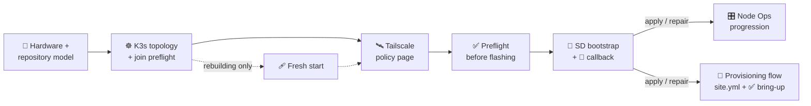

| I want to… | Go to |
| --- | --- |
| See the hardware and which roles each board allows | [🥧 Current hardware](#current-hardware-snapshot) |
| Understand call-home after power loss or an IP change | [🩹 Power-restore / IP change](#power-restore--ip-change-note) |
| Map inventory groups to Ansible roles | [🗺️ Repository model](#repository-model) |
| Join or recover a K3s server safely | [☸️ K3s topology and join preflight](#k3s-topology-and-join-preflight) |
| Copy the current endpoint, tags and encryption setting | [📌 Known-good values](#known-good-current-values) |
| Pick a node role | [🥧 Node roles](#node-roles-all-boards) |
| Rebuild the control plane | [🩹 Fresh start](#fresh-start-rebuild-the-control-plane) |
| Flash a card and watch it call home | [📡 SD bootstrap + callback](#sd-bootstrap--callback-recommended) |
| Generate the tailnet policy | [🛰️ Tailscale policy page](#tailscale-policy-page) |
| Configure a live node from the portal | [🎛️ Node Ops progression](#node-ops-progression) |
| Add a new node with Ansible | [✅ Bring-up checklist](#bring-up-checklist-for-new-nodes) |

<a id="current-hardware-snapshot"></a>
## 🥧 Current Hardware Snapshot

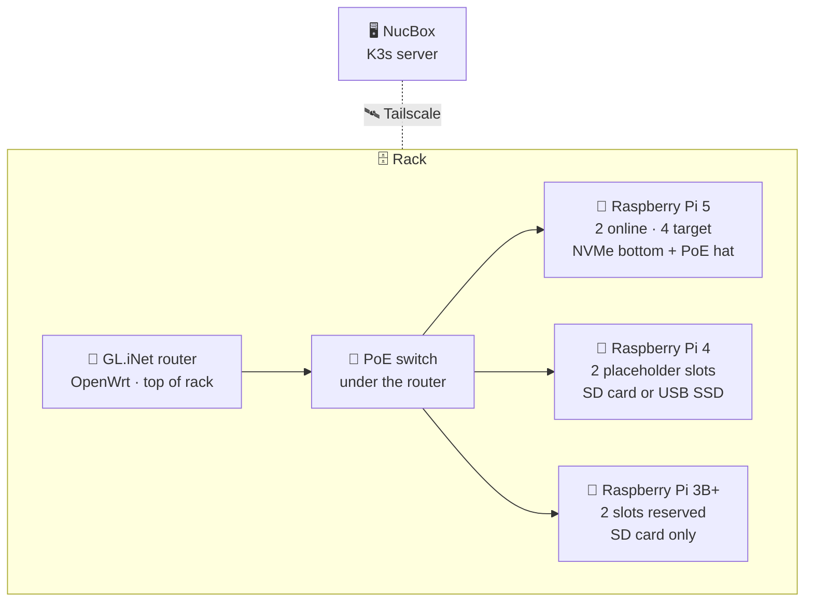

| Board | Slots | Image / storage | Selectable roles (**default** first) |
| --- | --- | --- | --- |
| 🥧 Pi 5 | 2 online, 4 target | NVMe bottom + PoE hat | **`worker`**, `control-plane`, `utility` (no Kubernetes) |
| 🥧 Pi 4 | 2 placeholders in `inventory.yml` | 64-bit image from SD card or USB SSD | **`worker`**, `control-plane` (boot from an SSD, see [K3s](#k3s-topology-and-join-preflight)), `utility` (no Kubernetes) |
| 🥧 Pi 3B+ | 2 reserved | 64-bit image, SD-card storage only | **`light-worker`** (a tainted K3s agent), `utility` (no Kubernetes), `control-plane` (⚠️ not recommended, see [K3s](#k3s-topology-and-join-preflight)) |

> [!NOTE]
> Pi 4 slots are placeholders: replace `CHANGE_ME_RPI4_*` in `inventory.yml` with real
> addresses. RAM and storage vary per unit.

<a id="power-restore--ip-change-note"></a>
## 🩹 Power-Restore / IP-Change Note

Every device provisioned by this workflow tries to call home again on every boot or power
restoration, through a persistent local systemd callback.

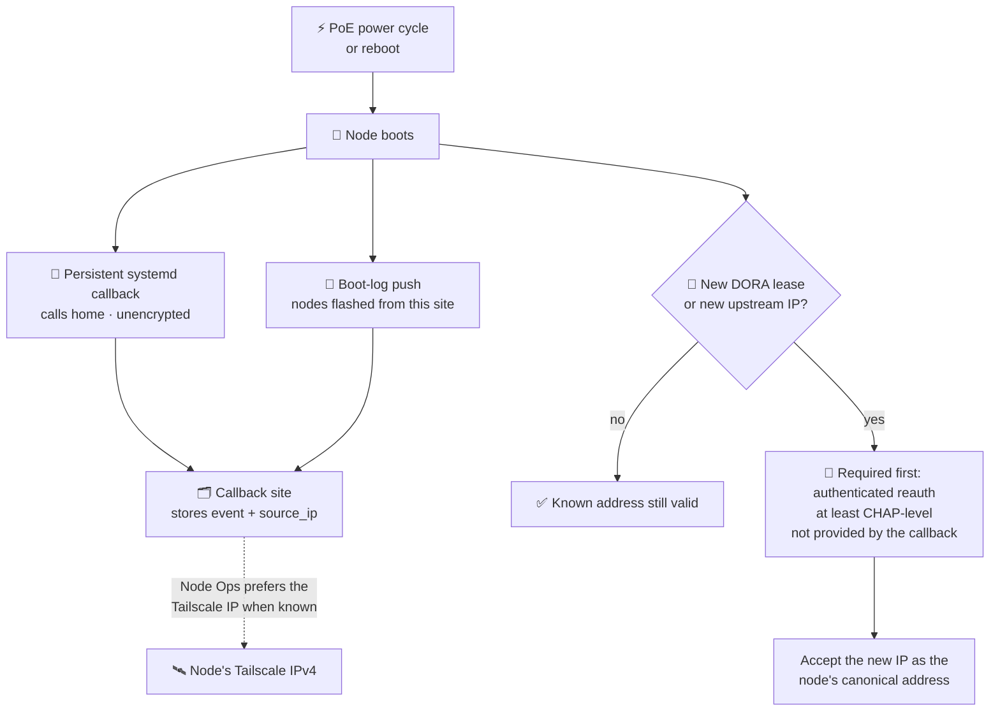

> [!WARNING]
> The callback is intentionally simple and **unencrypted** for now. When a PoE power cycle
> causes a different DORA lease or a new upstream IP, at least CHAP-level reauthentication
> is still needed before accepting that new IP as the node's canonical address. DHCP can
> change the TCP/IP endpoint, but the identity update still needs an authenticated reauth
> step to avoid stale or wrong lease data.

<a id="repository-model"></a>
## 🗺️ Repository Model

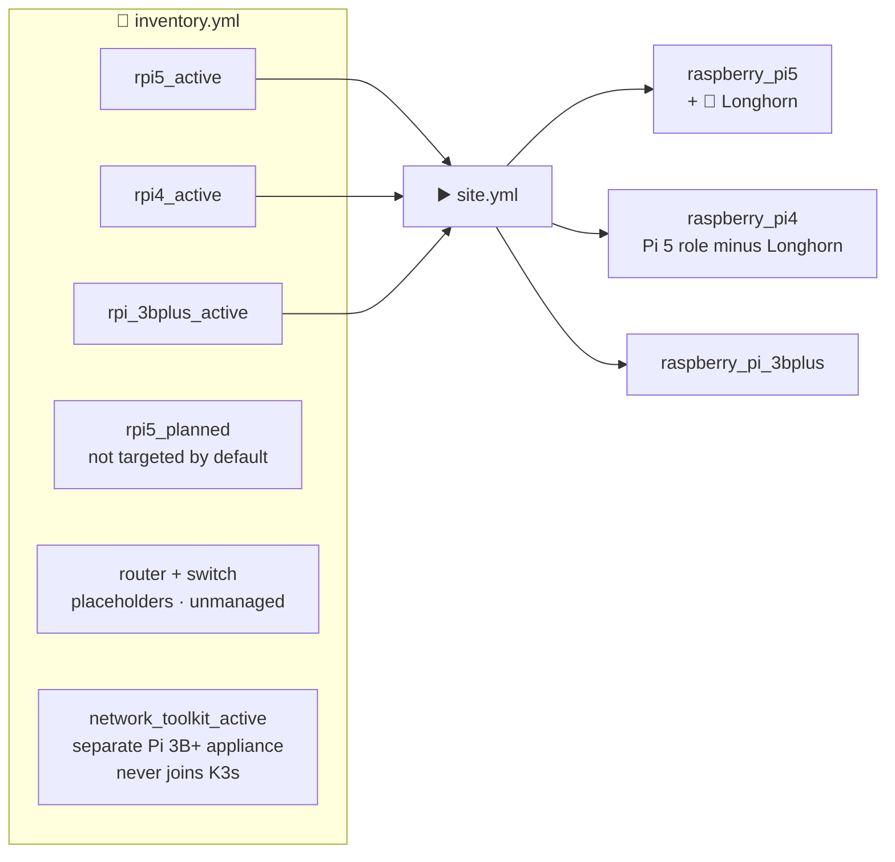

- **Active hosts** are in `rpi5_active`, `rpi4_active` and `rpi_3bplus_active` and are
  targeted by `site.yml` (roles `raspberry_pi5`, `raspberry_pi4`, `raspberry_pi_3bplus`).
  The Pi 4 role is the Pi 5 role without the Longhorn tasks; Longhorn stays Pi 5 only.
- **Planned hosts** are tracked in `rpi5_planned` but not targeted by default.
- **Router and switch** are infrastructure placeholders in inventory, marked unmanaged.

> [!NOTE]
> 🧰 **`network_toolkit_active`** is a separate Pi 3B+ appliance class: Wi-Fi uplink,
> device-only Ethernet, USB serial tools and an authenticated browser terminal. It uses
> Pi OS Trixie Lite 64-bit and does **not** join K3s. Its defaults are Baseline, Tailscale
> and Network Toolkit, and its sole tag is `tag:network-toolkit`. **Public Funnel access is
> opt-in**, not enabled merely by installing Tailscale. See
> [Network Toolkit setup and access](../callback_site/README.md#network-toolkit-pi-3b)
> for required credentials, tailnet policy, device commands and safe shutdown.

<a id="k3s-topology-and-join-preflight"></a>
## ☸️ K3s Topology And Join Preflight

The NucBox is the K3s server. Every other node reaches it over Tailscale.

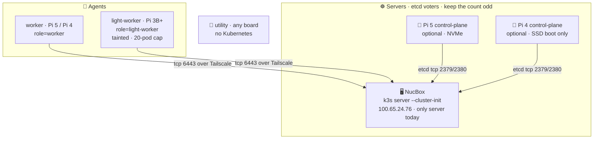

| Board | Default | Why |
| --- | --- | --- |
| 🥧 Pi 5 | `worker` | Can be made `control-plane`: NVMe storage and more RAM make it a far better etcd voter than a Pi 3B+. The NucBox plus two control-plane Pi 5 makes three servers, the odd count etcd wants. |
| 🥧 Pi 4 | `worker` | Behaves like a Pi 5 here (control-plane selectable, same option defaults). K3s documents that SD cards and eMMC cannot handle etcd's IO, so only make a Pi 4 control-plane when it boots from an SSD; consider the lightweight server options on a 1 to 2 GB model. |
| 🥧 Pi 3B+ | `light-worker` | About 900 MB of RAM and an SD card, below the 2 GB K3s documents for a server. Two of them as etcd voters took the cluster down twice. Control-plane stays selectable but is **not recommended**. |

<a id="join-preflight-checklist"></a>
### ✅ Join Preflight Checklist

- 🛰️ **Addresses.** Use the NucBox Tailscale address for the API endpoint and each node's
  own Tailscale IPv4 as `node-ip`/`advertise-address`. The LAN route may be NATed through
  `192.168.174.1`; etcd peer TLS identity is IP-sensitive, so **do not advertise that NAT
  address**.
- 🔌 **Ports.** Permit TCP 6443 to the API server and TCP 2379/2380 between control-plane
  peers over the selected path. Confirm `nc -z <peer-ip> 2380` in **both directions**
  before joining another server.
- 🔐 **Matching critical settings.** All control-plane servers must match, especially
  `secrets-encryption`. This cluster reports encryption disabled; remove an inherited
  `--secrets-encryption` systemd flag from joiners rather than enabling a different
  cluster mode.
- 🥧 **Pi 3B+ control-plane** units using `protect-kernel-defaults=true` require
  `vm.overcommit_memory=1`, `kernel.panic=10`, and `kernel.panic_on_oops=1`.
- 🏷️ **Labels.** Do not pass `node-role.kubernetes.io/control-plane` through `node-label`;
  K3s rejects that reserved label. The role uses `role=control-plane` and the standard
  control-plane taint.
- 💾 **Install, then config.** SD bootstrap installs the K3s server or agent (decided by the
  chosen role, not guessed from the config text) before Node Ops applies the complete
  structured config. Worker settings are the server endpoint, token, node IP, role label
  and the optional taint and pod cap; **do not set server-only pod/service CIDRs on agents**.
- 🧾 **Advanced config override** replaces the generated config for either family. If used,
  keep it complete: node name, join endpoint, token, node IP, role labels/taints, and any
  cluster-critical settings required by that node type.
- 🎛️ **Save before apply.** Save the endpoint, current server token, role, and node
  Tailscale IP under each node's Kubernetes module before applying. The token is sensitive
  and should remain masked in site/API views.
- 🚫 **No silent conversions.** A Pi already installed as a k3s server needs an explicit
  migration/reimage (and removal from etcd) before it can become a worker, and an installed
  agent cannot silently become a server; the module refuses both.

```bash
# Preflight: run in BOTH directions between control-plane peers
nc -z <peer-ip> 2380

# Inspect before retrying a failed control-plane join
k3s etcd-snapshot ls
etcdctl member list
```

<a id="failed-join-and-quorum-recovery"></a>
### 🩹 Failed Join And Quorum Recovery

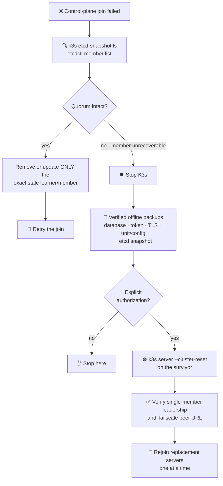

> [!CAUTION]
> Before retrying a failed control-plane join, inspect `k3s etcd-snapshot ls` and
> `etcdctl member list`. With quorum, remove or update only the exact stale learner/member;
> **do not delete a datastore or reset the cluster merely to clear a failed join.**
>
> If quorum is lost and a member cannot be recovered, first stop K3s and create verified
> offline backups of the surviving server database, token, TLS material, and unit/config,
> plus an etcd snapshot. **Only after explicit authorization**, use
> `k3s server --cluster-reset` on the survivor, verify its single-member leadership and
> Tailscale peer URL, then rejoin replacement servers one at a time.

<a id="known-good-current-values"></a>
### 📌 Known-Good Current Values

| Item | Known-good value |
| --- | --- |
| API endpoint | `https://100.65.24.76:6443` (NucBox over Tailscale) |
| Control-plane nodes | The NucBox only (`100.65.24.76`) since the 2026-11-03 `--cluster-reset`; the Pi 3B+ voters were removed |
| Node Tailscale addresses | Assigned per install: read each node's from `tailscale status` instead of reusing old ones |
| Node Ops target address | The node's Tailscale IP when one is known (callback or saved `node_ip`), ahead of any LAN or NAT address |
| Pi behind the router | `192.168.174.x`, seen as `10.255.45.243`; not reachable from the NucBox until it joins the tailnet |
| Pi 5 role | Defaults to `worker`; a Pi 5 can also be `control-plane` |
| Secrets encryption | Disabled on the NucBox; joining server units must not carry `--secrets-encryption` |
| Tailscale tags | NucBox: `tag:homelab`. Each Pi: its board tag (`tag:rpi5`, `tag:rpi4`, `tag:rpi-3bplus`) plus `tag:homelab` |

> [!IMPORTANT]
> Build the matching policy on the Tailscale ACL page (see
> [🛰️ Tailscale Policy Page](#tailscale-policy-page)). Without rules letting those tags
> reach each other on the K3s ports, a tagged node sees no peers and K3s cannot join.

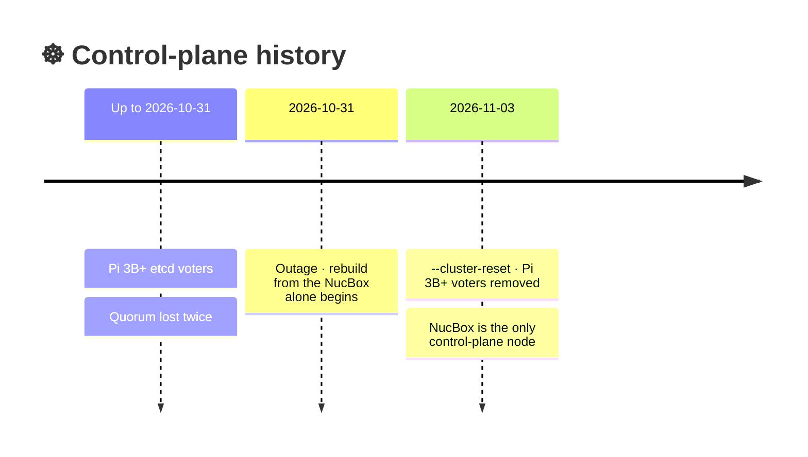

Current state (2026-10-31, after the outage): the Pi 3B+ control nodes were too small to
carry etcd reliably and quorum was lost twice. The cluster is being rebuilt from the NucBox
alone with the lightweight profile ([server options](#k3s-server-options-control-plane-role)).
The old `jd-shorty-rack-alpha-*`, `jd-shorty-rack-beta-*` and Pi 5 node records are stale
and removed by the [fresh-start script](#fresh-start-rebuild-the-control-plane).

<a id="node-roles-all-boards"></a>
### 🥧 Node Roles (all boards)

Chosen on the Home page (K3s section, once a Pi profile is selected; switching boards always
returns to that board's safe default role) or per node in Node Ops under the Kubernetes
module.

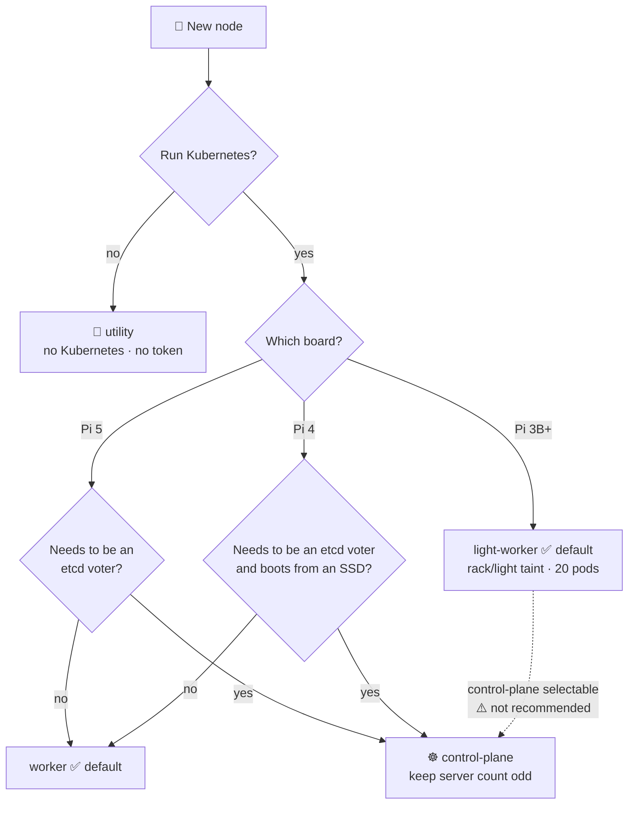

| Role | Board | What it does |
| --- | --- | --- |
| `worker` (default) | Pi 5, Pi 4 | K3s agent. Labelled `role=worker`. Optional taint `rack/dedicated=true:NoSchedule` and pod cap, both off by default. |
| `light-worker` (default) | Pi 3B+ | K3s agent: no etcd, no API server. Labelled `role=light-worker`, tainted `rack/light=true:NoSchedule` so only pods that tolerate it land there, and capped at 20 pods (K3s defaults to 110). |
| `utility` | all | No Kubernetes. Use it for Tailscale subnet routing or exit node, monitoring, DNS and similar. On the SD form this is simply the Standard distribution. In Node Ops the Kubernetes module applies nothing and needs no token. If K3s is already installed it is left as-is. |
| `control-plane` | all | K3s server and etcd voter, labelled `role=control-plane`. Taint, pod cap and the server options below are selectable. Pi 5 and Pi 4 start with all of them off, so they match the NucBox with no extra flags (a Pi 4 needs an SSD for this role). Pi 3B+ starts with the lightweight set on and the control-plane taint plus a 20-pod cap, and is not recommended. |

Every K3s role also takes the same two options: a **taint** (defaults: Pi 3B+ on, Pi 5 and
Pi 4 off) and a **pod cap** (blank means the board default). To schedule something on a
tainted node, give the pod a toleration for that role's taint and, if wanted, a
`nodeSelector` such as `role: light-worker`. A blank role is rejected, and a role the board
does not offer (for example `light-worker` on a Pi 5) is rejected with a clear message at
apply time.

> [!IMPORTANT]
> Keep the number of K3s servers **odd**. With the NucBox plus two control-plane Pi 5 there
> are three, which tolerates one failure; with two there is no fault tolerance until the
> third is in.

<a id="k3s-server-options-control-plane-role"></a>
### ☸️ K3s Server Options (control-plane role)

These trim or tune what a K3s server runs. On a Pi 3B+ they start on (the profile does not
make a 900 MB board comfortable, and embedded etcd can be slow on SD cards); on a Pi 5 they
start off.

| Option | Pi 3B+ | Pi 5 / Pi 4 | Notes |
| --- | --- | --- | --- |
| Disable ServiceLB | on | off | No svclb pods. LoadBalancer Services stay pending. |
| Disable metrics-server | on | off | No `kubectl top` or HPA. |
| Disable local-path storage | on | off | No default StorageClass. |
| Disable network policy controller | on | off | NetworkPolicy objects are not enforced. |
| Disable cloud controller | off | off | Optional. |
| Disable Helm controller | off | off | Only valid with ingress `none`, because Traefik is installed through Helm. |
| Ingress | `traefik` | `traefik` | `none` also disables Traefik. ingress-nginx is not offered: the Kubernetes project retired it in March 2026 (no releases or security fixes). |

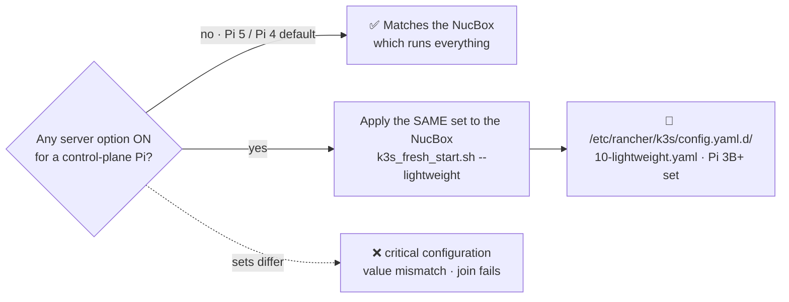

> [!WARNING]
> **Rules that bite**
> - `--disable` actively uninstalls the component from the running cluster, not just on
>   that node.
> - `servicelb`, `disable-network-policy`, `disable-helm-controller` and
>   `disable-cloud-controller` must be identical on every server or joins fail with
>   `critical configuration value mismatch`. Keep the other disables identical too, so
>   servers do not fight over redeploying manifests.
> - The NucBox runs everything, so a control-plane Pi must match it: leave the options off
>   (the Pi 5 default), or, if you turn any on, apply the same set to the NucBox, which
>   `scripts/k3s_fresh_start.sh --lightweight` writes to
>   `/etc/rancher/k3s/config.yaml.d/10-lightweight.yaml` using the Pi 3B+ set. Without
>   `--lightweight` the script leaves the NucBox's components alone.

Options only appear for the roles they apply to; options that do not apply are ignored by
the backend and the roles.

<a id="fresh-start-rebuild-the-control-plane"></a>
### 🩹 Fresh Start (rebuild the control plane)

Run on the NucBox, from the repository root, **before reflashing any Pi 3B+ node**.

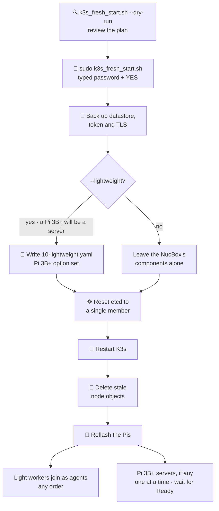

```bash
scripts/k3s_fresh_start.sh --dry-run   # 1. review the plan
sudo scripts/k3s_fresh_start.sh        # 2. typed password and YES confirmation
# Add --lightweight to step 2 ONLY if a Pi 3B+ will be a control-plane server.
```

1. `--dry-run` shows the plan without changing anything.
2. The real run backs up the datastore, token and TLS, resets etcd to a single member,
   restarts K3s and deletes the stale node objects. The token is preserved, so tokens saved
   in Node Ops stay valid.
3. Reflash the Pis. Light workers join as agents and can be brought up in any order. If you
   do run Pi 3B+ servers, join them one at a time and wait for each to be `Ready`: with two
   etcd members there is no fault tolerance until the third joins.

> [!CAUTION]
> Never reflash a control node while it is still an etcd member: removing it first is what
> keeps quorum.

<a id="four-pi-4-layout-two-control-plane-two-workers"></a>
### 🧱 Four Pi 4 Layout: Two Control-Plane, Two Workers

Target: the NucBox plus two control-plane Pi 4 make three etcd voters (tolerates one
failure), and two Pi 4 are plain workers.

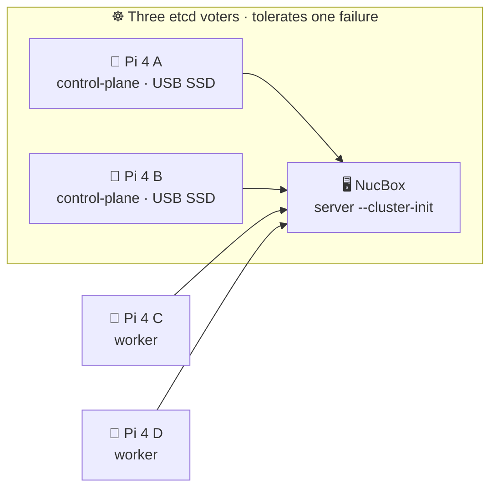

What the roles produce, checked against the NucBox (which runs
`k3s server --cluster-init --tls-san --node-ip --advertise-address` with every packaged
component on):

| Node | Config written by the role |
| --- | --- |
| ☸️ Control-plane Pi | `server` (NucBox Tailscale endpoint), `token` (server token), `node-ip` and `advertise-address` (its own Tailscale IPv4), `node-name`, `node-label: role=control-plane`, `secrets-encryption: false`. **No `cluster-init`**: only the first server has it, and the config check now rejects it on a joining node. **No `disable:` entries**, so it matches the NucBox, which is what K3s requires for servers. |
| 🥧 Worker Pi | `server`, `token`, `node-ip`, `node-name`, `node-label: role=worker`. No taint and no pod cap unless you choose them. |

Safeguards added for this layout:

| 🛡️ Safeguard | What it does |
| --- | --- |
| 💾 **SD card guard** | K3s says etcd cannot run on SD cards or eMMC, and that is what broke quorum before. A control-plane node refuses to install or apply when `/var/lib` is on an `mmcblk` device unless "Allow etcd on an SD card" is ticked (SD form and Node Ops). Boot the two control-plane Pis from a USB SSD. The check is exercised in tests with a fake `findmnt`, not on a real Pi. |
| 📌 **K3s version pin** | First boot used to install the stable channel, which can be newer than the NucBox. The SD form now installs the NucBox's own version by default (the "K3s version" box shows it); type another `vX.Y.Z+k3sN` to pin it, or `none` for the stable channel. A node should never be newer than the servers, and servers are upgraded before agents. |
| 🥧 **Raspberry Pi OS and old Ubuntu** | For a K3s image the script adds `cgroup_memory=1 cgroup_enable=memory` to `cmdline.txt` (Raspberry Pi OS needs it or K3s will not start), and adds `linux-modules-extra-raspi` on Ubuntu 21.10 to 23.10 images (22.04 needs it for flannel's VXLAN; 24.04 does not). |
| 🛰️ **Tailscale policy** | Generate it with "Pis may be K3s servers" ticked (the default): etcd uses tcp 2379-2380 between the servers. |
| 🧪 **Config check** | Flags `cluster-init` on a joiner, a missing token, and a `node-ip`/`advertise-address` outside `100.64.0.0/10` (etcd peer certificates are tied to the advertised address). |

**Order:** reset the cluster to the NucBox alone (`scripts/k3s_fresh_start.sh`), flash the
two workers (any order), then join the control-plane Pis one at a time and wait for
`etcdctl member list` to show each before starting the next.

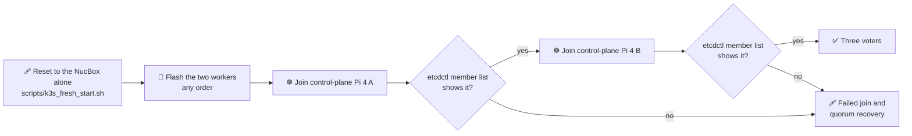

<a id="joining-a-control-plane-node-order-that-worked"></a>
### 🔁 Joining A Control-Plane Node (order that worked)

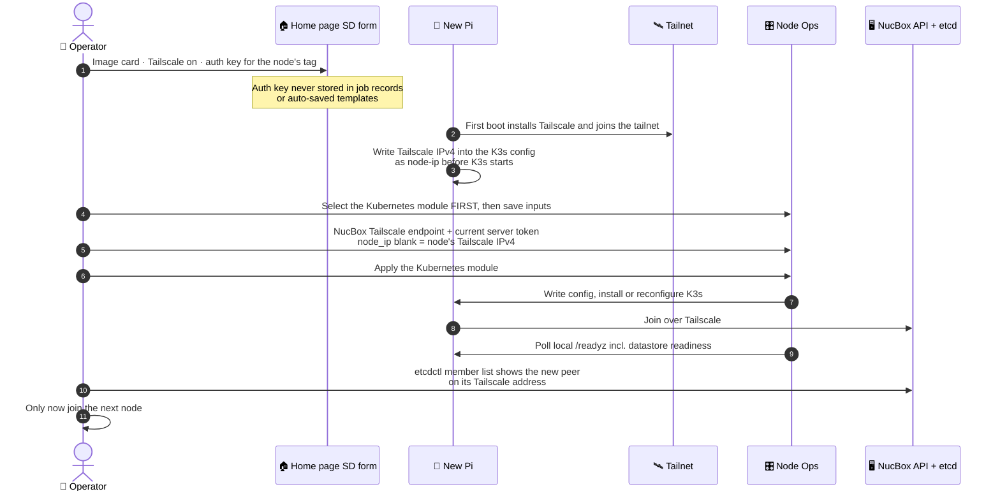

1. 💾 Image the card from the Home page with Tailscale enabled and an auth key for the
   node's tag. First boot installs Tailscale, joins the tailnet, and writes the Tailscale
   address into the K3s config as `node-ip` before K3s starts. This is fail-safe: if the
   join fails, cloud-init continues and Node Ops can finish it. The auth key is never stored
   in job records or auto-saved templates.
2. 🎛️ Select the Kubernetes module on the node first, then save its inputs. Saving inputs
   for an unselected module is ignored (the response lists it under
   `ignored_unselected_modules`).
3. 🔐 Save the NucBox Tailscale endpoint and the current server token. Leave `node_ip` blank
   to use the node's Tailscale IPv4.
4. ☸️ Apply the Kubernetes module, confirm `etcdctl member list` shows the new peer on its
   Tailscale address, then join the next node. A dry run cannot show file content, so
   confirm the written `/etc/rancher/k3s/config.yaml` is multi-line YAML before relying
   on it.
5. ⚠️ A Node Ops run that matches no hosts is reported as failed (Ansible itself exits 0 for
   it), and validation messages are no longer hidden by `no_log`.

<a id="two-pi-5s-joining-the-existing-control-plane"></a>
### ☸️ Two Pi 5s Joining The Existing Control Plane

The existing server plus two Pi 5 servers gives three embedded-etcd voters. Verify that the
existing server already uses embedded etcd; a standalone SQLite server must be migrated
before additional servers can join.

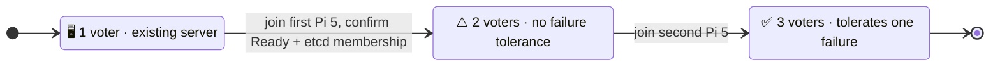

> [!CAUTION]
> Do not initialize a new cluster on either Pi or reset a healthy existing cluster for this
> expansion.

- 🔐 Use fresh Tailscale credentials and the current K3s **server** token from a private
  source. Previously exposed tokens must be rotated, not reused.
- 💾 Re-image former agents before selecting `control-plane`; Node Ops deliberately refuses
  implicit agent-to-server conversion. Remove an old server's etcd membership safely before
  reflashing it. Use SSD-backed `/var/lib`.
- 🎛️ In the web interface, select each Pi's Kubernetes module and `control-plane` role. Set
  the existing server's reachable Tailscale endpoint and server token. Leave the raw config
  override empty to use structured settings, and leave the node IP empty for automatic
  Tailscale discovery. Match the existing server's encryption and critical
  component/network settings.
- ☸️ Join one Pi at a time. The Ansible module now polls that Pi's local API `/readyz`
  (including datastore readiness) after installation or reconfiguration. It reports failure
  rather than success if readiness is not reached. Confirm node `Ready` status and etcd
  membership before starting the second Pi; there is no failure tolerance during the
  temporary two-voter stage.
- 🔁 Multi-node Apply runs process nodes serially and stop after the first failed,
  timed-out, or unavailable module. Later modules on that node and later nodes are not
  applied. The job preserves failure output for the web interface. Check mode still gathers
  results across nodes, but marks failed checks as failed; it does not run the readiness
  probe or prove that a live join works.

<a id="provisioning-flow"></a>
## 🔁 Provisioning Flow

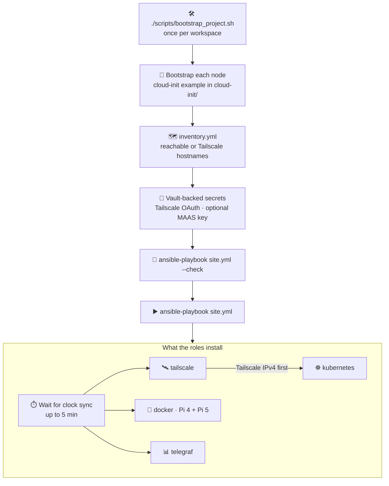

1. Bootstrap the local workspace once: `./scripts/bootstrap_project.sh`
2. Bootstrap each node with the matching cloud-init example in `cloud-init/`.
3. Set reachable hostnames or Tailscale hostnames in `inventory.yml`.
4. Add secrets to your vault-backed files (Tailscale OAuth and optional MAAS API key).
5. Run Ansible for active nodes, check mode first:

   ```bash
   ./scripts/bootstrap_project.sh                  # step 1, once
   ./.venv/bin/ansible-playbook site.yml --check
   ./.venv/bin/ansible-playbook site.yml
   ```

**What the roles install**, so a node whose first boot failed can be repaired from Node Ops
or `site.yml`:

| Role | What it does |
| --- | --- |
| ⏱️ every role | First waits (up to 5 minutes) for the clock to synchronise. A Pi has no RTC and boots on the image build date, so HTTPS installers fail with "certificate is not yet valid" and apt rejects fresh repositories until NTP catches up. A `DPkg::Lock::Timeout` drop-in and `lock_timeout` on the apt tasks make installs wait for cloud-init's own apt run. |
| 🛰️ `tailscale` | Downloads and runs the Tailscale installer when `tailscaled` is missing (download retried 5 times, install 3 times), then joins the tailnet. |
| ☸️ `kubernetes` | Creates `/etc/rancher/k3s`, writes the structured config, and installs K3s (agent for worker/light-worker, server for control-plane) when neither unit exists. The version matches the server it joins (read from `<endpoint>/version`); set `<board>_k3s_version` in `group_vars` to pin one. Join over Tailscale first: the Tailscale module must have run so the node has a Tailscale IPv4. |
| 🐳 `docker` (Pi 4 and Pi 5) | Installs `docker.io`, enables it, and writes `/etc/docker/daemon.json` only when a data root or registry mirror is entered. Existing images do not move when the data root changes. |
| 📊 `telegraf` | Installs the `telegraf` package and writes `/etc/telegraf/telegraf.conf` (root:telegraf, 0640, since it holds the token) from the Influx endpoint, bucket, org and access key — or downloads the Config URL with the token as an `Authorization: Token` header and stores the token in `/etc/default/telegraf` as `INFLUX_TOKEN` for UI-generated configs. Validates the config with `telegraf --test` before restarting the service. The token is the access key alone unless the "Influx Token Form" is `access_key:secret_key`; the first-boot script writes the same agent settings and now also restricts the file to root and the telegraf group. |

<a id="sd-bootstrap--callback-recommended"></a>
## 📡 SD Bootstrap + Callback (Recommended)

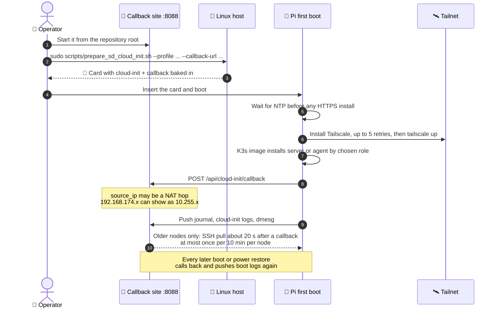

**Step 1 · 🐳 Start the callback site** from the repository root:

```powershell
# Windows with Docker Desktop
docker compose up --build -d
```

```bash
# Linux native
./scripts/bootstrap_project.sh --start-callback
```

> [!NOTE]
> On Windows, use the host's LAN IP (port 8088) for node callback URLs; localhost is only
> reachable from the host. Docker Desktop does not pass through SD-card devices, so prepare
> cards on a Linux host.

**Step 2 · 💾 Prepare an SD card** with cloud-init and the callback baked in (Pi 5 example):

```bash
chmod +x scripts/prepare_sd_cloud_init.sh
sudo scripts/prepare_sd_cloud_init.sh --profile pi5 --hostname rpi5-03 --device /dev/sdX --ssh-key-file ~/.ssh/id_ed25519.pub --callback-url http://<callback-host>:8088/api/cloud-init/callback
```

> [!CAUTION]
> `--device` is the card that gets overwritten. Replace `/dev/sdX` with the verified SD-card
> device before running.

**Step 3 · 🥧 Pi 3B+ and Pi 4.** For Pi 3B+, the default Ubuntu 24.04 ARM64 image applies
automatically (same as Pi 5), or pass `--image-url` explicitly:

```bash
sudo scripts/prepare_sd_cloud_init.sh --profile pi3bplus --hostname rpi-3bplus-01 --device /dev/sdX --ssh-key-file ~/.ssh/id_ed25519.pub --callback-url http://<callback-host>:8088/api/cloud-init/callback
```

For a Pi 4 use `--profile pi4` (same image; default Tailscale tags `tag:rpi4,tag:homelab`).

**Step 4 · 📡 Insert the SD card, boot the node, then watch callback events** at
`http://<callback-host>:8088/`.

**Step 5 · 🔌 NAT and `source_ip`.** If the callback host is reached through the router WAN
or another NAT hop, the dashboard shows that upstream address in `source_ip`. For example,
Pi LAN leases on `192.168.174.x` can still appear as `10.255.x` in callback logs when the
router NATs the request. Use the router client list for the Pi's LAN lease and the callback
dashboard for the observed request path.

<a id="called-back-but-not-on-the-tailnet"></a>
### 📜 Called Back But Not On The Tailnet

If a Pi called back but never appears in `tailscale status`, read its first-boot log.

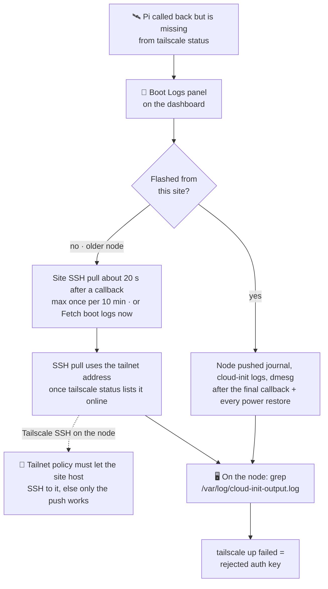

- **Boot Logs panel:** nodes flashed from this site push their journal, cloud-init logs and
  dmesg after the final callback and on every power restore. For older nodes the site tries
  an SSH pull about 20 seconds after a callback, at most once per 10 minutes per node, and
  "Fetch boot logs now" pulls on demand.
- **SSH pull needs a reachable address:** Node Ops now uses the node's tailnet address when
  `tailscale status` lists it online. If Tailscale SSH is enabled on the node, the tailnet
  policy must also allow the site host to SSH to it (error
  `tailnet policy does not permit you to SSH to this node`), otherwise only the push works.
- **On the node itself:**

  ```bash
  sudo grep -n 'rack-tailscale\|rack:' /var/log/cloud-init-output.log
  ```

  The first-boot script waits for NTP before any HTTPS install and retries the Tailscale
  install 5 times; the same log shows a rejected auth key (`tailscale up failed`).
- The NucBox cannot reach a Pi behind the router NAT (`192.168.174.x`) until it is on the
  tailnet, and Node Ops prefers a node's Tailscale address over any LAN or NAT address once
  it has one.

<a id="tailscale-policy-page"></a>
## 🛰️ Tailscale Policy Page

The Tailscale ACL page (`/tailscale-acl`) builds the rack's tailnet policy on the server
(`callback_site/tailscale_policy.py`, `POST /api/tailscale/policy`). **It never calls
Tailscale:** you paste the result into Access Controls. Tags come from the same board
registry the SD script and Ansible group_vars use, and tests fail if they drift.

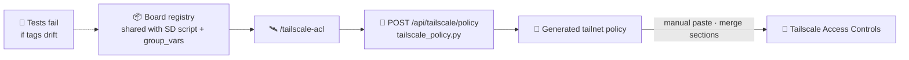

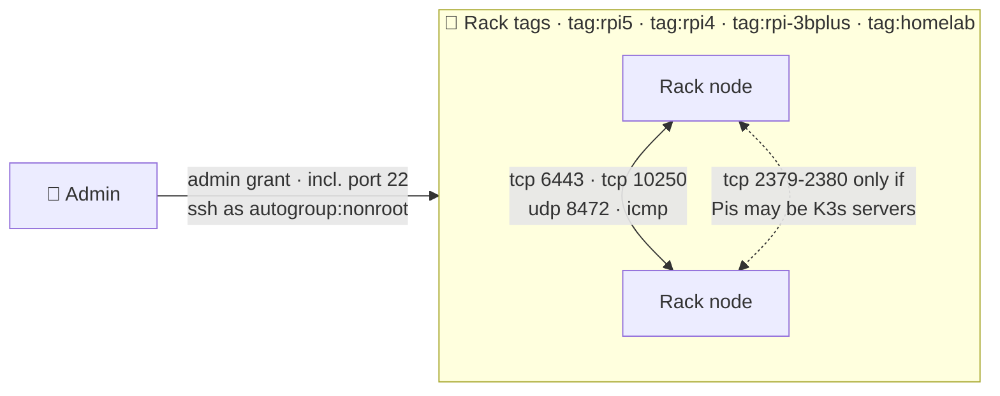

| Section | What it generates, and why |
| --- | --- |
| `tagOwners` | `tag:rpi5`, `tag:rpi4`, `tag:rpi-3bplus` and `tag:homelab`. A tag must exist here before a node can use it, and an auth key (or OAuth client) must be created with the same tags. |
| `grants` | Preferred over legacy `acls` (they can coexist). Admin to every rack tag and subnet, and rack to rack on the K3s ports only: tcp 6443 (nodes to a server), tcp 10250 (kubelet), udp 8472 (flannel VXLAN) and icmp. tcp 2379-2380 (etcd) is added only when "Pis may be K3s servers" is ticked, and `tcp:8088` (the callback site) is an editable extra. An "All ports" mode exists but is flagged. |
| `ssh` | The admin as `autogroup:nonroot` (root is an explicit opt-in). Tailscale SSH also needs a network rule to port 22, which the admin grant provides, and `tailscale up --ssh` on the node. |
| `autoApprovers` | Advertised subnets and, optionally, exit nodes. These only act when a route is first advertised; for one already advertised, stop and re-advertise it. |
| `tests` / `sshTests` | Accept assertions by default (Tailscale rejects a policy change that breaks one). Deny assertions are opt-in, because Tailscale's default allow-all grant would make them fail until it is removed. |

> [!IMPORTANT]
> **Rollout:** merge the sections rather than replacing your policy, keep the default
> allow-all grant until the rack works, then delete it.

> [!NOTE]
> The old page derived the homelab tag from the rack name, produced an ACL that let the Pis
> reach the NucBox but not the other way round (which blocks `kubectl logs` and flannel),
> and approved routes only for Pi 5. All three are fixed.

<a id="callback-site-testing"></a>
## 🧪 Callback Site Testing

- ☸️ Docker Desktop Kubernetes and saved Helm chart configurations are described in
  [the operator guide](../callback_site/README.md#docker-desktop-kubernetes-and-helm).
  The included Hello World chart can be imported, previewed and deployed into the local
  `playbook-helm` namespace without changing the rack cluster.
- 🧪 Run the local regression suite from `callback_site/`. It covers page/fragment
  rendering, image CRUD, callback event fragments, source IP precedence, and the health
  endpoint.
- 🖥️ The verifier terminal accepts only named checks (no freeform remote command input).
  Use `GET /api/test-terminal/checks` to review allowed checks.
- 🧾 Long-form blocks such as the K3s config are syntax-checked when the field loses focus
  (`POST /api/config/check`, result shown under the field) and re-checked server-side on SD
  prepare and Node Ops save, so a bad block is rejected even if the page check is skipped.
  To cover another block, add a checker to `LONGFORM_CHECKS` in
  `callback_site/services/k3s_config.py` and set `"check": "<kind>"` on its input spec.

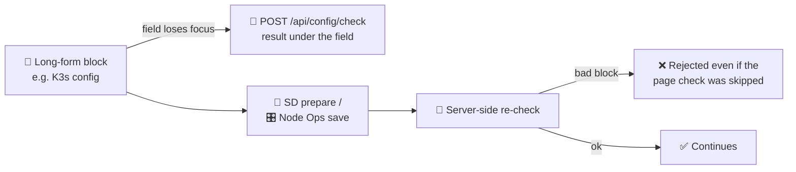

```bash
# from callback_site/
python -m unittest discover -s tests

# quick smoke checks
curl -i http://127.0.0.1:8088/
curl -s http://127.0.0.1:8088/health
curl -s http://127.0.0.1:8088/api/cloud-init/events
```

<a id="shared-state-model"></a>
## 🗂️ Shared State Model

```mermaid
flowchart LR
  cb["📡 Hardware callbacks"] --> sot["🗂️ /api/state/source-of-truth"]
  sot --> mon["📊 Hardware Monitor<br/>freshest callback-driven snapshot"]
  sot --> ops["🎛️ Node Ops<br/>same data + profiles + apply"]
  term["🖥️ Remote inventory / terminal checks<br/>one-off verification only"] -. "not a replacement" .- sot
```

- Hardware Monitor and Node Ops both read from `/api/state/source-of-truth`, so callback
  data, monitor state and node provisioning state stay aligned.
- Hardware callbacks populate the monitor view; Node Ops reuses the same callback-derived
  fields for live inventory and provisioning context.
- Use **Hardware Monitor** for the freshest callback-driven hardware snapshot; use
  **Node Ops** for the same data plus profile and apply controls.
- The remote inventory / terminal checks are for one-off verification and should not replace
  the shared state views.

<a id="preflight-before-flashing"></a>
## ✅ Preflight Before Flashing

1. ✅ Run the full callback-site validation script from the repository root:
   `python3 scripts/validate_callback_site.py`
2. ✅ Confirm hot-plug update on the Home page target device selector:
   - remove the SD card and verify the selector updates to the no-device state
   - reinsert the SD card and verify the expected `/dev/*` target reappears
3. ✅ Use the dashboard link to open the verifier terminal in a separate window and run a
   named check against a known host.
4. ✅ Confirm callback dashboard cards render long "Latest pull" values without clipping or
   overflow.

<a id="node-ops-progression"></a>
## 🎛️ Node Ops Progression

```mermaid
stateDiagram-v2
  direction LR
  state "📡 Callback events seen" as Seen
  state "🎛️ Profiles assigned" as Assigned
  state "💾 Inputs saved" as Saved
  state "🧪 Check Closer · mode=check" as Checked
  state "▶️ Apply" as Applied
  [*] --> Seen
  Seen --> Assigned: open /nodes
  Assigned --> Saved: save profile inputs
  Saved --> Checked: Check Closer
  Checked --> Saved: required values missing
  Checked --> Applied: checks look correct
  Applied --> [*]
  note right of Checked
    Plan-only checks = Ansible execution disabled
  end note
```

1. After callback events appear for a node, open `/nodes`.
2. Assign per-node configuration profiles (baseline/tailscale/telegraf/docker/kubernetes).
3. Save profile-specific inputs (for example, Telegraf endpoint/bucket/org/access key/secret
   key, Tailscale auth key/tailnet).
4. Prefer the node's current IP in Node Ops when local DNS is not available; the
   provisioning workflow uses that address to build a temporary inventory and target the
   live node directly.
5. Run "Check Closer" to validate node profile sets (`mode=check`). If required values are
   missing, fill them in, save inputs, and re-run the check.
6. Run "Apply" for optional provisioning once checks look correct.
7. For plan-only checks, disable Ansible execution in the Node Ops UI.

> [!NOTE]
> Provisioning is non-interactive: it should not hang on vault prompts, and it uses the
> bootstrap SSH identity/private key that matches the original cloud-init bootstrap.

> [!TIP]
> 📊 **Telegraf:** fill the endpoint, bucket, org and access key (the secret key is only
> needed for the `access_key:secret_key` token form), then press "Test Influx connection".
> It **writes one dummy point** with the values on screen (a blank secret field uses the
> saved secret), reports health and write results, and sets the token form to the one your
> server accepted. Save the module inputs to keep it, then Apply Module.

<a id="saved-module-configurations"></a>
### 🗂️ Saved Module Configurations

The module panel remembers its work, so a setup can be named and reapplied instead of
retyped.

```mermaid
flowchart LR
  save["💾 Save Module Inputs"] --> hist["🗂️ Per-module history<br/>30 newest unnamed kept"]
  named["🏷️ Save as named configuration<br/>name unique per module"] --> lib["📚 Saved configurations"]
  hist --> lib
  lib -- "Load" --> inputs["🎛️ Selected node's inputs"]
  lib -- "Apply" --> run["▶️ Load, then module apply"]
  draw["🔎 Draw from existing settings<br/>origin Node Ops or Provisioning dashboard"] -- "fills fields" --> inputs
```

| Feature | Behaviour |
| --- | --- |
| 💾 History | Every "Save Module Inputs" is recorded per module. Identical re-saves only refresh the time; the 30 newest unnamed saves are kept. |
| 🏷️ Named configuration | "Save as named configuration" keeps the current inputs under a name. A name is unique per module; reusing it moves the label to the newer save. Entries can be renamed or deleted. |
| 📥 Load / ▶️ Apply | **Load** fills the selected node's saved inputs from an entry; **Apply** loads it and then runs the module apply. |
| 🔎 Draw from existing settings | Lists values already enabled elsewhere, each showing the fields it would fill: other nodes' Node Ops inputs (origin "Node Ops") and SD-card option profiles from the provisioning dashboard (origin "Provisioning dashboard"). SD options map onto module fields, for example `k3s_role` to the node role and the `server:` and `token:` lines of `k3s_config` to the server endpoint and token. |

> [!IMPORTANT]
> 🔐 Secrets are stored so they can be reapplied, but the browser only ever sees
> "(secret kept)". The data lives in `callback_site/data/module_presets.json` (git-ignored)
> and is cleared by the Node Ops settings reset.

<a id="kubernetes-k8s-primer"></a>
## 🧭 Kubernetes (K8s) Primer

```mermaid
flowchart TD
  q{"Need multi-node scheduling,<br/>self-healing workloads and<br/>declarative app lifecycle at scale?"}
  q -- "no · a few homelab services" --> compose["🐳 Start with Docker / Ansible<br/>Compose is simpler to debug"]
  q -- "yes" --> slice["☸️ Stand up a small single-purpose<br/>cluster slice · one non-critical service"]
  slice --> core["Only then migrate<br/>core infrastructure"]
```

- **What it is:** a scheduler and control plane for running containerized workloads across
  multiple machines.
- **What it does for you:** keeps services running, restarts failed containers, handles
  rollouts, and can spread workloads across nodes.
- **Why people use it:** useful when you run many services across several nodes and want
  standardized deployment/operations.
- **Why it might be overkill:** if you mainly run a few homelab services, Docker Compose is
  often simpler and easier to debug.
- **Recommendation for this rack:** start with Docker/Ansible first; move to K8s only when
  you need multi-node scheduling, self-healing workloads, and declarative app lifecycle at
  scale.
- **Safe next step:** stand up a small single-purpose cluster slice (for example one
  non-critical service) before migrating core infrastructure.

<a id="maas-notes"></a>
## 🧱 MAAS Notes

- MAAS defaults are in `group_vars/all/maas.yml` and **disabled by default**.
- Set `maas_manage: true`, the MAAS API URL, and a vault-backed key when MAAS automation is
  introduced.
- Keep architecture/pool/zone mappings in `maas_role_profiles` aligned with your MAAS
  resource pools.

<a id="bring-up-checklist-for-new-nodes"></a>
## ✅ Bring-Up Checklist for New Nodes

1. ✅ Move the host from its planned group to the active group in inventory.
2. ✅ Set the node's `ansible_host` to a reachable DNS/IP/Tailscale name.
3. ✅ Validate SSH and Python availability on the node.
4. ✅ Run `site.yml` limited to that host first.
5. ✅ Run the full `site.yml` after host-level validation.

```bash
./.venv/bin/ansible-playbook site.yml --limit <hostname>   # step 4
./.venv/bin/ansible-playbook site.yml                      # step 5
```

➡️ **Next:** [🧭 SOHO rack vision](soho-rack-vision.md) ·
[📡 Operator guide](../callback_site/README.md) ·
[🧱 Functional contracts](callback_site-functional-prototypes.md) ·
[🏠 Repository README](../README.md)
