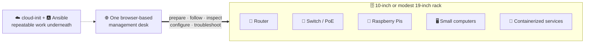
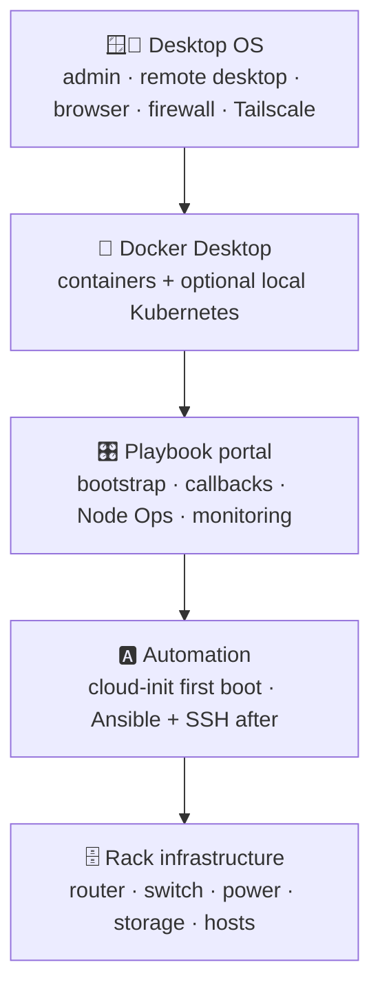
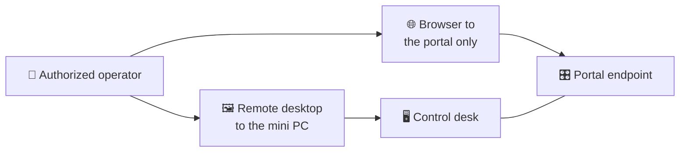
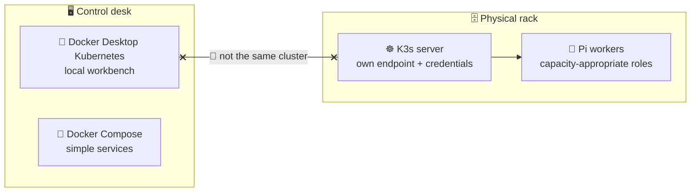
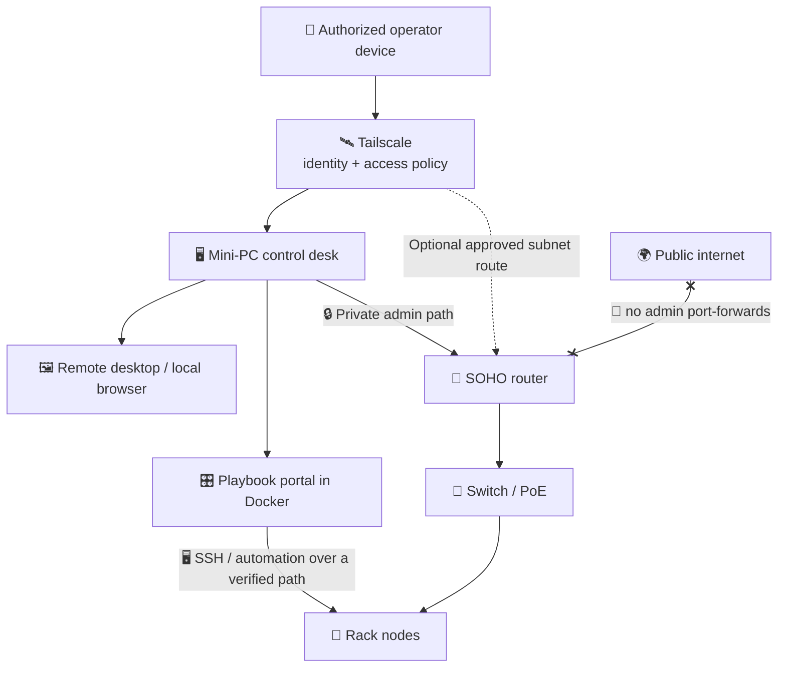
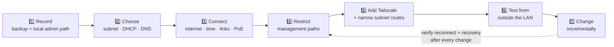
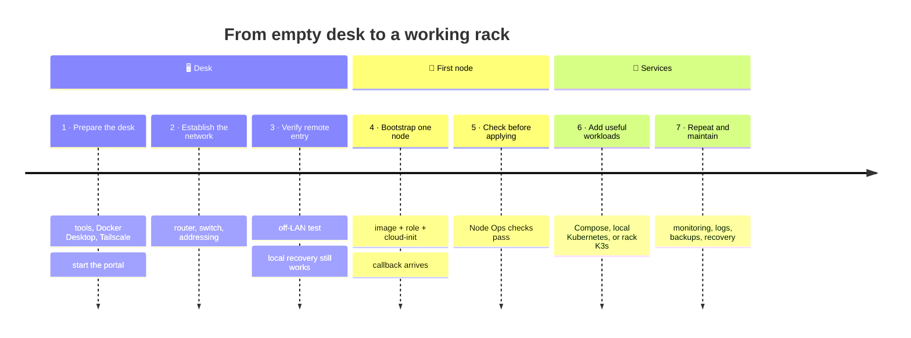

# 🧭 The SOHO Rack Vision

### One small computer. A clear interface. A private way back in.

🏠 [Project home](../README.md) · 🎛️ [Operator guide](../callback_site/README.md) ·
🥧 [Rack runbook](rack-cluster-runbook.md)

> [!NOTE]
> 🚧 **Document status: intended architecture.** This describes what Playbook is meant
> to become and how its existing pieces fit together. It does **not** claim that remote
> desktop setup, router configuration, or every hardware workflow is already automated
> or validated.

## 📑 On this page

- 🎯 [Purpose](#purpose)
- 🖥️ [The control desk](#the-control-desk)
- ☸️ [Two Kubernetes environments, two jobs](#two-kubernetes-environments-two-jobs)
- 🛰️ [Private access and the SOHO network](#private-access-and-the-soho-network)
- 🔁 [Bring-up journey](#bring-up-journey)
- 📈 [Current capabilities and remaining work](#current-capabilities-and-remaining-work)
- 🏁 [What a successful setup looks like](#what-a-successful-setup-looks-like)

---

## 🎯 Purpose

Make a small rack practical to **build, understand, and operate** — without an
enterprise management stack.

- 🏠 **Target:** a home lab, small office, or compact equipment rack.
- 🎛️ **Core experience:** a graphical management desk, not a pile of unrelated shell
  sessions.
- 🪶 **Right-sized:** small devices get small roles, and Kubernetes stays optional.
- 🙈 **No magic:** this lowers operational friction; it doesn't hide the network or
  pretend every device is interchangeable.

## 🖥️ The control desk

The anchor is a **NUC or comparable mini PC with a graphical OS**, near the rack. Use
it directly (screen, keyboard, mouse) or through an operator-configured remote desktop.

| Layer | Intended responsibility |
| --- | --- |
| 🪟 **Desktop OS** | Local administration, remote desktop, browser, host firewall, and Tailscale client. |
| 🐳 **Docker Desktop** | A graphical container-management environment and an optional local Kubernetes cluster. |
| 🎛️ **Playbook portal** | The browser interface for bootstrap, callbacks, node operations, and monitoring. |
| 🅰️ **Automation tools** | Cloud-init for first boot; Ansible and SSH for subsequent configuration and checks. |
| 🗄️ **Rack infrastructure** | Router, switch, node power, storage, and the physical service hosts. |

🪟 Windows + Docker Desktop is one documented path (with a PowerShell helper for local
Kubernetes). 🐧 Linux can host the desk too. Either way, the desktop is the host
experience and the portal runs in a container.

### 🚪 Two ways in

| Mode | Feels like | You configure |
| --- | --- | --- |
| 🖼️ **Remote desktop** | Sitting at the rack with all graphical tools | The OS's desktop-sharing service, restricted to authorized tailnet access, keeping its own authentication |
| 🌐 **Portal in a browser** | Just the dashboard, no full desktop session | An explicitly permitted private path to the published host endpoint |

> [!WARNING]
> Neither mode is provisioned automatically by this repository. A working host
> Tailscale connection also does **not** prove the portal container can discover
> tailnet peers or reach every node — test those paths separately.

## ☸️ Two Kubernetes environments, two jobs

- 🧪 **Docker Desktop Kubernetes is the local workbench.** Enable it in Docker Desktop,
  connect the portal with the documented helper, and try Kubernetes and Helm before
  touching rack workloads.
- ☸️ **K3s is the physical-rack path**, with its own server endpoint, credentials, node
  roles, and network requirements. The current runbook describes a NucBox server with
  capacity-appropriate Pi workers and optional additional servers.

| Environment | ✅ Use it for | 🚫 Do not assume |
| --- | --- | --- |
| 🧪 **Docker Desktop Kubernetes** | Local chart trials and learning on the control desk. | That it is a supported multi-machine cluster for the Pis. |
| ☸️ **Rack K3s** | Workloads scheduled onto physical rack nodes. | That joining a node is safe without role, storage, and network preflight. |
| 🐳 **Docker Compose** | Straightforward services that do not need multi-node scheduling. | That every SOHO service needs Kubernetes. |

> [!IMPORTANT]
> The workstation's management role and a K3s server role are separate decisions. They
> may share suitable hardware, but don't equate Docker Desktop's cluster with the
> rack's control plane, or rely on a desktop login session for critical infrastructure.

📚 See [local Kubernetes connection instructions](../callback_site/README.md#docker-desktop-kubernetes-and-helm)
and [rack K3s preflight](rack-cluster-runbook.md#k3s-topology-and-join-preflight).

## 🛰️ Private access and the SOHO network

The remote entry is **Tailscale, not public router port-forwards.** An authorized
operator joins the tailnet and reaches only explicitly permitted endpoints.

> [!NOTE]
> The diagram shows **desired** access relationships, not routes Playbook creates.
> Nodes can join Tailscale directly. Devices that can't need a reachable LAN path from
> the desk or an explicitly configured and approved subnet router. Advertising a route
> alone does not approve it or grant access.

### 🔌 Router and switch setup

Treat network configuration as a **deliberate, recoverable** step:

1. 💾 **Record the existing setup.** Back up the router configuration and preserve a
   local admin path before changing addressing, firewall rules, or routes.
2. 🗺️ **Choose the rack network.** Plan a non-overlapping LAN subnet, gateway, DHCP
   range, stable management addresses or reservations, and DNS.
3. 🔗 **Establish basic connectivity.** Verify internet access, DNS, time sync, switch
   links, and sufficient PoE power where applicable.
4. 🔒 **Restrict management.** Keep router administration and portal access on trusted
   management paths; permit only the necessary traffic.
5. 🛰️ **Add private remote access.** Configure Tailscale on the desk and supported nodes;
   add narrowly scoped subnet routing only if it is needed.
6. 🧪 **Test from outside the LAN.** Verify permitted access from an authorized tailnet
   device and confirm unauthorized paths remain blocked.
7. 🐢 **Change incrementally.** Verify reconnect and recovery after each network change
   before proceeding remotely.

> [!NOTE]
> OpenWrt shows up in the portal today as router Node Ops, SSH probing, and key
> onboarding. A full router configuration wizard, switch provisioning, and automatic
> network rollback are **not** implied by those features.

> [!WARNING]
> Keep public Funnel access out of the default management design. The portal is not
> meant for direct public-internet exposure, and Tailscale does not replace service
> authentication, host firewall rules, or careful credential handling.

## 🔁 Bring-up journey

| Stage | 🛠️ Operator action | ✅ Exit check |
| --- | --- | --- |
| **1. 🖥️ Prepare the desk** | Install the desktop tools, Docker Desktop, and Tailscale; start the portal. | The portal opens locally and its state persists across container recreation. |
| **2. 🔌 Establish the network** | Configure the router, switch, addressing, and management boundaries. | The desk can reach the intended device endpoints without relying on public admin ports. |
| **3. 🛰️ Verify remote entry** | Configure remote desktop and/or private portal access. | An authorized off-LAN device connects, and a local recovery path still works. |
| **4. 🥧 Bootstrap one node** | Choose the correct image and role, prepare cloud-init, and boot the device. | A callback arrives at a node-reachable host URL, not the desk's loopback address. |
| **5. 🔍 Check before applying** | Confirm identity, SSH access, saved module inputs, and intended changes. | Node Ops checks produce usable results and errors are resolved before applying. |
| **6. 🐳 Add useful workloads** | Use Compose, local Kubernetes trials, or rack K3s as appropriate. | The workload is healthy in the intended environment. |
| **7. 🔁 Repeat and maintain** | Add nodes gradually; review monitoring, logs, backups, and recovery. | Each device has a known role, access path, and recovery procedure. |

> [!CAUTION]
> 💾 **Physical SD-card access is a special case.** The default non-root Docker
> container is not a validated hardware flasher. Use the documented native Linux
> workflow or a separately verified device-access setup — don't assume a Windows card
> reader appears inside Docker.

## 📈 Current capabilities and remaining work

| Area | ✅ Available in the repository | 🚧 Intended direction / operator-owned work |
| --- | --- | --- |
| 🐳 **Portal runtime** | Docker Compose deployment with persistent application storage. | Prepare the desktop host, firewall, startup behavior, and backups. |
| 🥧 **Node lifecycle** | Pi image workflows, cloud-init, callbacks, Node Ops, monitoring, and logs. | Validate each hardware profile and bring devices online incrementally. |
| 🧪 **Local Kubernetes** | Docker Desktop kubeconfig helper and Helm workflows. | Enable the cluster and verify the connection on the chosen host. |
| ☸️ **Rack Kubernetes** | K3s roles and operational preflight in the runbook. | Choose appropriately sized servers, storage, and reachable peer paths. |
| 🛰️ **Remote access** | Tailscale-related node configuration and policy planning. | Enroll the desk, configure desktop sharing, approve rules/routes, and test access. |
| 🔌 **Router and switch** | OpenWrt SSH onboarding and infrastructure inventory placeholders. | Configure and back up the actual network; broader network automation remains future work. |

## 🏁 What a successful setup looks like

- ✅ The mini PC is usable locally and remotely as the rack's management desk.
- ✅ Docker Desktop runs the portal and provides an optional local Kubernetes workbench.
- ✅ The router and switch provide a documented, recoverable SOHO network.
- ✅ Authorized tailnet devices can reach only the management services they need.
- ✅ Nodes can report back, be inspected, and receive deliberate configuration.
- ✅ Local experiments are clearly separated from physical-rack workloads.
- ✅ A reboot, lease change, or remote-access failure has a tested recovery path.
- ✅ Persistent state, router configuration, and important workload data have
  independent backups — a Docker volume alone is not the recovery plan.

---

➡️ **Next:** 🐳 [Run the portal](../callback_site/README.md#docker-compose) ·
🥧 [Bring up rack nodes](rack-cluster-runbook.md) ·
🏠 [Back to the project overview](../README.md)
