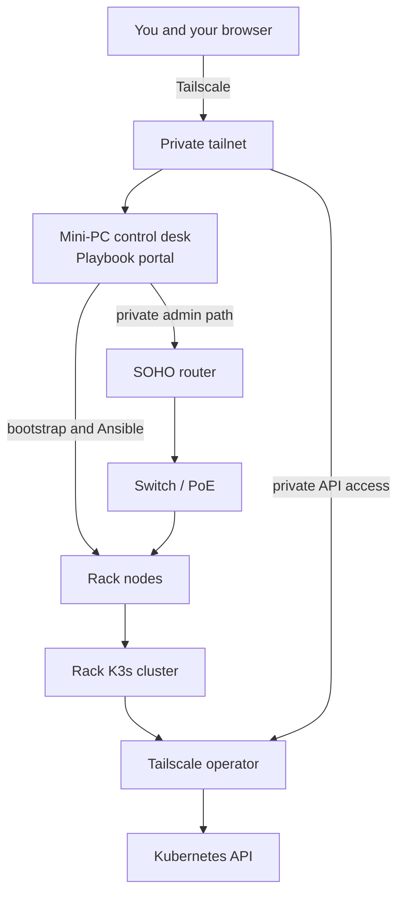

# The SOHO Rack Vision

### Small computers. Big plans. Surprisingly little YAML.

I dreamed of a day when my computers could talk to each other without making
me feel like their unpaid network therapist.

Playbook is a graphical management desk for booting machines, checking in on
them, changing what they do, and running Kubernetes when one computer just
isn't enough. Cloud-init and Ansible do the repetitive bits. The browser gives
the repetition a button.

The small version is one Pi. The big version is a rack of little computers,
each doing a job and finding its friends over Tailscale. Kubernetes is invited;
it is not mandatory.

[Project home](../README.md) · [Operator guide](../callback_site/README.md)

> **Reality check:** This is the direction, not a magic wand. Playbook helps
> manage the machines; it does not configure every router, flash every card,
> or make a broken network feel bad about itself.

## The control desk

A mini PC runs the portal. Open a browser to prepare boot media, watch new
nodes call home, inspect hardware, apply configuration, and troubleshoot.
Cloud-init gets a node started; Ansible helps it settle into a job.

Docker Compose is plenty for a simple service. Docker Desktop Kubernetes is a
local workbench. K3s is for workloads spread across the rack. Pick the amount
of orchestration that matches the amount of machine you have.

## Kubernetes, with a way back in

The desk can manage the rack, and the rack can run Kubernetes. For private
access to the Kubernetes API, the Tailscale Kubernetes operator can provide a
tailnet-connected proxy. No public API port, no forwarding a router port to the
internet, and no pretending the cluster is a single very confident Pi.

The operator is a workload in the cluster; it is not installed by drawing an
arrow on this diagram. Configure Tailscale access deliberately. Nodes that
cannot join the tailnet need a reachable LAN path or an explicitly approved
subnet route. A route advertisement is not a permission slip.

## The network, briefly

Use Tailscale for private remote access. Keep the router's admin page and the
portal off the public internet. Back up the router before changing it, and
keep a local way back in—especially before experimenting remotely. The network
is infrastructure, not a piñata.

Playbook has OpenWrt SSH onboarding, but it does not automatically configure
your router, switch, firewall, or remote desktop. Tailscale also does not
replace authentication, access rules, or backups. Security remains a group
project.

## Bring-up journey

1. **Start the desk.** Run the portal. Confirm it opens and keeps its data.
2. **Make the network boring.** Give the desk and nodes a path to each other.
   Boring is the highest compliment a network can get.
3. **Boot one node.** Prepare its image, power it on, and wait for its callback.
4. **Give it a job.** Check the hardware and access, then apply the configuration.
5. **Add Kubernetes if useful.** Try a local cluster, or build the rack K3s
   cluster. Not every container needs a committee.
6. **Back it up.** Save the router config and important data somewhere besides
   the machine that is currently having a day.

SD-card access depends on the host setup. Docker cannot read a card reader it
was never given.

## What exists today

- **Portal:** Docker Compose, persistent data, node callbacks, monitoring, and
  Node Ops.
- **Nodes:** Pi imaging and cloud-init workflows, configuration through
  Ansible, and boot logs.
- **Kubernetes:** local Docker Desktop helpers, rack K3s roles, Helm, and a
  Tailscale operator workflow.
- **Network:** Tailscale-related node setup and OpenWrt SSH onboarding.

The operator still has to prepare the host, network, access rules, and backups.
Playbook can make the computers cooperate; it has not yet negotiated with the
laws of physics.

---

**Next:** [Run the portal](../callback_site/README.md#docker-compose),
[set up Kubernetes](../callback_site/README.md#linux-k3s-and-the-kubernetes-dashboard),
or [return to the project overview](../README.md).
