# 💾 Isolated Linux flashing helper

> [!CAUTION]
> **This optional helper runs as root and overwrites whole raw block devices.** Every
> write erases all data on the selected disk. It is **host-administrator code, not a
> sandbox**. Windows-native raw disk access is not implemented.

The portal stays unprivileged. The helper only touches **explicitly allowed** disks and
accepts **neither shell commands nor arbitrary local paths**.

<a id="safety-at-a-glance"></a>
## ⚠️ Safety at a glance

| ⚠️ Rule | Details |
| --- | --- |
| Never expose the helper publicly or give its token to browsers | [Trust](#not-a-sandbox) |
| Confirm identity, size, model and serial before every write | [Discovery](#device-discovery-and-confirmation) |
| Never boot a UEFI installer USB on a machine whose data you need | [UEFI](#unattended-uefi-installation) |
| Keep UEFI installer USBs physically controlled | [After install](#after-installation) |
| Never force-delete an active helper or remove the card mid-write | [Interruptions](#interruptions) |
| Inspect logs before resubmitting after a disconnect | [Wake-up](#wake-and-expiry) |
| Treat work files and logs as sensitive | [Cleanup](#uninstall-and-cleanup) |

🗺️ [Workflows](#two-workflows) · [Architecture](#architecture) ·
[UEFI](#unattended-uefi-installation) · [API](#lifecycle-and-api) ·
[Trust](#trust-and-hardware-boundaries) · [Build](#build-and-direct-linux-use) ·
[Helm](#on-demand-helm-lifecycle)

<a id="two-workflows"></a>
## 🧭 Two workflows

> [!IMPORTANT]
> A UEFI USB installs onto a **different internal disk** when booted; it does **not**
> run the installed OS from the USB.

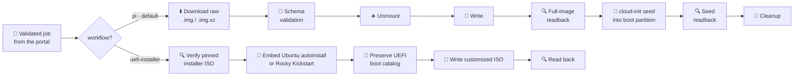

<a id="architecture"></a>
## 🧱 Architecture

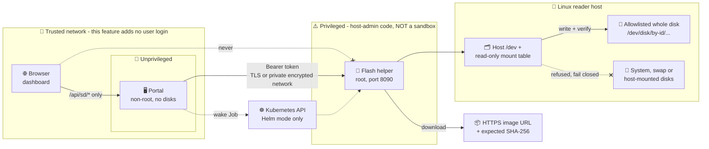

<a id="unattended-uefi-installation"></a>
## 💾 Unattended UEFI installation

> [!CAUTION]
> **Booting this USB will erase the sole eligible internal disk without another
> installation prompt.** Do not boot it on a machine whose data you need.

<a id="uefi-catalog"></a>
### 📦 Catalog

URLs and SHA-256s are pinned to upstream release checksum files.

| Distribution | x86_64 (`amd64`) | ARM64 (`aarch64`) |
| --- | :---: | :---: |
| Ubuntu Server 22.04 / 24.04 / 26.04 LTS | ✅ | ✅ |
| Rocky Linux 9 Minimal | ✅ | ✅ |
| Rocky Linux 10 Minimal | ✅ needs x86-64-v3 CPU | ✅ |

> [!WARNING]
> Architecture metadata does **not** make these images compatible with stock Raspberry
> Pi firmware. ARM targets must already support UEFI.

<a id="uefi-requests-and-authorization"></a>
### ✅ Requests and authorization

A UEFI request needs a configured Linux helper and all of:

- `profile=uefi-x86_64` or `profile=uefi-arm64`, plus the matching `catalog_id`
- `workflow=uefi-installer`
- **`install_authorized: true`**
- the existing USB `device`, `device_identity` and `confirm_device` fields

> [!IMPORTANT]
> Authorization must be explicit and fresh on **every** USB creation, separate from
> USB-device confirmation — **never** a saved template default.

<a id="uefi-install-flow"></a>
### 🔁 Install flow

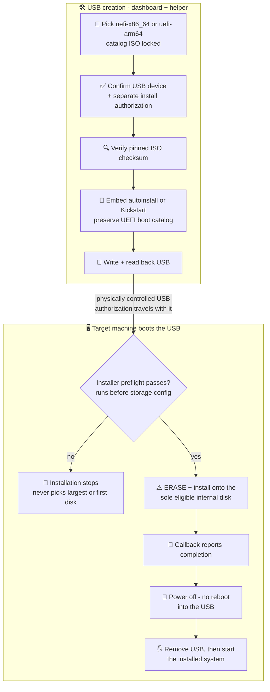

<a id="installer-preflight"></a>
### 🚫 Installer preflight

| Requirement | If not met |
| --- | --- |
| UEFI firmware | 🛑 Stop |
| Identifiable installer mounts | 🛑 Stop |
| No active mapped/RAID disks | 🛑 Rejected |
| **Exactly one** unmounted, writable, non-USB, non-removable **whole** disk of at least 16 GiB | Zero or multiple → 🛑 Stop |
| That disk has a serial or WWN | 🛑 Stop |
| No unknown media | 🛑 Stop |

> [!CAUTION]
> Existing unmounted partitions **do not protect data from erasure**. USB-attached
> destination disks and systems with multiple eligible internal disks require a future
> explicit disk-selection workflow.

<a id="installed-account-baseline"></a>
### 🔐 Installed account baseline

| Option | Value |
| --- | --- |
| Inputs | hostname, SSH public key, non-root `username` (default `rackadmin`), `timezone`, `locale`, callback URL |
| sudo | Passwordless administrative sudo |
| SSH | Key-based only; no SSH password login; no root SSH login |
| Network | DHCP and an accessible callback endpoint are **required** |

🚫 Other enabled Pi/cloud-init/K3s options are **rejected**, not silently discarded.
First-boot, Tailscale, package and K3s workflows are **not implemented** for UEFI.

<a id="after-installation"></a>
### 📴 After installation

> [!WARNING]
> - Remove the USB before starting the installed system.
> - Keep the USB physically controlled: creation-time authorization travels with it.
> - Remastering preserves upstream signed bootloader/kernel binaries but does **not**
>   promise Secure Boot compatibility on every firmware.

<a id="uefi-test-coverage"></a>
### 🧪 Test coverage

- ✅ Automated: single-disk refusal cases, generated unattended config, GRUB arguments,
  EFI boot-catalog preservation.
- 🔍 Real official x86_64 ISO remastering can be verified without disk access.

> [!WARNING]
> Complete machine boots, ARM firmware behavior and physical installs still need
> hardware/VM acceptance testing **before operational use**.

<a id="potential-next-distributions"></a>
### 📦 Potential next distributions

Debian stable, Fedora Server, openSUSE Leap/MicroOS and Alpine are candidates. Each
needs its own unattended config and boot acceptance tests; an ISO URL alone is **not**
supported provisioning.

<a id="lifecycle-and-api"></a>
## 🔁 Lifecycle and API

<a id="idle-lease"></a>
### 🔁 Idle lease

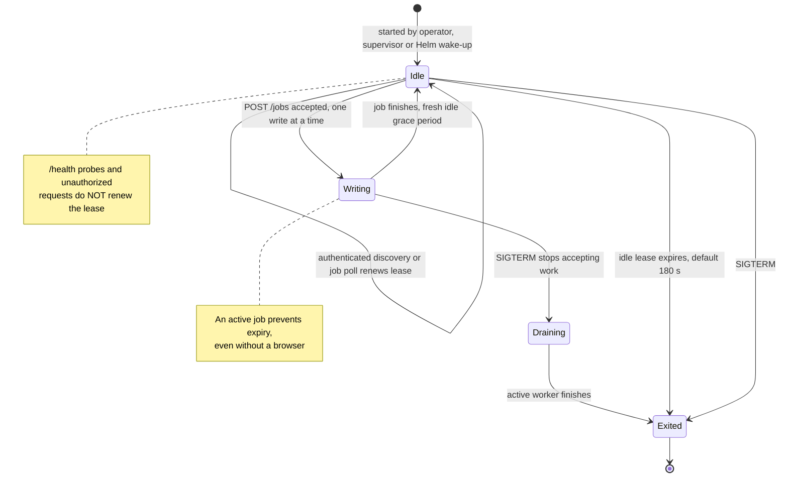

<a id="flash-job-lifecycle"></a>
### 🔁 Flash job lifecycle

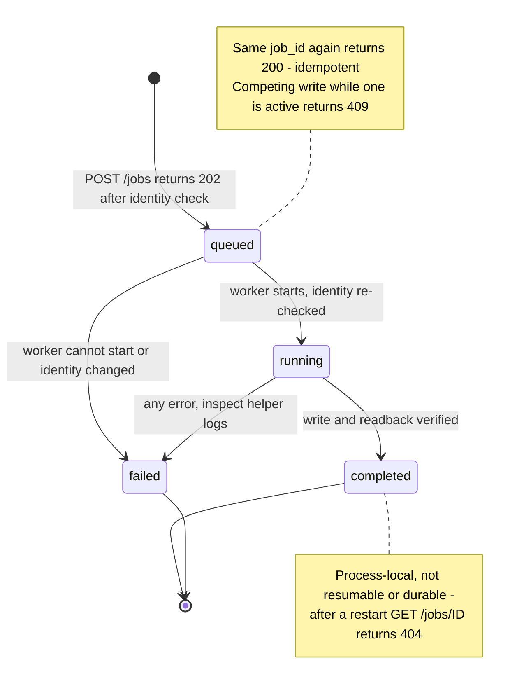

<a id="request-sequence"></a>
### 🔐 Request sequence

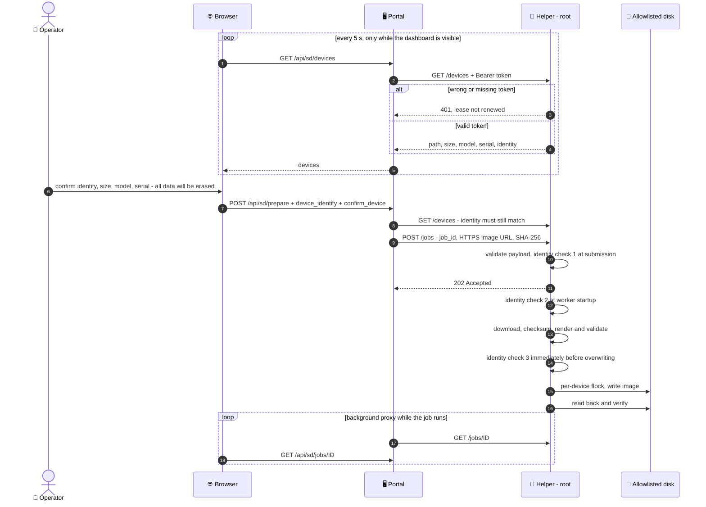

<a id="portal-api"></a>
### 🔗 Portal API

Browsers talk to the portal, never the privileged helper.

| Endpoint | Behavior |
| --- | --- |
| `GET /api/sd/backend` | `{ok, backend: "native" or "helper", discovery: "sse" or "poll"}`; no wake-up. |
| `GET /api/sd/devices` | Wakes a configured Kubernetes Job on connection failure; renews the running helper lease. Returns `{backend, devices, errors}`. Startup, authentication and discovery failures return HTTP 503 with errors, never an empty success. |
| `POST /api/sd/prepare` | Existing payload + `device_identity` and `confirm_device` (the confirmed path); UEFI adds `workflow`, `catalog_id`, `install_authorized` and a UEFI profile. Requires matching discovery identity, HTTPS image URL and expected SHA-256. No `image_file` or `workspace` override in helper mode. Job response shape unchanged. |
| `GET /api/sd/jobs`, `GET /api/sd/jobs/<id>` | Existing job API; a background proxy polls the helper while the job runs. |

<a id="device-discovery-and-confirmation"></a>
### 💾 Device discovery and confirmation

Device fields: `path` (stable `/dev/disk/by-id/...` alias), `name`, `size` (bytes),
`model`, `serial`, `transport`, `mountpoints`, opaque `identity`.

> [!CAUTION]
> Confirm identity/size/model/serial and **warn that all data will be erased**. Keep the
> selected path and identity across refreshes; if either changes, **require another
> explicit confirmation**.

- 🚫 Do not start the native SSE endpoint in helper mode (it returns 409).

<a id="helper-api"></a>
### 🔗 Helper API

The helper itself exposes **only** these endpoints. Use
`Authorization: Bearer <dedicated token>` for all non-health requests.

| Endpoint | Auth | Behavior |
| --- | :---: | --- |
| `GET /health` | ❌ | Readiness; no lease renewal. |
| `GET /devices` | 🔐 | Discovery and heartbeat. |
| `POST /jobs` | 🔐 | Validated preparation with a 32-character hex `job_id`: 202, or 200 for a duplicate ID; a competing write gets 409. |
| `GET /jobs/<id>` | 🔐 | Bounded job output/status; unknown jobs get 404. |

<a id="identity-checks"></a>
### 🛡️ Identity checks

- 🔁 Checked at submission, worker startup and **again immediately before
  overwriting**, after lengthy downloads/rendering.
- 🔒 The per-device `flock` also excludes concurrent script writers.
- 🔌 Unplug/replug changes Linux `diskseq`, even if path and serial are reused.
- 🛑 Missing identity information, unknown host mounts, system disks and swap disks
  **fail closed**.

<a id="trust-and-hardware-boundaries"></a>
## 🔐 Trust and hardware boundaries

<a id="not-a-sandbox"></a>
### 🔐 Not a sandbox

> [!CAUTION]
> **Host-administrator code, not a sandbox.** The narrow API and allowlist reduce
> accidental misuse; they cannot contain a compromised root process. **Never expose it
> publicly or give its token to browsers.**

- 🔑 The token authorizes one trusted portal, not a human login; the portal still needs
  trusted-network access controls (this adds no user login).
- 🛰️ Between hosts use TLS or a private encrypted network; plain HTTP only in-cluster
  with an enforced NetworkPolicy and a trusted network.

<a id="privileged-containers-and-rbac"></a>
### ☸️ Privileged containers and RBAC

> [!WARNING]
> Hotplug-capable container execution uses a **privileged pod** with the host's `/dev`
> and a read-only host mount table — for this optional helper only, **never** the
> dashboard.

Use a dedicated Linux reader host, explicit by-id allowlists, and a namespace permitting
privileged workloads.

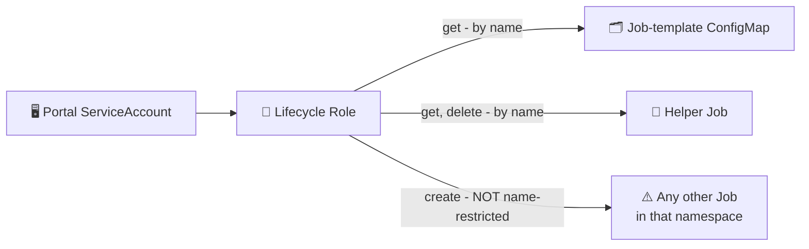

> [!IMPORTANT]
> `jobs/create` cannot be restricted by Job name or manifest: isolate that namespace and
> use admission controls if stronger separation is needed.

<a id="hardware-boundaries"></a>
### 🚫 Hardware boundaries

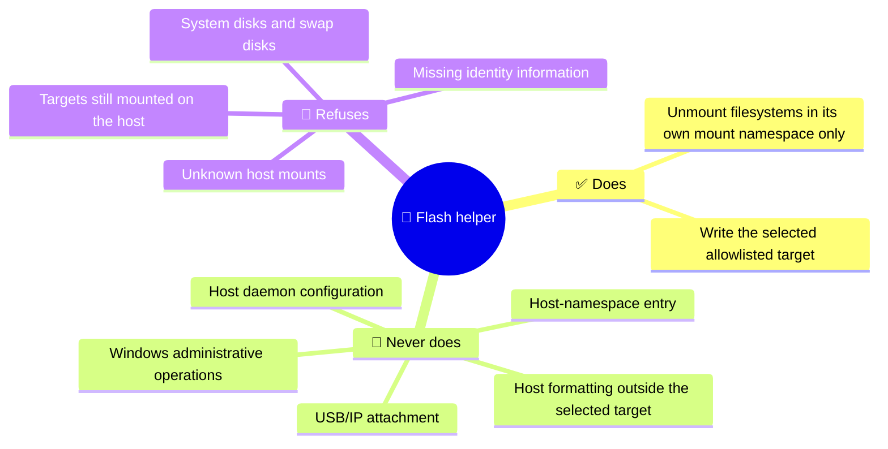

> [!WARNING]
> Unmount host-mounted target partitions **on the host** first and disable desktop
> automount for the dedicated reader. Kernels must expose
> `/sys/class/block/<disk>/diskseq`.

<a id="interruptions"></a>
### ⚠️ Interruptions

- 🐳 Docker Desktop Kubernetes runs in a VM where Windows USB devices do **not** appear;
  use a Linux node that actually sees the reader.
- ⚡ Kubernetes host maintenance, forced deletion, OOM, power loss and node eviction can
  still interrupt a write.

> [!CAUTION]
> **Never force-delete an active helper or remove the card until verification and
> cleanup finish.**

<a id="build-and-direct-linux-use"></a>
## 🛠️ Build and direct Linux use

<a id="choose-how-to-run"></a>
### 🧭 Choose how to run

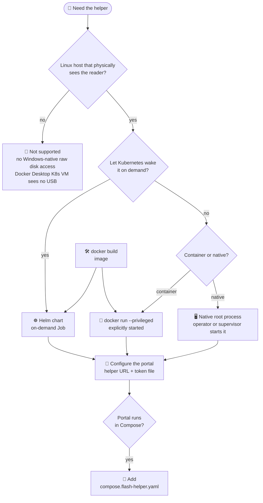

<a id="build-the-image"></a>
### 🛠️ Build the image

From the repository root:

```bash
docker build -f flash_helper/Dockerfile -t playbook-flash-helper:0.1.0 .
```

<a id="create-the-token"></a>
### 🔐 Create the token

> [!IMPORTANT]
> Use a dedicated token in a private file — **never in Git or command arguments**.
> Helper and portal must read **identical** contents. Example:

```bash
umask 077; openssl rand -hex 32 > /secure/flash-token
```

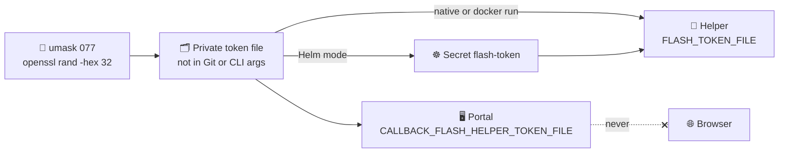

<a id="helper-environment-variables"></a>
### 🗂️ Helper environment variables

Only operator-owned configuration supplies these:

| Helper variable | Meaning |
| --- | --- |
| `FLASH_TOKEN_FILE` | Required; 32-256 URL-safe ASCII characters (hex recommended). |
| `FLASH_ALLOWED_DEVICES` | Required; comma-separated whole-disk by-id aliases. |
| `FLASH_IDLE_SECONDS` | 30-3600; default 180. |
| `FLASH_WORK_DIR` | Existing directory for UEFI remastering; default: system temp dir natively, `/work` in the image. |
| `FLASH_BIND`, `FLASH_PORT` | Default loopback and 8090; the image binds all container interfaces. |
| `FLASH_HOST_MOUNTINFO` | Host mount table; default `/proc/1/mountinfo` natively. Containers must use `/host/mountinfo`. |

<a id="native-root-process"></a>
### 🖥️ Native root process

Must run as **root**, with the Python dependencies and Linux packages from the
[Dockerfile](Dockerfile). From the repository root:

```bash
PYTHONPATH=.:callback_site python -m flash_helper.server
```

> [!WARNING]
> **Never** set `CALLBACK_FLASH_HELPER_URL` in the helper environment: it would
> recursively forward work. Native mode exits on idle; the operator or an independently
> controlled supervisor must start it when needed.

<a id="explicit-linux-container"></a>
### 🐳 Explicit Linux container

```bash
docker run --rm --name playbook-flasher --privileged \
  --mount type=bind,src=/dev,dst=/dev \
  --mount type=bind,src=/proc/1/mountinfo,dst=/host/mountinfo,readonly \
  --mount type=bind,src=/secure/flash-token,dst=/token/token,readonly \
  -e FLASH_TOKEN_FILE=/token/token \
  -e FLASH_ALLOWED_DEVICES=/dev/disk/by-id/usb-YOUR_READER \
  -e FLASH_HOST_MOUNTINFO=/host/mountinfo \
  -p 127.0.0.1:8090:8090 playbook-flash-helper:0.1.0
```

- 🚫 No `restart: always`: idle expiry is intentional.
- 🧾 The image includes `cloud-init` for mandatory schema validation.
- 💾 Ephemeral work/cache may need several times the expanded image size; provide
  enough disk space.

<a id="portal-configuration"></a>
### 🔌 Portal configuration

```text
CALLBACK_FLASH_HELPER_URL=https://linux-reader.example:8090
CALLBACK_FLASH_HELPER_TOKEN_FILE=<portal-readable token file>
```

<a id="compose-override"></a>
### 🐳 Compose override

Set `FLASH_HELPER_TOKEN_FILE` to the host file path, then:

```bash
docker compose -f compose.yaml -f compose.flash-helper.yaml up --build -d
```

- 🔐 Mounts only the token into the non-root portal — **not** disks or Docker's socket.
- 👤 UID 10001 must be able to read the token without it being public.
- ↩️ Leave the override unused to keep native behavior.

<a id="on-demand-helm-lifecycle"></a>
## ☸️ On-demand Helm lifecycle

<a id="what-the-chart-installs"></a>
### 📦 What the chart installs

Chart: [`charts/flash-helper`](../charts/flash-helper/).

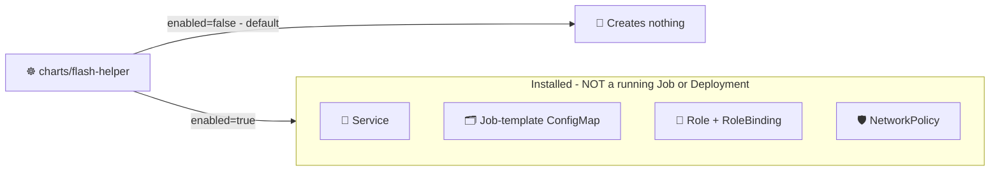

<a id="install-steps"></a>
### 🚀 Install steps

1. Push the image to a registry the pinned Linux node can reach (or preload it there);
   set `image.repository` and `image.tag`.
2. Create a dedicated namespace and a Secret from the private token file, e.g.:

   ```bash
   kubectl -n flash-helper create secret generic flash-token \
     --from-file=token=/secure/flash-token
   ```

   Mount the same token into the portal.
3. Install (replace the node, reader and existing portal ServiceAccount):

   ```bash
   helm upgrade --install rack charts/flash-helper --namespace flash-helper \
     --set enabled=true --set nodeName=linux-reader \
     --set existingSecret=flash-token \
     --set portal.namespace=default --set portal.serviceAccount=portal \
     --set 'allowedDevices[0]=/dev/disk/by-id/usb-YOUR_READER'
   ```

4. Configure the portal:

   ```text
   CALLBACK_FLASH_HELPER_URL=http://rack-flasher.flash-helper.svc:8090
   CALLBACK_FLASH_HELPER_TOKEN_FILE=<mounted token path>
   CALLBACK_FLASH_HELPER_NAMESPACE=flash-helper
   CALLBACK_FLASH_HELPER_TEMPLATE=rack-flasher-template
   ```

<a id="portal-requirements"></a>
### ✅ Portal requirements

- [ ] `kubectl` (already in its image)
- [ ] Lifecycle RBAC via its ServiceAccount or a dedicated kubeconfig
- [ ] Cluster API access and reachability to the Service
- [ ] `portal.podLabels` = the portal's actual labels; the CNI must enforce NetworkPolicy

> [!NOTE]
> This does not install a dashboard chart or silently grant cluster-admin.

<a id="wake-and-expiry"></a>
### 🔁 Wake and expiry

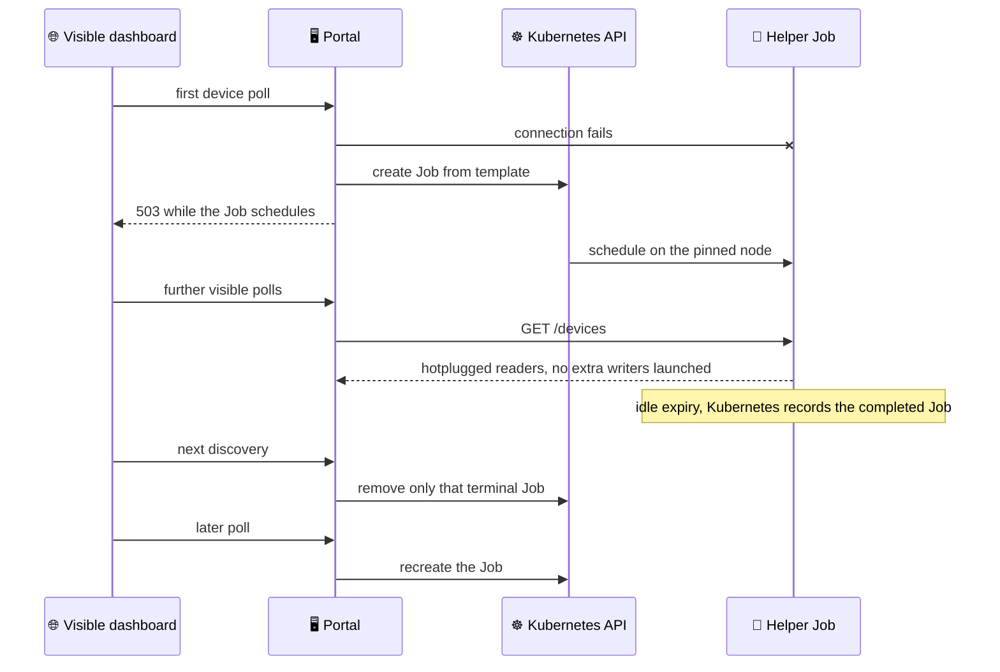

> [!CAUTION]
> **No automatic retry** of failed writes and no reconnect-triggered resubmission. A
> disconnected writer may still be active: **inspect its logs before resubmitting**.

> [!NOTE]
> A portal outside the cluster (including Windows Compose) needs a privately reachable
> helper Service address and a dedicated kubeconfig; cluster DNS does not normally
> resolve on Windows.

<a id="uninstall-and-cleanup"></a>
### 🩹 Uninstall and cleanup

> [!WARNING]
> - Uninstall **only after active writes finish**.
> - Helm does not own the dynamically created Job: delete that terminal Job
>   (`rack-flasher` above) yourself after uninstalling.
> - Jobs, work/cache and logs are temporary; save needed diagnostics before the next
>   wake-up deletes a completed Job.
> - Work files and logs are **sensitive**: cloud-init contains bootstrap credentials.

---

➡️ Next: [Callback site portal](../callback_site/README.md) ·
[Repository overview](../README.md)
